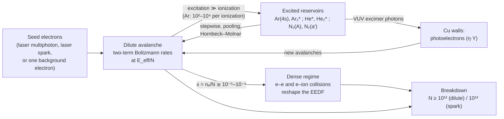
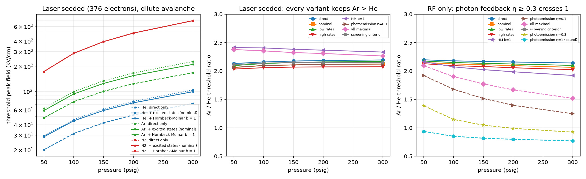
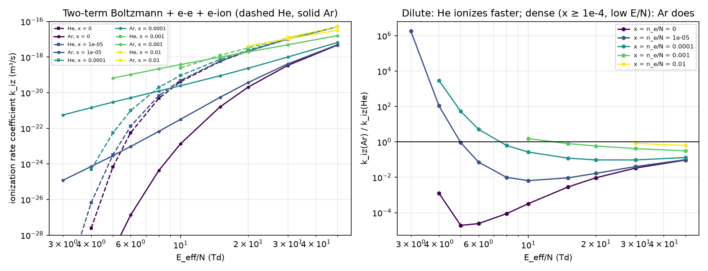
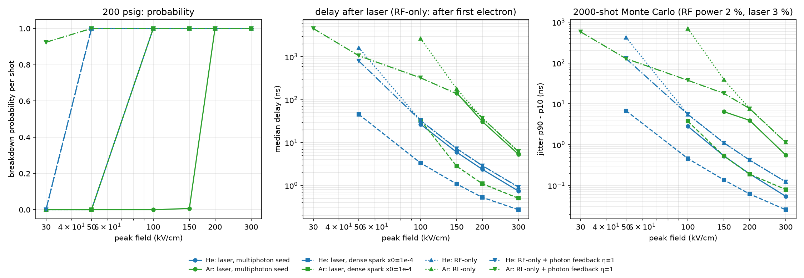

# Why would argon break down more easily than helium? Excited states, dense plasma and photon feedback at 50–300 psig

**Status:** exploratory modelling, not experimentally validated. Session of 22–23 Nov 2026. Every step was
reviewed by the workspace plasma-physics reviewer agent; its corrections are included. Rate data were compiled
by the literature agent ([rate compilation](../source/cases/excited_state_rates.md)).

## Executive summary

**Question.** In the sealed WR-284 switch cavity (2.95 GHz, 50–300 psig), you observe that argon breaks down at a
*lower* field than helium, and nitrogen at a much higher one, both with laser triggering and RF-only. Argon also
forms more slowly and with more jitter. The earlier avalanche model predicted argon needs about **2.2× helium's
field**. This study tested every physical channel that could reverse that ordering.

**Answer in four points.**

1. **Pure-gas avalanche physics does not reverse the ordering.** Adding sourced excited-state kinetics (stepwise
   ionization, pooling, excimers, Hornbeck–Molnar associative ionization, recombination) keeps
   **Ar/He = 2.0–2.4** for laser seeding and **1.9–2.2** for RF-only, across all rate uncertainties. N₂ stays at
   **6–11× He**, consistent with your nitrogen observation.
2. **The ionization-rate ordering does reverse in a dense plasma, at low reduced field.** Once the ionization degree
   reaches x = nₑ/N ≳ 10⁻⁴, electron–electron collisions rebuild the energetic tail. Argon then ionizes
   **faster** than helium below about 7 Td (x = 10⁻⁴) or about 10 Td (x = 10⁻³). At x = 10⁻² and 30–50 Td the two
   gases are within about 25 %. In the dilute limit helium is faster by 10 to 40 000×.
3. **A dense argon laser spark lowers the Ar threshold, but this does not explain your data as built.** You see a
   spark with the laser alone in Ar but not in He. Seeding argon with a dense plasma (x₀ ≈ 10⁻⁴) gives a modelled
   Ar/He of 0.69–0.99 (nominal rates; 0.53–1.43 across rate uncertainties). However:
   - the result assumes the RF field acts fully inside the spark. Your laser line is **perpendicular** to E, so the
     internal field is screened by a factor of about 50–500 (|ε|/2 at x₀ = 10⁻⁴);
   - the spark makes argon break down **faster** than helium (for example 2.8 vs 6.0 ns at 150 kV/cm, 200 psig),
     the opposite of your slower, more variable argon;
   - the runs deposit at least 6–8 eV per atom in the argon core, so the fixed gas density and fixed field assumed
     are not self-consistent. Treat it as a qualitative mechanism only.
4. **RF-only: strong VUV photon feedback could reverse the ordering, but only at implausibly high efficiency.**
   Argon excimers radiate 9.8 eV photons that can free electrons from the copper walls. Helium has its own prompt
   He₂(A) Hopfield-continuum feedback with a higher copper yield. With both included, RF-only Ar/He falls below 1
   only if the photon-to-surviving-electron efficiency is large: η ≥ 0.3 at ≥ 200 psig (0.99–0.92), or η ≈ 1
   (0.77–0.94). The reviewer's order-of-magnitude estimate is η ≲ 0.1 (high-field wall fraction × survival against
   back-diffusion; not a measured bound), where Ar/He stays at **1.25–1.92**. This channel is
   **not excluded**, but it is not a demonstrated explanation.

**Bottom line.** No mechanism in a self-consistent pure-gas model reproduces Ar < He at your fields. The candidate
mechanisms either need conditions that don't match the experiment (field inside a perpendicular spark) or unusually
large wall photoemission. Helium itself already breaks down in the experiment at about 3.9× lower field than any
pure-helium model predicts. The most likely common cause is outside the gas kinetics: how the field is determined
for each gas (calibration, cavity tuning), local field enhancement, or surfaces. §8 lists the decisive measurements.

## 1. Experimental reference and the question

| Item | Value |
|---|---|
| Cavity | WR-284 section, 2.95 GHz, loaded Q ≈ 331 (simulated), gap 34 mm |
| Pressures | 50, 100, 150, 200, 300 psig (4.5–21.7 bar absolute) |
| Peak RF fields used in the experiment | 30, 50, 100, 150, 200, 300 kV/cm (user) |
| Gases | He, Ar, N₂, 99.999 % |
| Observations (user, qualitative) | breakdown field Ar < He ≪ N₂ (laser-triggered and RF-only); Ar slower, more jitter; with the laser alone, a visible spark in Ar but no visible plasma in He. Spark density, size and shape are not measured. |

At 200 psig, 30 kV/cm peak is only **E_rms/N ≈ 5.9 Td**. In the dilute-avalanche picture, direct ionization at that
reduced field is negligible in every gas within microseconds. The experiment therefore already operates outside the
dilute-avalanche regime that earlier models assumed.

## 2. What was modelled

*Schematic of the channels in the model, not measured data. Which branch dominates depends on pressure, field, seed and
the uncertain rate data discussed below.*

**Model** ([excited_avalanche.py](../source/src/rf_plasma/excited_avalanche.py)):

- **Geometry.** A radial reaction–diffusion avalanche: a cylinder (2 mm laser line seed) or a sphere (single
  electron, RF-only). The field is uniform over the avalanche, which is millimetres across against a
  centimetre-scale cavity field.
- **Electron rates** at the RF effective field from two-term Boltzmann solutions (BOLOS + IST-Lisbon LXCat). New
  per-state excitation-count tables ([swarm_excited.py](../source/src/rf_plasma/swarm_excited.py)).
- **Excited reservoirs and kinetics** from [excited_kinetics.json](../source/cases/excited_kinetics.json).
  Every coefficient carries its source and verification label; low and high sets use the stated uncertainty factors.
- **Dense regime.** The Boltzmann equation with e–e collisions (Hagelaar & Pitchford 2005) plus Coulomb e–ion
  momentum transfer, solved at the local ionization degree
  ([swarm_ee.py](../source/src/rf_plasma/swarm_ee.py), [dense_regime.py](../source/src/rf_plasma/dense_regime.py)).
- **Wall photoemission.** A 0-D population of wall-born avalanches fed by radiating states with efficiency η·Y.
- **Field window and criterion.** Laser at t = 0, 100 ns of flat RF, then ring-down with τ = 35.7 ns; RF-only uses
  a 5 µs flat pulse. Breakdown when the electron count reaches N_br = 10¹² (10¹³ for dense seeds). e_cal = 1, i.e.
  the stated field is the physical peak field.
- **Verification.** Electron, ion and charge balance close to below 1 % in every run. Seven focused tests cover the
  direct limit against the previous model (He, Ar, N₂), free diffusion, conservation, uncertainty-set directions,
  and the dense-table dilute limit. The full RF-plasma suite (121 tests) passes.

## 3. Result 1 — dilute avalanche: no channel reverses the ordering

Threshold peak field (kV/cm) for **He / Ar / N₂**:

| Variant | 50 psig | 100 psig | 150 psig | 200 psig | 300 psig |
|---|---|---|---|---|---|
| Laser, direct ionization only | 29 / 63 / 173 | 46 / 99 / 286 | 61 / 134 / 395 | 76 / 166 / 500 | 104 / 228 / 704 |
| Laser, + excited states (nominal) | 29 / 59 / 173 | 45 / 93 / 286 | 59 / 125 / 394 | 73 / 155 / 498 | 99 / 211 / 703 |
| Laser, + Hornbeck–Molnar b = 1 | 20 / 48 / 173 | 31 / 76 / 286 | 42 / 100 / 394 | 52 / 124 / 498 | 72 / 168 / 703 |
| Laser, all channels maximal | 20 / 48 / 170 | 31 / 74 / 280 | 42 / 98 / 387 | 52 / 120 / 490 | 72 / 162 / 689 |
| RF-only, direct only | 16 / 34 / 119 | 26 / 56 / 201 | 36 / 77 / 280 | 45 / 98 / 357 | 64 / 137 / 509 |
| RF-only, + excited states | 15 / 33 / 118 | 25 / 54 / 200 | 35 / 73 / 281 | 44 / 92 / 360 | 62 / 128 / 518 |
| RF-only, + Hornbeck–Molnar b = 1 | 12 / 25 / 118 | 19 / 40 / 200 | 27 / 55 / 281 | 34 / 68 / 360 | 49 / 94 / 518 |

*Every dilute-avalanche variant keeps argon harder to break down than helium (ratio about 2). The only exception is
RF-only with strong photon feedback (dashed curves, right), discussed in §6.*

**Why.** The table of excitations per direct ionization explains it.

| E/N (Td) | He | Ar |
|---:|---:|---:|
| 20 | 15 | 1 900 |
| 30 | 8 | 255 |
| 50 | 4 | 42 |

Argon spends almost all its energy on excitation. At 5–20 bar the 4s atoms become Ar₂* excimers within about
1–5 ns (Millet 1982; Santorelli 2021). The excimers radiate rather than ionize, so the stored energy is lost.
Stepwise ionization and pooling grow with the square of density and act only late in the avalanche: they lower the
Ar threshold by 7–11 % and He by 3–4 %. Hornbeck–Molnar ionization from high levels lowers both by about 30 %.

## 4. Result 2 — in a dense plasma, argon ionizes faster

Ionization rate coefficient k_iz (m³/s) from the Boltzmann equation with e–e and e–ion collisions, at
N = 2.41 × 10²⁶ m⁻³ (10 bar):

| x = nₑ/N | E/N | He | Ar | faster |
|---|---|---|---|---|
| 0 (dilute) | 6 Td | 5.6 × 10⁻²³ | 1.4 × 10⁻²⁷ | He by 4 × 10⁴ |
| 0 (dilute) | 20 Td | 2.2 × 10⁻¹⁸ | 2.1 × 10⁻²⁰ | He by 100 |
| 10⁻⁵ | 4 Td | 6.5 × 10⁻²⁷ | 7.1 × 10⁻²⁵ | Ar by 100 |
| 10⁻⁴ | 6 Td | 9.9 × 10⁻²² | 5.1 × 10⁻²¹ | **Ar by 5** |
| 10⁻⁴ | 10 Td | 9.2 × 10⁻²⁰ | 2.5 × 10⁻²⁰ | He by 4 |
| 10⁻³ | 10 Td | 2.4 × 10⁻¹⁹ | 3.8 × 10⁻¹⁹ | **Ar by 1.5** |
| 10⁻² | 30 Td | 1.3 × 10⁻¹⁷ | 1.1 × 10⁻¹⁷ | about equal |

*At low E/N, electron–electron collisions refill the high-energy tail. Argon gains much more because its
ionization threshold is lower (15.8 vs 24.6 eV), its elastic energy loss per collision is about 10× smaller
(heavier atom) and its low-energy collision rate is small (Ramsauer minimum).*

Coulomb e–ion collisions reduce the argon rates by only 10–40 %, and several high-x, low-E/N points did not converge
(reported as missing in [dense_regime.json](../data/excited_avalanche/dense_regime.json)).
An avalanche starting from a few electrons reaches only x ≈ 3 × 10⁻⁶ before its plasma depolarizes the RF field
(the screening density nₛ ≈ 2–3 ε₀mₑων_m/e², about 10²¹ m⁻³). The dilute model has no depolarization, which is why
its runs continue to much higher x. In the experiment, this dense regime is reached only if the **laser** creates a
dense plasma.

## 5. Result 3 — laser trigger with a dense argon spark

A laser-made plasma of peak ionization degree x₀ (radius 5 µm, length 2 mm) must grow to 10¹³ electrons. The run
uses the dense-regime rates and per-cell electron temperature, full excited kinetics, dissociative and three-body
recombination. Helium keeps its ~376-electron multiphoton seed.

Ar threshold in kV/cm, with the Ar/He ratio in brackets:

| Case | 50 psig | 100 psig | 150 psig | 200 psig | 300 psig |
|---|---|---|---|---|---|
| He, multiphoton seed (no spark), kV/cm | 29 | 45 | 60 | 74 | 101 |
| Ar, multiphoton seed | 60 (2.08) | 95 (2.11) | 127 (2.13) | 157 (2.12) | 215 (2.12) |
| **Ar, dense spark x₀ = 10⁻⁴ — nominal rates** | **20 (0.69)** | **40 (0.88)** | **58 (0.97)** | **73 (0.99)** | **101 (0.99)** |
| Ar spark — high excited-state rates | 15 (0.53) | 30 (0.67) | 43 (0.72) | 54 (0.73) | 73 (0.72) |
| Ar spark — low excited-state rates | 31 (1.08) | 59 (1.30) | 84 (1.40) | 106 (1.43) | 144 (1.42) |
| Ar spark — recombination product Ar₂* | 25 (0.87) | 44 (0.97) | 61 (1.01) | 75 (1.02) | 102 (1.01) |
| Ar spark — recombination to ground | 29 (0.99) | 54 (1.19) | 76 (1.27) | 96 (1.29) | 130 (1.28) |
| He with the same dense seed (not observed) | 16 | 25 | 35 | 43 | 60 |

*A dense argon spark can bring the argon threshold to or below helium's, most clearly at 50–100 psig, but the result
spans 0.53–1.43 across the rate uncertainties. With equal seeds argon stays 1.3–1.7× above helium.*

**Caveats (reviewer, highest priority first).** Together they make this result qualitative only.

1. **The RF field must act inside the spark.** This holds only for a thin line along E. Your laser line is
   perpendicular to E. For that geometry the field inside a spark at x₀ = 10⁻⁴ is reduced by about |ε|/2,
   roughly 50–500 (E_in ≈ 2E₀/(ε + 1)), so the numbers above do not apply to the experiment as built.
2. **The spark makes argon faster, not slower.** Where both gases break down, the Ar spark delays are shorter than
   He's (§7). That contradicts your slower, more variable argon.
3. **Energy is not self-consistent.** At threshold the argon runs deposit at least 6–8 eV per atom in the spark core
   (about 5 mJ at 200 psig; helium 1.4–2.7 eV per atom). That is comparable to the RF energy stored in the cavity.
   Gas heating, rarefaction and field depletion would all follow, but none is modelled.
4. **Net growth is a small difference of large terms.** Growth is only about 0.3 % of the gross stepwise
   ionization, pooling and recombination rates, so the result depends on FT-2/UNV rate data.
5. **Table range and filling.** Runs reached peak x of 5 × 10⁻⁴ to 3.6 × 10⁻², partly beyond the table edge
   (clipped at 10⁻²). 55 of 80 runs used non-converged table cells filled from lower x.
6. **The spark itself is reported, not characterized.** You see a spark in Ar and none in He with the laser alone,
   but its density, size and shape are not measured.

## 6. Result 4 — RF-only: VUV photon feedback

In the 5 µs RF-only window, excimers radiate VUV photons that reach the copper walls. A fraction η·Y produces
electrons that start new avalanches; it combines geometry, photoyield Y and survival against back-diffusion.

- **Argon:** Ar₂* singlet (4 ns) and triplet (about 3 µs) excimers and trapped 4s resonance radiation, at 9.8–11.6
  eV. Y = 0.03–0.05 is assumed for Cu; it is unmeasured, and the literature only says it is "considerably
  reduced" relative to about 0.1 at 80 nm.
- **Helium:** the dominant excimer He₂*(a) does not radiate. Singlet He atoms form He₂(A¹Σu⁺), which emits the
  11–20 eV Hopfield continuum within nanoseconds, with Y ≈ 0.1. This channel was added after the reviewer
  flagged it. Its formation rate and lifetime are not verified.

RF-only Ar/He threshold ratio:

| η | 50 psig | 100 psig | 150 psig | 200 psig | 300 psig |
|---|---|---|---|---|---|
| 0 (nominal) | 2.15 | 2.12 | 2.11 | 2.09 | 2.06 |
| 0.1 (reviewer's order-of-magnitude estimate, not measured) | 1.92 | 1.68 | 1.52 | 1.40 | 1.25 |
| 0.3 | 1.39 | 1.15 | 1.05 | **0.99** | **0.92** |
| 1 (geometric upper bound) | **0.94** | **0.85** | **0.82** | **0.80** | **0.77** |

At η = 1 the RF-only thresholds (kV/cm) for Ar / He are 13 / 14, 18 / 22, 24 / 29, 29 / 37 and 39 / 51.

*Photon feedback lowers argon's threshold much more than helium's, because argon makes 10²–10⁴ excitations per
ionization. It reverses the ordering only at η ≥ 0.3 and ≥ 200 psig, or at η ≈ 1. Those values require every wall
photoelectron in the high-field region to escape back-diffusion, which is unlikely at 20 bar, where half of each RF
cycle drives electrons back into the wall. In the 100 ns laser window the effect is small (Ar/He = 1.8–2.1 even at
η = 1), because most triplet photons arrive later. Treat this as an asymmetric upper-bound scenario: **not
excluded, not demonstrated.***

The literature agent found that photon feedback is directly observed in **helium** detectors at 5 atm, and that
copper's yield is higher at helium's shorter wavelengths. The 0-D wall model also assumes that wall-born electrons
see the full volume gain and that photons arrive without transit delay.

## 7. Delays and jitter at your fields

A 2000-shot Monte Carlo over RF power (±2 %), laser energy (±3 %, N₀ ∝ E⁶) and avalanche statistics gives the
median delay ± half of the p10–p90 spread. A dash means no breakdown in the window.

**200 psig:**

| Case | 30 kV/cm | 50 | 100 | 150 | 200 | 300 |
|---|---|---|---|---|---|---|
| He, laser (multiphoton seed) | – | – | 27 ± 1.4 ns | 6.0 ± 0.3 ns | 2.4 ± 0.1 ns | 0.74 ± 0.03 ns |
| Ar, laser (multiphoton seed) | – | – | – | 140 ns (1 % of shots) | 31 ± 2 ns | 5.3 ± 0.3 ns |
| N₂, laser | – | – | – | – | – | – |
| Ar, laser, dense spark x₀ = 10⁻⁴ | – | – | 34 ± 1.9 ns | 2.8 ± 0.3 ns | 1.1 ± 0.1 ns | 0.50 ± 0.04 ns |
| He, RF-only | – | 1.6 ± 0.2 µs | 33 ± 3 ns | 7.3 ± 0.6 ns | 2.9 ± 0.2 ns | 0.92 ± 0.06 ns |
| Ar, RF-only | – | – | 2.7 ± 0.35 µs | 180 ± 20 ns | 38 ± 4 ns | 6.2 ± 0.6 ns |
| Ar, RF-only + photon feedback η = 1 | **4.6 ± 0.3 µs (92 %)** | **1.1 µs ± 64 ns** | 320 ± 19 ns | 140 ± 9 ns | 38 ± 4 ns | 6.2 ± 0.6 ns |
| He, RF-only + photon feedback η = 1 | – | 800 ± 64 ns | 33 ± 3 ns | 7.3 ± 0.6 ns | 2.9 ± 0.2 ns | 0.92 ± 0.06 ns |

**50 psig:**

| Case | 30 kV/cm | 50 | 100 | 150 | 200 | 300 |
|---|---|---|---|---|---|---|
| He, laser | 94 ± 5 ns | 14 ± 0.6 ns | 1.9 ± 0.07 ns | 0.66 ns | 0.33 ns | 0.13 ns |
| Ar, laser | – | – | 13 ± 0.6 ns | 3.1 ± 0.13 ns | 1.3 ± 0.05 ns | 0.43 ns |
| Ar, laser, dense spark | 24 ± 1.2 ns | 6.0 ± 0.5 ns | 1.6 ± 0.13 ns | 1.0 ns | 0.74 ns | 0.49 ns |
| N₂, laser | – | – | – | – | 35 ± 3 ns | 3.3 ± 0.2 ns |
| Ar, RF-only + photon feedback η = 1 | 1.3 µs ± 74 ns | 350 ± 26 ns | 15 ± 1.3 ns | 3.7 ns | 1.5 ns | 0.51 ns |
| He, RF-only + photon feedback η = 1 | 119 ± 10 ns | 18 ± 1.3 ns | 2.4 ± 0.16 ns | 0.84 ns | 0.42 ns | 0.17 ns |

*In the dilute model argon is always slower than helium at the same field, which matches your qualitative
observation. The dense Ar spark is the exception: it makes argon faster than helium. With photon feedback, argon
RF-only breakdown appears at 30–50 kV/cm with **microsecond** delays. At 30 kV/cm and 200 psig the 4.6 µs median
and its spread are truncated by the end of the 5 µs pulse (p90 = 4.9 µs; 8 % of shots do not break down). The
RF-only times are measured from the appearance of the first electron; the random wait for that electron
(statistical lag) is extra and gas dependent.*

**Reading against the experiment.** You run at about 30 kV/cm. In the pure-gas model at ≥ 100 psig, neither gas
breaks down there within the laser window. That is the same 3–4× field gap noted for helium (e_cal ≈ 3.9).
- The dense Ar spark gives argon breakdown at 30 kV/cm only at 50 psig, and with shorter delays than helium.
- Strong photon feedback gives RF-only argon breakdown at 30–50 kV/cm with µs delays, but only at η ≈ 1.

Neither reproduces the whole pattern (lower field *and* slower argon) under realistic assumptions.

## 8. What remains unexplained, and the decisive tests

**Unexplained.** Helium needs about 3.9× less field in the experiment than in any pure-helium model (e_cal ≈ 3.9),
and no variant here removes that gap. A shared cause is the simplest explanation: field calibration, local field
enhancement, or seeding by surfaces or residual charge.

**Gas detuning must be corrected, not used as an explanation.** At a fixed drive frequency, gas permittivity
detunes the cavity by Δf ≈ −1.4 (He), −10.9 (Ar) and −11.5 (N₂) MHz at 200 psig, against a half-bandwidth of
4.5 MHz. The stored field then falls to 0.96 / 0.38 / 0.36 of its on-resonance value
([gas_detuning.json](../data/excited_avalanche/gas_detuning.json)). If reported fields
come from forward power assuming resonance, argon's true field is even lower than reported, which makes the
discrepancy **worse**. It matters only if the cavity was not retuned per gas.

**Decisive measurements, in order.**

1. **Laser only, RF off, quantified:** spark size, shape and brightness (photodiode or camera) in Ar, and its
   absence in He, at the operating energy and pressures.
2. **Threshold versus laser energy:** an avalanche seed gives a few percent change per decade; a spark gives a step
   at the spark-formation energy.
3. **Delay between laser and RF:** dense-plasma memory decays in 10–100 ns; excimer and metastable memory lasts µs.
4. **Laser axis along versus perpendicular to E:** a strong dependence points to the dense-spark mechanism.
5. **Per-gas cavity calibration:** f₀ and Q_L for each gas and pressure, and how the field is inferred.
6. **RF-only delay distribution in Ar:** a µs-scale tail tied to the 3 µs triplet lifetime would support photon
   feedback. Lining the high-field walls with a VUV-opaque, low-photoyield material would test it directly. Please
   also confirm the RF-only pulse length (the model uses 5 µs).

## Evidence and reproducibility

- Code: [excited_avalanche.py](../source/src/rf_plasma/excited_avalanche.py),
  [excited_study.py](../source/src/rf_plasma/excited_study.py),
  [swarm_excited.py](../source/src/rf_plasma/swarm_excited.py),
  [swarm_ee.py](../source/src/rf_plasma/swarm_ee.py),
  [dense_regime.py](../source/src/rf_plasma/dense_regime.py),
  [excited_figures.py](../source/src/rf_plasma/excited_figures.py);
  tests in [test_excited_avalanche.py](../source/tests/test_excited_avalanche.py).
- Data: [thresholds.json](../data/excited_avalanche/thresholds.json),
  [spark.json](../data/excited_avalanche/spark.json),
  [dense_regime.json](../data/excited_avalanche/dense_regime.json),
  [delays.json](../data/excited_avalanche/delays.json).
- Rate sources and verification labels: [excited_state_rates.md](../source/cases/excited_state_rates.md).
  Key primary or secondary sources: Stankov et al. 2022 PSST 31 125002; Kemaneci et al. 2017 J. Phys. D 50 245203;
  Millet et al. 1982 J. Phys. B 15 2935; Santorelli et al. 2021 EPJC; Deloche et al. 1976 PRA 13 1140; Schröter et
  al. 2018 PCCP 20 24263; Hagelaar & Pitchford 2005 PSST 14 722.
- Commands (from `simulations/rf_plasma`, `PYTHONPATH=src`):
  `python -m rf_plasma.swarm_excited`, `python -m rf_plasma.dense_regime`,
  `python -m rf_plasma.excited_study thresholds|spark|delays`, `python -m rf_plasma.excited_figures`.

**Limitations.**

- The model uses the local-field approximation. The free-to-ambipolar transition uses an interpolation, not a
  Poisson solution.
- There is no RF depolarization inside dense plasma: a validity diagnostic is reported, and the alternative
  "screening" criterion changes thresholds by 2–4 %.
- Three-body rates are extrapolated from measurements at or below 1 bar.
- The N₂ dense regime is not modelled.
- The field is treated as the physical peak field, e_cal = 1.
