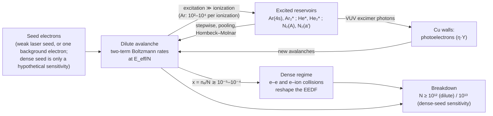
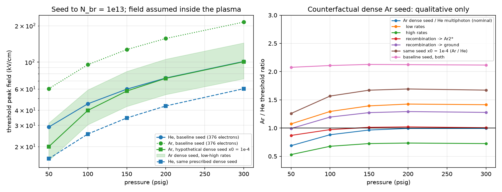

# Why would argon break down more easily than helium? Excited states, dense plasma and photon feedback at 50–300 psig

**Status:** exploratory modelling, not experimentally validated. Session of 22–23 Nov 2026. Every step was
reviewed by the workspace plasma-physics reviewer agent; its corrections are included. Rate data were compiled
by the literature agent ([rate compilation](../source/cases/excited_state_rates.md)).

## Executive summary

**Question.** In the sealed WR-284 switch cavity (2.95 GHz, 50–300 psig), you observe that argon breaks down at a
*lower* field than helium, and nitrogen at a much higher one, both with laser triggering and RF-only. Argon also
forms more slowly and with more jitter. The laser alone does **not** make a visible argon spark; it supplies a seed
for the RF avalanche. Your estimated seed density is about 10⁶ electrons/cm³. The earlier avalanche model predicted
argon needs about **2.2× helium's field**. This study tested candidate channels that could reverse that ordering.

**Answer in four points.**

1. **Pure-gas avalanche physics does not reverse the ordering.** Adding sourced excited-state kinetics (stepwise
   ionization, pooling, excimers, Hornbeck–Molnar associative ionization, recombination) keeps
   **Ar/He = 2.0–2.4** for laser seeding and **1.9–2.2** for RF-only, across all rate uncertainties. N₂ stays at
   **6–11× He**, consistent with your nitrogen observation.
2. **The ionization-rate ordering does reverse in a dense plasma, at low reduced field.** Once the ionization degree
   reaches x = nₑ/N ≳ 10⁻⁴, electron–electron collisions rebuild the energetic tail. Argon then ionizes
   **faster** than helium below about 7 Td (x = 10⁻⁴) or about 10 Td (x = 10⁻³). At x = 10⁻² and 30–50 Td the two
   gases are within about 25 %. In the dilute limit helium is faster by 10 to 40 000×.
3. **A hypothetical dense argon seed can lower the Ar threshold, but it does not represent your laser seed.**
   You report no visible spark with the laser alone and estimate a seed density near 10⁶ electrons/cm³. The
   counterfactual dense-plasma case (x₀ ≈ 10⁻⁴; about 10¹⁶ electrons/cm³ at 200 psig) gives a modelled Ar/He of
   0.69–0.99 (nominal rates; 0.53–1.43 across rate uncertainties). It is roughly ten orders of magnitude denser
   than your estimate and is not evidence that the actual laser seed helps argon this way. In this prescribed-seed
   scenario, the calculation also assumes the RF field acts fully inside the plasma; a perpendicular cylinder
   would screen the field by roughly 50–500× at x₀ = 10⁻⁴. The scenario makes Ar break down **faster** than He
   (2.8 vs 6.0 ns at 150 kV/cm, 200 psig), unlike your observed slower, more variable Ar. These are limitations
   and outputs of the hypothetical dense-seed case, not evidence about the weak laser seed.
   - The runs deposit at least 6–8 eV per atom in the argon core, so the fixed gas density and field are not
     self-consistent; treat the result as a qualitative sensitivity only.
4. **RF-only: strong VUV photon feedback can nearly reverse the ordering, but requires high effective efficiency.**
   Argon excimers radiate 9.8 eV photons that can free electrons from the copper walls. Helium has its own prompt
   He₂(A) Hopfield-continuum feedback with a higher copper yield. At 200 psig the computed RF-only Ar/He threshold
   ratio is 2.09 at η = 0, 1.40 at η = 0.1, 0.99 at η = 0.3 and 0.80 at η = 1. The reviewer’s order-of-magnitude
   estimate is η ≲ 0.1 (high-field wall fraction × survival against back-diffusion; not a measured bound), where
   the ratio remains above one. Feedback is a **quantified candidate**, not a demonstrated explanation.

**Bottom line.** With the measured laser-seed estimate and the reviewer's low-η estimate, the model does not
reproduce Ar < He. Its high-efficiency wall-feedback scenarios can reverse the RF-only ordering, but η is not
measured and those scenarios are not a demonstrated explanation. The dense-seed calculation is a prescribed
initial-condition sensitivity, not a model of laser ionization and not established as your experiment's seed. The
gas-detuning estimate predicts the opposite direction from your observation if fields were inferred from forward
power assuming resonance. Helium itself also breaks down at about 3.9× lower field than any pure-helium model
predicts. Per-gas resonance and field calibration, seed density, and wall feedback remain unresolved; §8 lists the
decisive measurements.

## 1. Experimental reference and the question

| Item | Value |
|---|---|
| Cavity | WR-284 section, 2.95 GHz, loaded Q ≈ 331 (simulated), gap 34 mm |
| Pressures | 50, 100, 150, 200, 300 psig (4.5–21.7 bar absolute) |
| Peak RF fields used in the experiment | 30, 50, 100, 150, 200, 300 kV/cm (user) |
| Gases | He, Ar, N₂, 99.999 % |
| Observations (user, qualitative) | Breakdown field Ar < He ≪ N₂ (laser-triggered and RF-only); Ar is slower and has more jitter. The laser alone makes no visible Ar spark; it seeds the RF avalanche. User-estimated seed density is ~10⁶ electrons/cm³; its volume and measurement basis are not specified. |

At 200 psig, 30 kV/cm peak is only **E_rms/N ≈ 5.9 Td**. In the dilute-avalanche picture, direct ionization at that
reduced field is negligible in every gas within microseconds. The experiment therefore already operates outside the
dilute-avalanche regime that earlier models assumed.

## 2. What was modelled

*Schematic of the channels in the model, not measured data. Which branch dominates depends on pressure, field, seed and
the uncertain rate data discussed below.*

**Model** ([excited_avalanche.py](../source/src/rf_plasma/excited_avalanche.py)):

- **Geometry.** A radial reaction–diffusion avalanche: a cylinder (2 mm laser line seed) or a sphere (single
  electron, RF-only). The field is uniform over the avalanche, which is millimetres across against a
  centimetre-scale cavity field.
- **Laser seed input.** The original laser-seeded sweep used 376 electrons from a heuristic seed estimate, not from
  your laser parameters. At 10⁶ electrons/cm³, the same model Gaussian line volume (2πσ²L ≈ 2.1×10⁻⁷ cm³)
  contains only about 0.2 electrons on average; conditional on a seed electron being present, one electron is the
  appropriate discrete starting count. A sensitivity run is reported in §3.
- **Electron rates** at the RF effective field from two-term Boltzmann solutions (BOLOS + IST-Lisbon LXCat). New
  per-state excitation-count tables ([swarm_excited.py](../source/src/rf_plasma/swarm_excited.py)).
- **Excited reservoirs and kinetics** from [excited_kinetics.json](../source/cases/excited_kinetics.json).
  Every coefficient carries its source and verification label; low and high sets use the stated uncertainty factors.
- **Dense regime.** The Boltzmann equation with e–e collisions (Hagelaar & Pitchford 2005) plus Coulomb e–ion
  momentum transfer, solved at the local ionization degree
  ([swarm_ee.py](../source/src/rf_plasma/swarm_ee.py), [dense_regime.py](../source/src/rf_plasma/dense_regime.py)).
- **Wall photoemission.** A 0-D population of wall-born avalanches fed by radiating states with efficiency η·Y.
- **Field window and criterion.** Laser at t = 0, 100 ns of flat RF, then ring-down with τ = 35.7 ns; RF-only uses
  a 5 µs flat pulse. Breakdown when the electron count reaches N_br = 10¹² (10¹³ for dense seeds). e_cal = 1, i.e.
  the stated field is the physical peak field.
- **Verification.** Electron, ion and charge balance close to below 1 % in every run. Seven focused tests cover the
  direct limit against the previous model (He, Ar, N₂), free diffusion, conservation, uncertainty-set directions,
  and the dense-table dilute limit. The full RF-plasma suite (121 tests) passes.

## 3. Result 1 — dilute avalanche: no channel reverses the ordering

Threshold peak field (kV/cm) for **He / Ar / N₂**. This sweep uses the heuristic 376-electron laser-seed baseline
unless otherwise noted:

| Variant | 50 psig | 100 psig | 150 psig | 200 psig | 300 psig |
|---|---|---|---|---|---|
| Laser, direct ionization only | 29 / 63 / 173 | 46 / 99 / 286 | 61 / 134 / 395 | 76 / 166 / 500 | 104 / 228 / 704 |
| Laser, + excited states (nominal) | 29 / 59 / 173 | 45 / 93 / 286 | 59 / 125 / 394 | 73 / 155 / 498 | 99 / 211 / 703 |
| Laser, + Hornbeck–Molnar b = 1 | 20 / 48 / 173 | 31 / 76 / 286 | 42 / 100 / 394 | 52 / 124 / 498 | 72 / 168 / 703 |
| Laser, all channels maximal | 20 / 48 / 170 | 31 / 74 / 280 | 42 / 98 / 387 | 52 / 120 / 490 | 72 / 162 / 689 |
| RF-only, direct only | 16 / 34 / 119 | 26 / 56 / 201 | 36 / 77 / 280 | 45 / 98 / 357 | 64 / 137 / 509 |
| RF-only, + excited states | 15 / 33 / 118 | 25 / 54 / 200 | 35 / 73 / 281 | 44 / 92 / 360 | 62 / 128 / 518 |
| RF-only, + Hornbeck–Molnar b = 1 | 12 / 25 / 118 | 19 / 40 / 200 | 27 / 55 / 281 | 34 / 68 / 360 | 49 / 94 / 518 |

*Every dilute-avalanche variant keeps argon harder to break down than helium (ratio about 2). The only exception is
RF-only with strong photon feedback (dashed curves, right), discussed in §6.*

**Laser-seed sensitivity.** The reported density estimate maps to a sub-electron *mean* in the modeled focal-line
volume, so a physical shot that contains a seed would start with at least one electron. At 200 psig, reducing the
baseline heuristic seed from 376 electrons to one raises both nominal thresholds by only about 6% and leaves
Ar/He essentially unchanged. Treating the density-derived mean as a deterministic 0.214-electron input gives a
similar result; this is a mathematical sensitivity, not a fractional particle in a shot.

| Initial laser-line count | He threshold | Ar threshold | Ar/He |
|---:|---:|---:|---:|
| 376 (heuristic baseline) | 73.1 kV/cm | 154.6 kV/cm | 2.12 |
| 1 (conditional on a seed electron) | 77.3 kV/cm | 164.3 kV/cm | 2.12 |
| 0.214 (mean from 10⁶ cm⁻³ estimate) | 78.3 kV/cm | 166.4 kV/cm | 2.13 |

These are nominal deterministic thresholds at 200 psig. The density-to-count conversion assumes the model's
effective Gaussian cylinder volume 2πσ²L ≈ 2.1×10⁻⁷ cm³; the user's estimate's spatial profile is not known.
The solver treats the 0.214 mean as a deterministic input: it does not model seed-presence probability, discrete
occupancy or shot-to-shot seed-count statistics. These values are threshold sensitivities, not per-shot predictions
or breakdown probabilities.
The machine-readable sensitivity output is [laser_seed_sensitivity.json](../data/excited_avalanche/laser_seed_sensitivity.json).

**Why.** The table of excitations per direct ionization explains it.

| E/N (Td) | He | Ar |
|---:|---:|---:|
| 20 | 15 | 1 900 |
| 30 | 8 | 255 |
| 50 | 4 | 42 |

Argon spends almost all its energy on excitation. At 5–20 bar the 4s atoms become Ar₂* excimers within about
1–5 ns (Millet 1982; Santorelli 2021). The excimers radiate rather than ionize, so the stored energy is lost.
Stepwise ionization and pooling grow with the square of density and act only late in the avalanche: they lower the
Ar threshold by 7–11 % and He by 3–4 %. Hornbeck–Molnar ionization from high levels lowers both by about 30 %.

## 4. Result 2 — in a dense plasma, argon ionizes faster

Ionization rate coefficient k_iz (m³/s) from the Boltzmann equation with e–e and e–ion collisions, at
N = 2.41 × 10²⁶ m⁻³ (10 bar):

| x = nₑ/N | E/N | He | Ar | faster |
|---|---|---|---|---|
| 0 (dilute) | 6 Td | 5.6 × 10⁻²³ | 1.4 × 10⁻²⁷ | He by 4 × 10⁴ |
| 0 (dilute) | 20 Td | 2.2 × 10⁻¹⁸ | 2.1 × 10⁻²⁰ | He by 100 |
| 10⁻⁵ | 4 Td | 6.5 × 10⁻²⁷ | 7.1 × 10⁻²⁵ | Ar by 100 |
| 10⁻⁴ | 6 Td | 9.9 × 10⁻²² | 5.1 × 10⁻²¹ | **Ar by 5** |
| 10⁻⁴ | 10 Td | 9.2 × 10⁻²⁰ | 2.5 × 10⁻²⁰ | He by 4 |
| 10⁻³ | 10 Td | 2.4 × 10⁻¹⁹ | 3.8 × 10⁻¹⁹ | **Ar by 1.5** |
| 10⁻² | 30 Td | 1.3 × 10⁻¹⁷ | 1.1 × 10⁻¹⁷ | about equal |

*At low E/N, electron–electron collisions refill the high-energy tail. Argon gains much more because its
ionization threshold is lower (15.8 vs 24.6 eV), its elastic energy loss per collision is about 10× smaller
(heavier atom) and its low-energy collision rate is small (Ramsauer minimum).*

Coulomb e–ion collisions reduce the argon rates by only 10–40 %, and several high-x, low-E/N points did not converge
(reported as missing in [dense_regime.json](../data/excited_avalanche/dense_regime.json)).
An avalanche starting from a few electrons reaches only x ≈ 3 × 10⁻⁶ before its plasma depolarizes the RF field
(the screening density nₛ ≈ 2–3 ε₀mₑων_m/e², about 10²¹ m⁻³). The dilute model has no depolarization, which is why
its runs continue to much higher x. The dense-regime rates apply only if the avalanche reaches the stated ionization
degree; this workspace does not establish that the laser creates such a dense plasma.

## 5. Result 3 — counterfactual dense-seed stress test

A hypothetical plasma of peak ionization degree x₀ (radius 5 µm, length 2 mm) must grow to 10¹³ electrons. This
prescribes an initial state; the code does not model its laser production. It is not the observed laser condition:
you report no visible spark and estimate ~10⁶ electrons/cm³ (visibility alone does not determine sub-visible density). The run
uses the dense-regime rates and per-cell electron temperature, full excited kinetics, dissociative and three-body
recombination. The dilute-seed comparison for both gases uses the same heuristic 376-electron baseline; neither
row models gas-specific laser multiphoton ionization.

Ar threshold in kV/cm, with the Ar/He ratio in brackets:

| Case | 50 psig | 100 psig | 150 psig | 200 psig | 300 psig |
|---|---|---|---|---|---|
| He, heuristic 376-electron baseline | 29 | 45 | 60 | 74 | 101 |
| Ar, heuristic 376-electron baseline | 60 (2.08) | 95 (2.11) | 127 (2.13) | 157 (2.12) | 215 (2.12) |
| **Ar, prescribed dense seed x₀ = 10⁻⁴ — nominal rates** | **20 (0.69)** | **40 (0.88)** | **58 (0.97)** | **73 (0.99)** | **101 (0.99)** |
| Ar dense seed — high excited-state rates | 15 (0.53) | 30 (0.67) | 43 (0.72) | 54 (0.73) | 73 (0.72) |
| Ar dense seed — low excited-state rates | 31 (1.08) | 59 (1.30) | 84 (1.40) | 106 (1.43) | 144 (1.42) |
| Ar dense seed — recombination product Ar₂* | 25 (0.87) | 44 (0.97) | 61 (1.01) | 75 (1.02) | 102 (1.01) |
| Ar dense seed — recombination to ground | 29 (0.99) | 54 (1.19) | 76 (1.27) | 96 (1.29) | 130 (1.28) |
| He with the same prescribed dense seed (sensitivity) | 16 | 25 | 35 | 43 | 60 |

*A hypothetical dense argon seed can bring the argon threshold to or below helium's, most clearly at 50–100 psig,
but the result spans 0.53–1.43 across rate uncertainties. With equal dense seeds argon stays 1.3–1.7× above helium.
This does not describe the reported weak laser seed.*

**Caveats (reviewer, highest priority first).** Together they make this prescribed-seed sensitivity qualitative only.

1. **The assumed RF field inside this prescribed plasma is uncertain.** The calculation assumes the applied field
   acts fully inside the seed. For a plasma cylinder perpendicular to E, the simple dielectric estimate would reduce
   the internal field by about |ε|/2, roughly 50–500 at x₀ = 10⁻⁴ (E_in ≈ 2E₀/(ε + 1)). The stipulated seed's
   actual shape and orientation are not measured; this is a limitation of the sensitivity case, not an observed
   effect of a measured laser-produced plasma.
2. **The prescribed dense seed makes argon faster, not slower.** Where both gases break down in this scenario, its
   Ar delays are shorter than He's (§7). This does not test the actual weak laser seed.
3. **Energy is not self-consistent.** At threshold the argon runs deposit at least 6–8 eV per atom in the prescribed
   dense-seed core
   (about 5 mJ at 200 psig; helium 1.4–2.7 eV per atom). That is comparable to the RF energy stored in the cavity.
   Gas heating, rarefaction and field depletion would all follow, but none is modelled.
4. **Net growth is a small difference of large terms.** Growth is only about 0.3 % of the gross stepwise
   ionization, pooling and recombination rates, so the result depends on FT-2/UNV rate data.
5. **Table range and filling.** Runs reached peak x of 5 × 10⁻⁴ to 3.6 × 10⁻², partly beyond the table edge
   (clipped at 10⁻²). 55 of 80 runs used non-converged table cells filled from lower x.
6. **The actual seed is not characterized.** You report no visible Ar spark; the ~10⁶ cm⁻³ seed density is an
   estimate, and the ionized volume and uncertainty are not yet specified.

## 6. Result 4 — RF-only: VUV photon feedback

In the 5 µs RF-only window, excimers radiate VUV photons that reach the copper walls. The wall source scales with
η·Y: Y is the assumed photon-to-electron photoyield, while η is the geometric collection and survival factor for
photoelectrons against back-diffusion.

- **Argon:** Ar₂* singlet (4 ns) and triplet (about 3 µs) excimers and trapped 4s resonance radiation, at 9.8–11.6
  eV. Y = 0.03–0.05 is assumed for Cu; it is unmeasured, and the literature only says it is "considerably
  reduced" relative to about 0.1 at 80 nm.
- **Helium:** the dominant excimer He₂*(a) does not radiate. Singlet He atoms form He₂(A¹Σu⁺), which emits the
  11–20 eV Hopfield continuum within nanoseconds, with Y ≈ 0.1. This channel was added after the reviewer
  flagged it. Its formation rate and lifetime are not verified.

RF-only Ar/He threshold ratio:

| η | 50 psig | 100 psig | 150 psig | 200 psig | 300 psig |
|---|---|---|---|---|---|
| 0 (nominal) | 2.15 | 2.12 | 2.11 | 2.09 | 2.06 |
| 0.1 (reviewer's order-of-magnitude estimate, not measured) | 1.92 | 1.68 | 1.52 | 1.40 | 1.25 |
| 0.3 | 1.39 | 1.15 | 1.05 | **0.99** | **0.92** |
| 1 (idealized η upper bound) | **0.94** | **0.85** | **0.82** | **0.80** | **0.77** |

At η = 1 the RF-only thresholds (kV/cm) for Ar / He are 13 / 14, 18 / 22, 24 / 29, 29 / 37 and 39 / 51.

*Photon feedback lowers argon's threshold much more than helium's, because argon makes 10²–10⁴ excitations per
ionization. At η = 0.3 it only marginally reverses the ordering at 200 psig (Ar/He = 0.99) and gives 0.92 at
300 psig; η = 1 gives 0.77–0.94 across the pressure range. η = 1 is the idealized unit geometry-and-survival limit;
the η ≲ 0.1 estimate is unmeasured, not a device-specific bound. Thus the model says low-η feedback is insufficient,
not that higher efficiencies have been experimentally excluded. In the 100 ns laser window the effect is small
(Ar/He = 1.8–2.1 even at η = 1), because most triplet photons arrive later. Treat this as an asymmetric upper-bound
scenario: **not excluded, not demonstrated.***

The literature agent found that photon feedback is directly observed in **helium** detectors at 5 atm, and that
copper's yield is higher at helium's shorter wavelengths. The 0-D wall model also assumes that wall-born electrons
see the full volume gain and that photons arrive without transit delay.

## 7. Conditional delays and jitter at your fields

A 2000-shot Monte Carlo over RF power (±2 %), laser energy (±3 %, N₀ ∝ E⁶ around the heuristic 376-electron
baseline) and avalanche statistics gives the median delay ± half of the p10–p90 spread. These delay and jitter
results are conditional on that heuristic baseline; the seed-count sensitivity in §3 reruns thresholds only and
does not validate timing for the user's estimated weak seed. A dash means no breakdown in the window.

**200 psig:**

| Case | 30 kV/cm | 50 | 100 | 150 | 200 | 300 |
|---|---|---|---|---|---|---|
| He, laser, heuristic 376-electron baseline | – | – | 27 ± 1.4 ns | 6.0 ± 0.3 ns | 2.4 ± 0.1 ns | 0.74 ± 0.03 ns |
| Ar, laser, heuristic 376-electron baseline | – | – | – | 140 ns (1 % of shots) | 31 ± 2 ns | 5.3 ± 0.3 ns |
| N₂, laser | – | – | – | – | – | – |
| Ar, laser, prescribed dense seed x₀ = 10⁻⁴ | – | – | 34 ± 1.9 ns | 2.8 ± 0.3 ns | 1.1 ± 0.1 ns | 0.50 ± 0.04 ns |
| He, RF-only | – | 1.6 ± 0.2 µs | 33 ± 3 ns | 7.3 ± 0.6 ns | 2.9 ± 0.2 ns | 0.92 ± 0.06 ns |
| Ar, RF-only | – | – | 2.7 ± 0.35 µs | 180 ± 20 ns | 38 ± 4 ns | 6.2 ± 0.6 ns |
| Ar, RF-only + photon feedback η = 1 | **4.6 ± 0.3 µs (92 %)** | **1.1 µs ± 64 ns** | 320 ± 19 ns | 140 ± 9 ns | 38 ± 4 ns | 6.2 ± 0.6 ns |
| He, RF-only + photon feedback η = 1 | – | 800 ± 64 ns | 33 ± 3 ns | 7.3 ± 0.6 ns | 2.9 ± 0.2 ns | 0.92 ± 0.06 ns |

**50 psig:**

| Case | 30 kV/cm | 50 | 100 | 150 | 200 | 300 |
|---|---|---|---|---|---|---|
| He, laser, heuristic 376-electron baseline | 94 ± 5 ns | 14 ± 0.6 ns | 1.9 ± 0.07 ns | 0.66 ns | 0.33 ns | 0.13 ns |
| Ar, laser, heuristic 376-electron baseline | – | – | 13 ± 0.6 ns | 3.1 ± 0.13 ns | 1.3 ± 0.05 ns | 0.43 ns |
| Ar, laser, prescribed dense seed | 24 ± 1.2 ns | 6.0 ± 0.5 ns | 1.6 ± 0.13 ns | 1.0 ns | 0.74 ns | 0.49 ns |
| N₂, laser | – | – | – | – | 35 ± 3 ns | 3.3 ± 0.2 ns |
| Ar, RF-only + photon feedback η = 1 | 1.3 µs ± 74 ns | 350 ± 26 ns | 15 ± 1.3 ns | 3.7 ns | 1.5 ns | 0.51 ns |
| He, RF-only + photon feedback η = 1 | 119 ± 10 ns | 18 ± 1.3 ns | 2.4 ± 0.16 ns | 0.84 ns | 0.42 ns | 0.17 ns |

*With the heuristic 376-electron baseline, the dilute model predicts slower Ar than He at the same field, the same
qualitative direction as your observation. This is not a timing prediction for the estimated weak seed: the delay
distribution has not been rerun with a measured or justified seed-count distribution. The prescribed dense Ar seed
is the exception in that counterfactual; it makes argon faster than helium. With photon feedback, argon
RF-only breakdown appears at 30–50 kV/cm with **microsecond** delays. At 30 kV/cm and 200 psig the 4.6 µs median
and its spread are truncated by the end of the 5 µs pulse (p90 = 4.9 µs; 8 % of shots do not break down). The
RF-only times are measured from the appearance of the first electron; the random wait for that electron
(statistical lag) is extra and gas dependent.*

**Reading against the experiment.** You run at about 30 kV/cm. In the pure-gas model at ≥ 100 psig, neither gas
breaks down there within the laser window. That is the same 3–4× field gap noted for helium (e_cal ≈ 3.9).
- The counterfactual dense Ar seed gives breakdown at 30 kV/cm only at 50 psig, and with shorter delays than helium;
  it is not the reported laser-seed condition.
- Strong photon feedback gives RF-only argon breakdown at 30–50 kV/cm with µs delays, but only at η ≈ 1.

The weak-seed case and η ≤ 0.1 feedback do not reproduce Ar < He. Higher-η feedback can reverse the modeled
ordering, and its simulated delays are long, but the effective wall efficiency and per-gas field calibration are
unknown; it remains a candidate rather than an established explanation.

## 8. What remains unexplained, and the decisive tests

**Unexplained.** Helium needs about 3.9× less field in the experiment than in any pure-helium model (e_cal ≈ 3.9),
and no variant here removes that gap. A shared cause is the simplest explanation: field calibration, local field
enhancement, or seeding by surfaces or residual charge.

**Quantitative check: wall feedback can help; detuning alone has the wrong sign.** At 200 psig, the RF-only
threshold ratios are Ar/He = 2.09, 1.40, 0.99 and 0.80 for η = 0, 0.1, 0.3 and 1, respectively (§6). Thus it
approaches parity around η = 0.3, while the reviewer's estimate is η ≲ 0.1; the efficiency is not measured.

At fixed drive frequency and forward power, gas permittivity detunes the cavity (single-mode Lorentzian estimate,
Q_L = 331): at 200 psig Δf ≈ −1.4 MHz (He) and −10.9 MHz (Ar), versus a 4.46 MHz half-bandwidth. The modeled
field factors are 0.956 (He) and 0.379 (Ar). If reported fields were inferred from forward power as though both
gases were on resonance, E_reported = E_physical/f_g, and the implied Ar/He threshold ratio is *higher*:

| psig | f_He / f_Ar | Intrinsic RF-only Ar/He (η = 0) | Implied reported ratio at fixed frequency* |
|---:|---:|---:|---:|
| 50 | 1.24 | 2.15 | 2.66 |
| 100 | 1.62 | 2.12 | 3.45 |
| 150 | 2.07 | 2.11 | 4.36 |
| 200 | 2.52 | 2.09 | 5.29 |
| 300 | 3.39 | 2.06 | 7.00 |

*Conditional calculation: intrinsic ratio multiplied by f_He/f_Ar, assuming fixed drive frequency and forward power
and an on-resonance field calibration.*

Thus this detuning scenario worsens—not explains—the observed Ar-lower-than-He threshold. The values are calculated,
not per-gas field calibrations; for a retuned cavity the field factors above cannot be applied this way. Per-gas,
per-pressure resonance, loaded Q, coupling, and peak local-field calibration are needed to determine the actual
correction. Reversing the nominal model ratio of 2.09 would require an Ar/He relative field-calibration advantage
greater than 2.09 (larger still for a measured threshold ratio below one); the fixed-frequency detuning model gives
the opposite.

**Decisive measurements, in order.**

1. **Measure the laser seed directly:** density and volume (with a diagnostic sensitive to the weak, non-visible
   plasma), plus wavelength, pulse energy, duration and focus. This resolves whether ~10⁶ cm⁻³ is a peak or
   volume-average estimate and fixes the initial electron count.
2. **Threshold versus laser energy:** for an avalanche seed, increasing seed count should shift threshold smoothly;
   a sharp onset would indicate a change in the laser-created state.
3. **Delay between laser and RF:** measure the laser-on/off threshold and delay distribution versus delay. This
   tests whether the laser's role is prompt electron seeding or also leaves longer-lived reservoirs; optical
   diagnostics may check for sub-visible emission but visibility alone is not a density measurement.
4. **Per-gas cavity calibration:** measure f₀ and Q_L for each gas and pressure, retune each gas, and document how
   the peak local field is inferred from forward power.
5. **RF-only delay distribution in Ar:** a µs-scale tail tied to the 3 µs triplet lifetime would support photon
   feedback. Lining the high-field walls with a VUV-opaque, low-photoyield material would test it directly. Please
   also confirm the RF-only pulse length (the model uses 5 µs).

## Evidence and reproducibility

- Code: [excited_avalanche.py](../source/src/rf_plasma/excited_avalanche.py),
  [excited_study.py](../source/src/rf_plasma/excited_study.py),
  [swarm_excited.py](../source/src/rf_plasma/swarm_excited.py),
  [swarm_ee.py](../source/src/rf_plasma/swarm_ee.py),
  [dense_regime.py](../source/src/rf_plasma/dense_regime.py),
  [excited_figures.py](../source/src/rf_plasma/excited_figures.py);
  tests in [test_excited_avalanche.py](../source/tests/test_excited_avalanche.py).
- Data: [thresholds.json](../data/excited_avalanche/thresholds.json),
  [spark.json](../data/excited_avalanche/spark.json),
  [laser_seed_sensitivity.json](../data/excited_avalanche/laser_seed_sensitivity.json),
  [dense_regime.json](../data/excited_avalanche/dense_regime.json),
  [delays.json](../data/excited_avalanche/delays.json).
- Rate sources and verification labels: [excited_state_rates.md](../source/cases/excited_state_rates.md).
  Key primary or secondary sources: Stankov et al. 2022 PSST 31 125002; Kemaneci et al. 2017 J. Phys. D 50 245203;
  Millet et al. 1982 J. Phys. B 15 2935; Santorelli et al. 2021 EPJC; Deloche et al. 1976 PRA 13 1140; Schröter et
  al. 2018 PCCP 20 24263; Hagelaar & Pitchford 2005 PSST 14 722.
- Commands (from `simulations/rf_plasma`, `PYTHONPATH=src`):
  `python -m rf_plasma.swarm_excited`, `python -m rf_plasma.dense_regime`,
  `python -m rf_plasma.excited_study thresholds|spark|delays|laser-seed`,
  `python -m rf_plasma.excited_figures`.

**Limitations.**

- The model uses the local-field approximation. The free-to-ambipolar transition uses an interpolation, not a
  Poisson solution.
- There is no RF depolarization inside dense plasma: a validity diagnostic is reported, and the alternative
  "screening" criterion changes thresholds by 2–4 %.
- Three-body rates are extrapolated from measurements at or below 1 bar.
- The N₂ dense regime is not modelled.
- The field is treated as the physical peak field, e_cal = 1.
