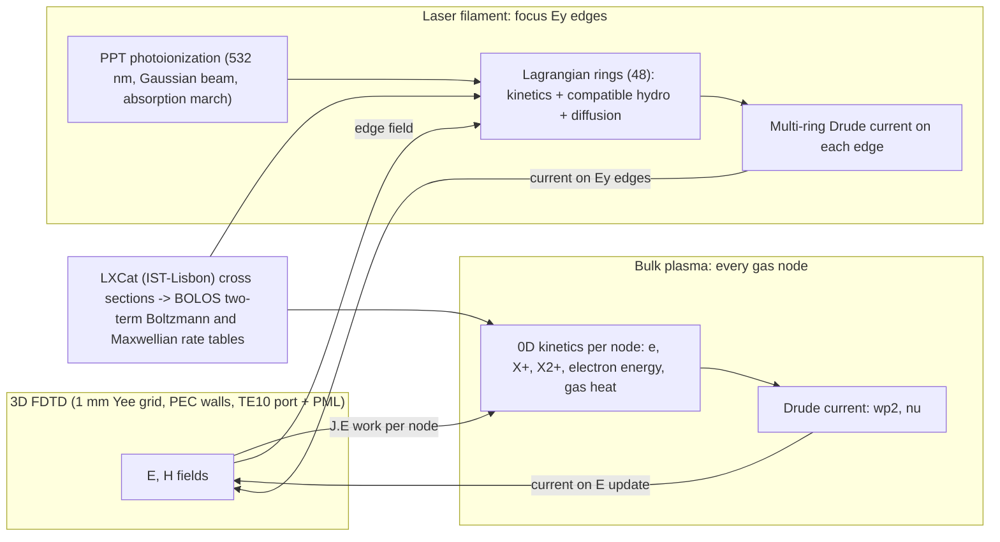
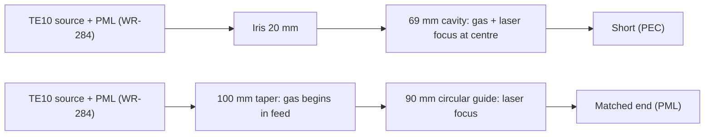

# Coupled 3D simulation: laser-induced plasma in an RF cavity and a waveguide taper

## Status and scope

This report covers a **self-consistent, cycle-resolved 3D simulation** of
plasma produced by a 532 nm laser focus in He, N2 or Ar at 790.8 kPa (100 psig),
inside two 3 GHz devices driven so the empty-device peak field at the focus is
10 MV/m:

- a WR-284 iris-coupled cavity;
- a WR-284 to 90 mm circular-guide taper.

The plasma acts back on the RF field everywhere in the gas, and the RF field
heats and ionizes the plasma. The simulation is **numerical evidence under
stated assumptions**, not a prediction validated by experiment. All inputs are
illustrative, as in the
[benchmark report](rf-plasma-simulation-benchmarks.md). The walls are perfect
electric conductors (PEC), and the main kinetic gaps are listed under
[Limitations](#limitations).

Code, commands and raw outputs are in the
[simulation project](../simulations/rf_plasma/README.md):

- `src/rf_plasma/coupled3d.py`: driver;
- `src/rf_plasma/plasma3d.py`: kinetics, filament and Drude kernels;
- `src/rf_plasma/gas_model.py`: gas data and provenance;
- `results/coupled3d/`: one folder per case.

## Model

This schematic shows the per-block data flow. It is not a scale drawing.



### Methods

- **Electromagnetics.**
  - Custom Numba FDTD: dx = 1 mm, dt = 1.887 ps, Courant-limited.
  - The plasma current is updated every step from each node's Drude
    coefficients, so its memory is kept in full and no field envelope is used.
  - The run starts from a cold steady state ("prefill") scaled to put
    10 MV/m at the focus, and the drive is held at that amplitude.
- **Cavity.**
  - 72×34×132 cells; a 20 mm inductive iris and a 69 mm cavity.
  - Ringdown calibration: f0 = 2.95037 GHz, loaded Q 331. With PEC walls this
    is the external Q, so the empty cavity reflects fully (|Γ| = 1).
  - Forward power 271 kW.
- **Taper.**
  - 90×90×267 cells; a 100 mm linear taper; empty-device |Γ| = 0.054.
  - It is a travelling-wave device. Reaching 10 MV/m at the focus in the 90 mm
    guide takes a forward power of 316 MW and about 15.7 MV/m in the WR-284
    feed.
  - The gas fills cells k = 61–245, which includes part of the feed.
- **Gas and electron rates.**
  - n0 = 1.909e26 m⁻³ (300 K). The peak reduced field E/N is 52 Td.
  - Rates are interpolated in mean electron energy from tables built with BOLOS
    from IST-Lisbon LXCat cross sections.
  - **EEDF closure (derived criterion, no fitted transition point):**
    - k = (1−w)·k_Boltzmann + w·k_Maxwell, with a local weight
      w = ν_ee / (ν_ee + ν_ε).
    - ν_ee = 2.91e-12·ne·lnΛ·Te^−3/2 s⁻¹ (SI) is the NRL Plasma Formulary
      electron collision rate. The code already uses it for electron–ion
      momentum transfer.
    - ν_ε = N·(k_exc/ε + k_el + k_iz·I_p/ε) is the electron energy-relaxation
      frequency, from the same LXCat/BOLOS Boltzmann table that supplies the
      rates.
    - Physical basis: the EEDF becomes Maxwellian where e–e energy exchange
      outpaces energy loss to neutrals (Raizer 1991; Lieberman & Lichtenberg
      2005). The BOLSIG+ manual defines the ionization degree ne/N as the
      "main control parameter for Coulomb collisions" in the two-term
      solution (Hagelaar & Pitchford 2005). w = 1/2 exactly where ν_ee = ν_ε.
    - At the 52 Td operating field this places the transition (ν_ee = ν_ε)
      at ne/N ≈ 1.7e-4 in Ar (6.3 eV), 5.7e-4 in He (9.6 eV) and 1.9e-4 in
      N₂ (1.2 eV). In laser-heated N₂ at 2–6 eV, strong vibrational and
      electronic losses raise it to about 1e-3–5e-3. It is gas- and
      energy-dependent, as the criterion requires.
    - The interpolation shape between the two limits remains a modeling
      choice. The O(1) uncertainty of the criterion is bounded by scaling ν_ee
      by 0.1 and 10 (Figure 1).
    - Planned swap-in: BOLSIG+ tables computed at the local ionization degree
      (user-supplied; LXCat redistribution terms apply).
- **Heavy-particle chemistry.**
  - Atomic and molecular ions X+ and X2+: conversion, dissociative and
    three-body recombination, and dimer dissociation.
  - Coefficients and their verification flags are in
    [gas-kinetics-coefficients.md](gas-kinetics-coefficients.md) and
    `cases/gas_kinetics_model.json`. Each run summary repeats the provenance.
  - Unverified entries: Ar k3b and N2 Z_eff.
- **Filament.**
  - The 20 µm-waist beam is resolved on 48 Lagrangian rings per Ey edge, below
    the 1 mm FDTD cell.
  - Ionization: PPT photoionization, then RF and laser inverse-bremsstrahlung
    heating, electron-impact ionization, recombination, and electron and gas
    energy exchange.
  - The hydrodynamics are energy-compatible: ring work p·2πr·ū·dt, with
    pressure p0 at the outer boundary.
  - The laser power is marched along the beam and depleted by absorption.
- **Conservation.**
  - Every kinetic substep conserves nuclei: neutrals are depleted by
    ionization.
  - Every energy channel is booked in a ledger: RF work, laser absorption,
    excitation, elastic, ionization, gas heating, sinks and chemistry.

### Apparatus schematic

This schematic shows the topology only; it is not to scale.



## Validation

| Check | Result |
|---|---|
| Unit and regression tests (`tests/test_plasma3d.py`, `tests/test_gas_model.py`) | All pass. They include ledger closure, depletion, energy-limiter and hydro-compatibility tests. |
| Filament energy closure, `ledger_filament_J.closure_residual_rel` | 1e-13 to 1e-15 relative in every case with non-negligible laser absorption. Values of 1e-4 to 1e-2 occur only where absorption is below 1e-10 of the input, at the roundoff floor. |
| RF energy balance (input − ΔU − absorbed) | 1.5–2.2% in the cavity. 1.2–2.4% in the taper; Ar 1 mJ, at −2.4%, misses the 2% target. |
| Time-step convergence: coupling block 8 → 4 steps, Ar 30 mJ cavity | Peak ne −0.5%, RF absorbed −0.8%, laser absorbed +0.3%, Γ_end −0.2%, focus-field minimum +0.4%. Quench time t_half −7% (4.83 → 4.50 ns). |
| Radial convergence: 48 → 96 rings | Below 1% on every output except the focus-field minimum (−3%). |
| EEDF-closure bound: ν_ee × 0.1 and × 10, Ar 30 mJ cavity | Peak ne −7% / +7%, RF absorbed +0.6% / −2.1%, laser absorbed +3% / −4%. Γ_end 0.70 / 0.99 against 0.97; focus-field minimum 2.64 / 0.095 against 0.51 MV/m; t_half 5.33 / 4.47 against 4.83 ns. |
| Seed density, He RF only: 1e9 → 1e7 m⁻³ | Quench delayed by 1.15 ns (t_half 6.40 → 7.55 ns); RF absorbed and Γ_end within 0.5%. |
| Spatial mesh convergence, dx = 1 → 0.8 mm | **Not done.** It needs a new calibration and prefill. |


*Figure 1. Sensitivity of the coupled cavity runs. The coupling time step and
the radial ring count change global energy measures by less than 1%; the
block-size change shifts t_half by 7%, and doubling the ring count shifts the
focus-field minimum by 3%. The peak ne and absorbed energies stay within about
7% over a ×0.1–×10 bound on the e–e rate in the EEDF closure. The late-time RF
state (|Γ| and the minimum focus field) still depends strongly on that bound.*

## Results

### Laser-only breakdown (no RF)


*Figure 2. Laser-only filament formation in the taper at 790.8 kPa. The
threshold (laser absorption above 1%) falls between 3 and 10 mJ for Ar at
300 ps and near 30 mJ for He and N2. A 3 ns pulse needs about 3–10× more
energy. The reference 1 mJ pulse produces only a weak seed of 1e9 to 6e13 m⁻³.*

Peak on-axis electron density, in m⁻³:

| Pulse | Gas | 1 mJ | 3 mJ | 10 mJ | 30 mJ | 100 mJ |
|---|---|---|---|---|---|---|
| 300 ps | Ar | 6.4e13 | 1.8e19 | 5.8e25 (16% absorbed) | 8.3e25 (68%) | – |
| 300 ps | N2 | 9.5e12 | 2.1e16 | 1.2e21 | 2.2e24 (2.5%) | – |
| 300 ps | He | 1.5e9 | 9.1e9 | 4.3e13 | 1.6e26 (0.7%) | – |
| 3 ns | Ar | – | – | 5.2e17 | 2.2e25 (4.9%) | 3.7e25 (56%) |
| 3 ns | N2 | – | – | 9.5e13 | 2.4e17 | 1.4e23 (0.07%) |
| 3 ns | He | – | – | 4.9e10 | 4.9e18 | 1.8e26 (26%) |

Peak densities change by less than 20% from the earlier fixed-x_c closure.
Filament peaks occur where the plasma is strongly ionized, and both closures
are Maxwellian there. The largest change is near threshold: the absorbed
fraction for Ar at 3 ns / 30 mJ falls from 7.8% to 4.9%.

The coupled matrix uses three laser points:

- 300 ps at 1 mJ, the reference case below threshold;
- 300 ps at 30 mJ, above threshold for all gases;
- 3 ns at 100 mJ.

Each gas also has an RF-only control.

### Coupled RF + laser matrix


*Figure 3. Coupled matrix overview, coloured by gas (Ar blue, He orange, N2
green). The 10 MV/m line in the last panel is the empty-device focus field.*

**Cavity**

| Case | Peak filament ne (m⁻³) | Peak bulk ne (m⁻³) | RF absorbed (mJ) | ΔU (mJ) | Stored energy halved at (ns) | Γ end | Min focus E (MV/m) |
|---|---|---|---|---|---|---|---|
| Ar RF only | 6.6e11 | 7.8e11 | 4e-7 | −0.4 | – | 1.00 | 10.0 |
| Ar 300 ps / 1 mJ | 4.9e15 | 1.3e11 | 1e-7 | −0.3 | – | 1.00 | 10.0 |
| Ar 300 ps / 30 mJ | 8.2e25 | 1.4e21 | 20.5 | −19.8 | 4.83 (laser at 1.5) | 0.97 (min 0.17) | 0.51 |
| Ar 3 ns / 100 mJ | 3.3e25 | 9.3e20 | 20.2 | −19.8 | 8.36 (laser at 6.0) | 0.98 (min 0.19) | 0.07 |
| He RF only | 4.4e20 | 2.4e20 | 19.9 | −19.8 | 6.40 | 0.99 | 0.03 |
| He 300 ps / 1 mJ | 1.4e21 | 3.9e20 | 19.9 | −19.8 | 6.40 | 0.99 | 0.04 |
| He 300 ps / 30 mJ | 1.9e26 | 9.0e20 | 19.9 | −19.8 | 4.27 | 0.98 | 0.05 |
| He 3 ns / 100 mJ | 1.7e26 | 6.4e20 | 19.8 | −19.8 | 5.98 (before laser peak) | 0.99 | 0.01 |
| N2 RF only | 1.0e9 | 1.1e9 | 5e-8 | −0.4 | – | 1.00 | 10.0 |
| N2 300 ps / 1 mJ | 9.5e12 | 1.1e9 | 3e-8 | −0.3 | – | 1.00 | 10.0 |
| N2 300 ps / 30 mJ | 2.2e24 | 1.1e9 | 0.011 | −0.3 | – | 1.00 | 9.97 |
| N2 3 ns / 100 mJ | 1.6e23 | 1.1e9 | 0.0038 | −0.4 | – | 1.00 | 9.98 |

Small negative ΔU values of about −0.3 to −0.4 mJ in non-breakdown cases are
within the 2% RF balance of the roughly 19 mJ stored energy.


*Figure 4. Ar, 300 ps, 30 mJ in the cavity.*
- The filament forms at 1.5 ns (70% of the laser absorbed, Tg ≈ 6.8e3 K).
- RF heating then keeps the filament electrons hot enough to sustain it at
  1e24–1e25 m⁻³ for the rest of the window.
- An avalanche grows from 1e10 to 1.4e21 m⁻³ at the filament tips beside the
  cavity walls.
- The plasma absorbs the whole stored energy (about 19.8 mJ) plus about
  0.7 mJ fed through the iris. The focus field decays to about 0.5 MV/m.
- |Γ| falls to 0.17 near the quench: plasma loss briefly brings the PEC
  cavity close to critical coupling, then over-damps it (|Γ| 0.97 at the
  end).

Findings from the cavity:

1. **Ar: the laser acts as a switch above threshold.** RF alone at 52 Td does
   not break down Ar within 16 ns, and the 1 mJ seed has no measurable RF
   effect. Above the laser threshold, the filament plus field-enhanced tip
   breakdown quenches the cavity, absorbing about 20 mJ. The quench time
   (stored energy halved 3.3 ns after the 300 ps pulse; 3.0–3.8 ns over the
   ν_ee ×0.1–×10 closure range) is the key observable.
2. **He breaks down from RF alone.** At 52 Td the He avalanche (about 4e9 /s)
   quenches the cavity in about 6.4 ns from the 1e9 m⁻³ seed. The laser can
   only bring the quench forward (30 mJ: 4.27 ns). The 3 ns pulse at 6 ns
   arrives after the quench has begun. Lowering the seed to 1e7 m⁻³ delays
   the quench by 1.15 ns, consistent with ln(100)/(4e9 /s). The He result
   therefore depends on the background seed, which is not known for a real
   apparatus.
3. **N2 has no RF effect.** The laser filament reaches 2e24 m⁻³ at 30 mJ, but
   it decays by 10× within about 0.2 ns. This is consistent with the model's
   fast molecular-ion recombination at these densities; the decay channels
   were not isolated. RF absorption stays at micro-joule level, and neither Γ
   nor the focus field changes measurably.

**Taper (travelling wave)**

| Case | Peak filament ne (m⁻³) | Peak bulk ne (m⁻³) | RF absorbed (mJ) | Γ start → end | Min focus E (MV/m) | RF balance |
|---|---|---|---|---|---|---|
| Ar RF only (16 ns) | 2.4e10 | 1.7e22 | 722 | 0.054 → 0.88 | 1.23 | −1.6% |
| Ar 300 ps / 1 mJ (11.5 ns) | 1.0e15 | 1.6e22 | 425 | 0.054 → 0.87 | 1.85 | −2.4% |
| Ar 300 ps / 30 mJ (11.5 ns) | 8.2e25 | 1.8e22 | 932 | 0.054 → 0.86 | 0.076 | −1.4% |
| Ar 3 ns / 100 mJ (16 ns) | 3.4e25 | 1.6e22 | 731 | 0.054 → 0.88 | 1.28 | −1.5% |
| He RF only (16 ns) | 7.3e13 | 1.8e22 | 1548 | 0.054 → 0.84 | 0.59 | −1.3% |
| He 300 ps / 1 mJ (11.5 ns) | 1.9e14 | 1.8e22 | 1133 | 0.054 → 0.84 | 0.70 | −1.8% |
| He 300 ps / 30 mJ (11.5 ns) | 1.9e26 | 1.8e22 | 1133 | 0.054 → 0.84 | 0.049 | −1.8% |
| He 3 ns / 100 mJ (16 ns) | 1.8e26 | 1.8e22 | 1548 | 0.054 → 0.84 | 0.003 | −1.3% |
| N2 RF only (16 ns) | 1.0e9 | 1.7e9 | 5.8e-7 | 0.054 → 0.054 | 9.99 | −1.4% |
| N2 300 ps / 1 mJ (11.5 ns) | 9.5e12 | 1.6e9 | 4.2e-7 | 0.054 → 0.054 | 9.99 | −1.2% |
| N2 300 ps / 30 mJ (11.5 ns) | 2.2e24 | 1.6e9 | 0.011 | 0.054 → 0.054 | 9.98 | −1.2% |
| N2 3 ns / 100 mJ (16 ns) | 1.6e23 | 1.7e9 | 0.0038 | 0.054 → 0.054 | 9.99 | −1.4% |


*Figure 5. Ar, 300 ps, 30 mJ in the taper at 11.5 ns. The bulk plasma forms
two regions:*
- *a sheet in the first 17 mm of gas in the WR-284 feed (z ≈ 61–78 cells),
  where the travelling TE10 amplitude is about 15.7 MV/m;*
- *a disc seeded by the 20 mm laser filament, which spreads across almost the
  full 90 mm diameter in the focus plane and holds 45% of the bulk electrons.*

Findings from the taper:

4. **In Ar, the feed region breaks down without the laser; a 300 ps / 30 mJ
   filament adds a second, shielding discharge at the focus.**
   - The field is higher where the gas starts in the WR-284 feed than at the
     focus (15.7 against 10 MV/m), so Ar RF breakdown starts about 145 mm
     upstream of the laser with or without the laser: in the RF-only case
     bulk ne exceeds 1e21 m⁻³ by 6.4 ns.
   - This upstream plasma reflects and absorbs the wave (|Γ| rises from 0.054
     to about 0.87) and partly shields the focus (1.2–1.9 MV/m).
   - The 300 ps / 30 mJ filament seeds a bulk disc at the focus that passes
     1e21 m⁻³ at 3.9 ns, before the feed. Over 11.5 ns it raises the RF
     absorbed from 425 to 932 mJ and drives the focus field down to
     0.08 MV/m. |Γ| is hardly changed (0.86 against 0.87), because the
     feed plasma upstream sets the reflection.
   - The 3 ns / 100 mJ pulse seeds almost no disc (3% of the bulk electrons)
     and the RF response matches the RF-only case within 1–4%.
   - With the earlier fixed-x_c closure, the 30 mJ disc was weaker
     (762 mJ absorbed, focus field 1.4 MV/m), so this result depends on the
     EEDF closure in the same way as the late-time cavity state.
   - **Design implication:** in a real taper, keep the gas out of the
     high-field feed (for example with a pressure window), or study the
     consequences of filling it.
5. **He in the taper.** He breaks down in the feed as well, faster and harder
   than Ar: bulk ne passes 1e21 m⁻³ by 1.7 ns, and 1.13 J is absorbed in
   11.5 ns and 1.55 J in 16 ns. A filament above threshold adds no bulk
   discharge at the focus. Its own over-dense core still shields the local
   field, from 0.6–0.7 MV/m without a useful filament to 0.05 MV/m at 30 mJ
   and 0.003 MV/m at 100 mJ.
6. **N2 in the taper.** As in the cavity, no RF breakdown occurs anywhere.
   The gas stays near its 1.7e9 m⁻³ seed density, Γ stays at 0.054, the
   minimum focus field stays near 10 MV/m, and RF absorption remains below
   0.012 mJ. The 30 mJ laser case has a transient local focus-field increase
   (11.7 MV/m at the endpoint), but does not produce significant RF
   attenuation. Among the three gases, only N2 at 790.8 kPa keeps the
   15.7 MV/m feed free of breakdown.

## Limitations

- **EEDF closure.** The switch between the Boltzmann and Maxwellian rate rows
  is derived from cited rates (ν_ee from the NRL Formulary, ν_ε from the
  Boltzmann rows). The interpolation form w = ν_ee/(ν_ee + ν_ε), however, is
  a modeling choice, and the criterion is uncertain by a factor of order one.
  A ×0.1–×10 bound moves integrated quantities by up to 7%, but it moves the
  late-time Γ (0.70–0.99) and the focus-field minimum (0.1–2.6 MV/m)
  strongly (Figure 1). A BOLSIG+ table computed with e–e collisions at the
  local ionization degree would remove this uncertainty.
- **Unsourced closures.**
  - The fast-heating fraction η_fast = 0.
  - Ion mobilities are 0, so there is no ambipolar transport (estimated
    τ_D of about 30 µs is far longer than the window).
  - The Ar three-body coefficient k3b and the N2 Z_eff are unverified.
  - The 1e9 m⁻³ background seed is not known for a real apparatus.
- **Missing physics.**
  - No multiple ionization, superelastic collisions or radiation transport.
  - Rate tables stop at 40 eV and are clamped above it. Fully ionized He
    reaches Te of 12–66 eV, and Tg up to 2.6e5 K in laser-only He at
    100 mJ, so those extreme temperatures are not quantitative.
  - Neutral permittivity and windows are neglected.
  - The laser is quasi-static with a fixed Gaussian shape: no refraction by
    the plasma, no self-focusing and no plasma-induced defocusing.
  - Bulk plasma diffuses only through the RF field; there is no bulk
    hydrodynamics.
- **Numerics.**
  - Walls are PEC, so the cavity Q is external only.
  - The 1 mm mesh does not resolve the curvature of the field-enhancement
    regions at the filament tips. Bulk tip breakdown is therefore
    mesh-dependent, and mesh convergence was not tested.
  - The taper RF balance is up to 2.4%, above the 2% target in the Ar 1 mJ
    case.
- **Inputs.** All geometry, field and pulse inputs are illustrative. No
  experimental comparison has been made.

## Reproduce

From `simulations/rf_plasma` in PowerShell:

```powershell
$py = '.\.venv\Scripts\python.exe'; $env:PYTHONPATH = 'src'
& $py -m unittest tests.test_plasma3d tests.test_gas_model
& $py -m rf_plasma.coupled3d calibrate                       # cavity iris / Q scan
& $py -m rf_plasma.coupled3d prefill --geometry cavity
& $py -m rf_plasma.coupled3d prefill --geometry taper
& $py -m rf_plasma.coupled3d matrix --geometry cavity taper --skip-existing --threads 8
& $py -m rf_plasma.coupled3d run --geometry cavity --gas Ar --energy 0.03 --ee-scale 0.1 --tag E30mJ_ee0.1
& $py -m rf_plasma.plots3d                                   # figures + matrix_summary.json
```

On 8 threads a cavity case takes about 3–7 min and a taper case about 14–17
min.

## References

- Raizer, Yu. P. (1991). *Gas Discharge Physics*. Springer, Berlin.
  (Maxwellization of the EEDF by electron–electron collisions.)
- Lieberman, M. A. & Lichtenberg, A. J. (2005). *Principles of Plasma
  Discharges and Materials Processing*, 2nd ed. Wiley.
- Richardson, A. S. (2019). *NRL Plasma Formulary*. Naval Research
  Laboratory. (Electron collision rate ν_e = 2.91e-6·n_e[cm⁻³]·lnΛ·T_e^−3/2.)
- Hagelaar, G. J. M. *BOLSIG+ user manual* (2016 version, bolsigdoc0316.pdf),
  bolsig.laplace.univ-tlse.fr. ("Ionization degree: main control parameter
  for Coulomb collisions.")
- Hagelaar, G. J. M. & Pitchford, L. C. (2005). Solving the Boltzmann equation
  to obtain electron transport coefficients and rate coefficients for fluid
  models. *Plasma Sources Sci. Technol.* 14, 722. doi:10.1088/0963-0252/14/4/011
- Perelomov, A. M., Popov, V. S. & Terent'ev, M. V. (1966). Ionization of
  atoms in an alternating electric field. *Sov. Phys. JETP* 23, 924.
- IST-Lisbon database, LXCat, www.lxcat.net (cross sections used through
  BOLOS; see `cases/swarm/` and the run provenance).
- Kemaneci, E. et al. (2017). A global model of cylindrical and coaxial
  surface-wave discharges. *J. Phys. D* 50, 245203.
  doi:10.1088/1361-6463/aa7093. These are low-pressure fits, used here outside
  their stated regime; see
  [gas-kinetics-coefficients.md](gas-kinetics-coefficients.md).
