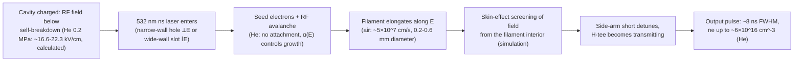

# Experimental data for validating a laser-triggered helium plasma switch in an S-band waveguide or cavity

*Technion group (Krasik, Shlapakovski, Leopold, Hadas et al.) plus a small set of validation datasets*

| Item | Value |
| --- | --- |
| Search date | 2026-11-20 |
| Review type | **Targeted starting point, not a systematic review.** There is no PRISMA protocol, and IEEE Xplore and AIP full texts could not be opened. |
| Sources used | OpenAlex (metadata, reconstructed abstracts, ORCID author filters), Crossref (until rate-limited), OSTI (AIP abstracts), IOPscience HTML full text (EPL, PSST), arXiv API, publisher landing pages |
| Machine-readable companion | [experimental_data.json](experimental_data.json) |
| Related workspace reviews | [laser-induced-plasma-in-gases.md](laser-induced-plasma-in-gases.md), [laser-induced-plasma-rf-waveguide.md](laser-induced-plasma-rf-waveguide.md), [standing-wave-helium-plasma-reflector.md](standing-wave-helium-plasma-reflector.md), [rf-plasma-simulation-benchmarks.md](rf-plasma-simulation-benchmarks.md) |

**Labels used throughout.**

- **FT**: confirmed in the full text I read.
- **ABS**: from the abstract or metadata only.
- **DER**: derived by me from reported values, with the assumptions stated.
- **UNC**: uncertain or conflicting between sources.

## Access limitations

- **IEEE Xplore** (TPS 2014, TPS 2015, ICOPS abstracts) was blocked by a bot challenge, so only abstracts were available.
- **AIP** (`pubs.aip.org`: PoP 2015, PoP 2016, JAP 2013 and 2014, PoP 2024 and 2025) returned HTTP 403, so only abstracts were available, via OSTI or OpenAlex.
- **MDPI** (*Plasma* 2019 and 2025) returned 403. PDF downloads (IOP, JACoW) returned binary content that could not be parsed.
- **Full text was read** for only two papers:
  - Beilin et al., *EPL* **109**, 25001 (2015).
  - Yatom et al., *PSST* **25**, 064001 (2016), §4.
- I could not read figure axes digitally. Values marked "Fig. N" come from the text describing that figure, not from digitizing it.
- **Gleizer:** I found no Gleizer-authored compressor or plasma-switch paper. Hadas appears on TPS 2014, JAP 2014, PoP 2015 and TPS 2015.

## 1. Research question and short answer

**Question.** What measured data exist for a laser-triggered gas-discharge switch in a pressurized S-band waveguide tee or cavity that can be used to check our model? The model is a WR-284 guide or cavity near 3 GHz, filled with helium at 1 MPa (target range 50–250 psi), with a 532 nm ns trigger laser.

**Short answer.** The Technion resonant pulse-compressor experiments match our system closely:

- WR-284 parts, an H-plane tee with a shorted side arm, about 2.767 GHz;
- a 532 nm, ns Nd:YAG (Surelite) trigger;
- **helium at 0.2 MPa** and dry air at 0.2–0.3 MPa.

They report delay and jitter, output pulse shape and peak power, extraction efficiency, filament imaging (air), and time-resolved Stark-broadening electron density (helium).

**No dataset I found covers helium at 0.34–1.7 MPa in an S-band guide.** The closest helium point is 0.2 MPa (about 29 psi absolute). Any comparison at 1 MPa therefore needs a scaling argument (see §5), and that argument is an inference, not data.

## 2. Conceptual switch sequence

This is a conceptual schematic, not to scale. The order of events is taken from Yatom 2016 §4 and Beilin 2015 (FT) and from the Shlapakovski 2015 PoP abstract (ABS). Specific timescales apply only to the conditions given in the tables below.

## 3. Technion S-band laser-triggered compressor: extracted parameters

### 3.1 Common experimental setup

| Parameter | Value | Label | Source |
| --- | --- | --- | --- |
| RF source | CPI VMS1177 magnetron, 200–450 kW, up to 2.4 µs | FT | Yatom 2016 §4 |
| Frequency | 2766.9 MHz (EPL). The PSST text gives about 2.766 GHz and says it shifts slightly with pressure. | FT | Beilin 2015 setup; Yatom 2016 §4 |
| Waveguide | WR-284 (72 × 34 mm) cavity; switch is an H-plane tee whose side arm is shorted by a deformable copper membrane. The laser port is λg/4 from the short. | FT | Yatom 2016 §4 / Fig. 12; Beilin 2015 Fig. 1 |
| Laser | Continuum Surelite Nd:YAG, 532 nm, ≤ 50 mJ | FT | both |
| Laser pulse duration | **~7 ns FWHM (EPL) vs 4 ns FWHM (PSST)** | UNC | Beilin 2015 setup; Yatom 2016 §4 |
| Focusing / spot size | **Not reported** in either full text. TPS 2015 used an unfocused beam; PoP 2016 compared focused (at the guide centre) with unfocused. | FT (absence) / ABS | — |
| Laser direction | Through a hole in the narrow wall (⟂E) or a slot on the wide-wall centreline (∥E) | FT | Yatom 2016 §4 |
| Diagnostics | 4QuikE camera (2 ns frames, ~7.35 µm/pixel) through a 7 × 2 mm slot; spectroscopy through a 5 mm hole; RF detectors on input and output | FT | Yatom 2016 §4 |

### 3.2 Helium at 0.2 MPa (closest to our case)

These are measured values. The field before triggering is calculated from measured power, not measured directly.

| Quantity | Value | Label | Source |
| --- | --- | --- | --- |
| Gas, pressure | He, 2×10^5 Pa = **0.20 MPa** (≈ 29 psi absolute) | FT | Beilin 2015; Yatom 2016 §4.2 |
| Why the power was reduced | The text says helium breaks down at a field 5–6 times lower than dry air, so magnetron power was lowered to avoid self-breakdown. | FT | Yatom 2016 §4 |
| RF field at switch before triggering | 15–20 kV/cm (EPL introduction). The two cases are **22.3 kV/cm** at P_cav ≈ 860 kW and **16.6 kV/cm** at P_cav ≈ 470 kW, both calculated from measured cavity traveling-wave power. The text does not say whether these are peak or RMS values. | FT (calculated) / UNC (peak or RMS) | Yatom 2016 §4.2; Beilin 2015 |
| Reduced field (DER) | 22.3 kV/cm → E/N ≈ 46 Td; 16.6 kV/cm → ≈ 34 Td. Assumes N = p/kT at 300 K = 4.83×10^25 m^-3. E/p ≈ 14.9 and 11.1 V cm^-1 Torr^-1. | DER | — |
| Output pulse | ≈ 8 ns FWHM; peak ≈ 90–330 kW. Fig. 3c shows single pulses at about 90, 250 and 300 kW. | FT | Beilin 2015 |
| Delay | The low-power case was delayed 30 ± 15 ns relative to the high-power case. In PSST case (b) (low field, laser ⟂E), the delay was about 30 ns longer than in cases (a) and (c). The absolute delay for helium is not stated in the text I read. | FT | Beilin 2015; Yatom 2016 §4.2 / Fig. 14 |
| Jitter | ±6 ns at high power (31 shots); ±9 ns at low power (39 shots). Microwave-output jitter matched the optical-emission jitter. | FT | Beilin 2015 |
| Effect of laser direction | With the beam ∥E, plasma emission appears a few ns earlier; rise time and peak ne are similar. TPS 2015 abstract: delay and jitter are smaller for ∥E or higher intensity; output peak power and waveform are almost unaffected. | FT / ABS | Yatom 2016 §4.2; Shlapakovski 2015 TPS |
| Electron density (Stark, He I 388.865 nm) | Rises to **≈ 6×10^16 cm^-3** at ≈ 300 kW output, about 3× the value at ≈ 90 kW. Time resolution 0.25 ns. Instrumental width 0.064 nm; van der Waals width 0.0158 nm; line-width error ≈ 0.005 nm. | FT | Beilin 2015 Fig. 3; Yatom 2016 Fig. 16 |
| ne (He I 447.15 nm, ratio of forbidden to allowed components) | ≈ 10^16 cm^-3 | FT | Yatom 2016 §4.2 |
| Te, gas temperature | Not reported for the microwave switch. The Te of 1–3 eV in Yatom 2016 §3 belongs to a separate HV-diode helium discharge and must **not** be used here. | FT | Yatom 2016 §3 |
| Extraction efficiency | Experiment ≈ 33%, agreeing with MAGIC simulation | FT | Yatom 2016 §4.3 |

### 3.3 Dry air at 0.2–0.3 MPa (imaging data; different gas)

| Quantity | 0.2 MPa, ≈ 310 kW input | 0.3 MPa, ≈ 420 kW input | Label | Source |
| --- | --- | --- | --- | --- |
| Mean delay, laser entry → 10% of output RF | ≈ 24 ns | ≈ 43 ns | FT | Yatom 2016 §4.1 / Fig. 13 |
| Jitter | ±1.4 ns | ±1.9 ns | FT | same |
| Trend | Delay and jitter grow as input power falls | | FT | same |
| Filament | Usually one, at most four; diameter 0.2–0.6 mm; grows along E at ≈ 5×10^7 cm/s. Emission is visible 5.1 ns before extraction (0.5 mm long) and fills the 7 mm window by +8.5 ns, the output peak. | | FT | same |
| Density estimate | ≤ 10^17 cm^-3, estimated from filament size and expansion | | FT (cited) / ABS | Beilin 2015 citing TPS 2014 |

### 3.4 Improved operation in dry air (PoP 2016; abstract only)

| Quantity | Value | Label |
| --- | --- | --- |
| Input | ≤ 450 kW, 1.8 µs | ABS |
| Laser | 213 nm or 532 nm, beam ∥E | ABS |
| Focused at the guide centre | ≈ 47% efficiency, ≈ 14 MW output; delay < 1 ns; minimal jitter | ABS |
| Unfocused | ≈ 20% efficiency, ≈ 6 MW | ABS |
| Pressure, focal length, spot size, which wavelength gave which result | Not in the abstract | — |

Comparing the 0.2–0.3 MW outputs in EPL with the 6–14 MW outputs in PoP 2016 suggests that the compressor configuration or charging differed. I could not check this because the full text was closed.

### 3.5 Measured values vs simulation outputs

| Experimental (measured) | Simulation (MAGIC 3D PIC / gas-conductivity model) |
| --- | --- |
| Input and output RF waveforms, delay, jitter, output FWHM and peak, efficiency ≈ 33% (He) | Waveforms for preset fields of 16.6 and 22.3 kV/cm (Beilin 2015 Fig. 4); efficiency ≈ 33% with the nominal seed |
| ne(t) from Stark broadening (He) | Filament growth with skin-effect screening (Yatom 2016 Figs. 17–18; PoP 2015 abstract) |
| Filament diameter and velocity from imaging (air) | A filament-shaped seed of 10^-5 C/cm³ (10^6× the nominal seed) gives ≈ 75% efficiency (Yatom 2016 Fig. 19) |
| — | Simulation inputs: Townsend fit α = C·E·exp(−D·E^-1/2); seed is a 1.2 mm cube at 10^-11 C/cm³ with 10^4 cm^-3 background (Beilin 2015) |

The seed charge and α(E) fit are **model assumptions**, not measurements. Our model should not adopt them as validation targets.

## 4. Related Leopold and Krasik breakdown data (X-band, gas-filled tube; abstract only)

These use a different source and band: ns pulses of about 300 MW at 9.6 GHz in a gas-filled dielectric tube. They are useful mainly for helium-versus-other-gas trends and threshold definitions.

| Paper | Key data | Label |
| --- | --- | --- |
| Maksimov et al., PoP **31**, 122109 (2024) | Pulse ≈ 300 MW, ≈ 0.7 ns. Threshold defined as the pressure at which transmitted energy falls to ≈ 30%: air 0.4×10^5 Pa, Ar 1×10^5 Pa, **He 1.8×10^5 Pa**, SF6 0.2×10^5 Pa. Plasma is diffuse below 5×10^4 Pa and streamer-like above 10^5 Pa. | ABS |
| Maksimov et al., PoP **32**, 053303 (2025) | Pulse ≈ 300 MW, ≈ 0.8 ns, ≈ 9.6 GHz. Helium below 1 kPa and H2 below 0.5 kPa do not attenuate the pulse. Helium emission lasts ≈ 20 ns and peaks within ≤ 5 ns. | ABS |

The abstracts do not give field amplitudes, so the 2024 helium "threshold" pressure cannot be converted to E/N without the full text.

## 5. Mapping to the user's 50–250 psi range (inference, not data)

| Pressure | MPa (gauge reading taken as absolute) | MPa absolute if gauge (+0.101) | E at constant E/N = 46 Td (DER) |
| --- | --- | --- | --- |
| Technion He | 0.20 | — | 22.3 kV/cm (reported, calculated) |
| 50 psi | 0.345 | 0.446 | ≈ 38 / 50 kV/cm |
| 100 psi | 0.689 | 0.791 | ≈ 77 / 88 kV/cm |
| 145 psi (1 MPa) | 1.00 | — | ≈ 112 kV/cm |
| 250 psi | 1.724 | 1.825 | ≈ 192 / 204 kV/cm |

Constant E/N scaling is a similarity *assumption*. It neglects:

- three-body conversion (He⁺ → He₂⁺), which scales as p²;
- the change in diffusion losses with pΛ;
- the shorter avalanche time at higher N;
- gas impurities, which strongly affect helium (Penning ionization).

For comparison, the standing-wave runs used 8 MV/m = 80 kV/cm at 1 MPa, which is ≈ 33 Td at 300 K (DER). That is in the same reduced-field range as the Technion low-field case (≈ 34 Td). Their high-field case (≈ 46 Td) corresponds to about 112 kV/cm at 1 MPa.

## 6. Other validation datasets

1. **MacDonald & Brown, Phys. Rev. 75, 411 (1949), "High Frequency Gas Discharge Breakdown in Helium."** Metadata checked in OpenAlex; ABS.
   - Measured microwave breakdown fields in helium in cavities of several sizes over a large pressure range.
   - Boltzmann-equation theory with no adjustable parameters agreed with experiment to within 6% at most.
   - Limitations: the study covers *low pressure*, far below 0.2–1.7 MPa, and I did not access the E_eff/p versus pΛ tables.
   - Use: a classic diffusion-controlled threshold check for an RF-only breakdown module, after mapping onto the same pΛ.
   - I quote no numbers because I could not read the source.
2. **Vadiee, "Microwave Triggered Laser Ionization of Air," MS thesis, Univ. New Mexico (2013).** Open-access repository PDF that I could not parse; ABS.
   - Laser: 1064 nm, 600 mJ, 7 ns, focused to a 30 µm spot, in air at 631 Torr (0.084 MPa).
   - Measured the laser breakdown threshold field; interaction of the laser-induced plasma with a 400 MW, 10.1 GHz relativistic BWO pulse, using photodiode, microphone, microwave detector and shadowgraphy diagnostics.
   - Use: a laser-only breakdown threshold, and a template for laser–HPM timing overlap. Different gas and wavelength.
3. **Ikeda & Soriano, Opt. Express 30, 33756 (2022).** ABS; already in [laser-induced-plasma-rf-waveguide.md](laser-induced-plasma-rf-waveguide.md).
   - Atmospheric air, 1064 nm laser breakdown threshold intensity 2.6–4.9×10^11 W/cm², with a 1.0 kW, 1.0 ms microwave pulse.
   - Use: shows whether microwave pre-heating lowers the laser threshold. Different gas and power scale.
4. **Freemire et al., JINST 13, P01029 (2018).** ABS.
   - Review of high-pressure gas-filled RF test cells, mainly H2, at about 805 MHz.
   - Use: a route to multi-MPa RF breakdown data. Helium values were not checked.

## 7. Quantities we can compare against, and proposed checks

| Observable | Experimental value and conditions | How to compare in our model |
| --- | --- | --- |
| No self-breakdown before trigger | He 0.2 MPa holds 16.6–22.3 kV/cm (calculated) for µs fill times without triggering | Run RF-only at 0.2 MPa with matching fill time; plasma must stay below switching density for ≥ 1 µs |
| Laser-to-output delay and its dependence on field | Air: 24 ns (0.2 MPa) and 43 ns (0.3 MPa). He: +30 ± 15 ns when the field falls from 22.3 to 16.6 kV/cm | Sweep E at 0.2 MPa He; compare Δdelay, not absolute delay, because the trigger reference differs |
| Jitter | He: ±6 / ±9 ns; air: ±1.4 / ±1.9 ns; focused beam (PoP 2016): "minimal", with delay < 1 ns | Monte-Carlo over seed density and laser energy (statistical) |
| ne(t) peak | He: ≈ 6×10^16 cm^-3 = 6×10^22 m^-3 at 300 kW output; ≈ 2×10^16 cm^-3 at 90 kW (DER from the text's "≈ 3× lower"). Line-of-sight, through a 5 mm hole | Spatially averaged filament ne over the collection volume, with 0.25 ns resolution |
| Filament geometry | Air: 0.2–0.6 mm diameter; ≈ 5×10^7 cm/s along E | Needs an ionization-wave model; the current subgrid filament has a radius of only 5–13 µm |
| Output pulse | ≈ 8 ns FWHM, 90–330 kW (He); efficiency ≈ 33% | Requires the full compressor cavity and tee geometry, not the matched guide |
| Change in reflection or transmission | Not reported as S-parameters; inferred from the extracted pulse | Use output-arm energy, not port \|Γ\| |

**Recommended first validation case.**

- Helium at 0.2 MPa, 2.767 GHz, field before triggering of 22.3 and 16.6 kV/cm.
- 532 nm, 50 mJ trigger, 4–7 ns long (run both because the sources disagree). The focus is unknown, so scan the waist.
- Targets: Δdelay ≈ 30 ns between the two fields, and ne approaching 6×10^16 cm^-3 at the high field.
- Only after that, extrapolate to 0.34–1.7 MPa.

## 8. Annotated bibliography

**Core Technion S-band laser-triggered switch papers**

1. **L. Beilin, A. Shlapakovski, M. Donskoy, T. Queller, Ya. E. Krasik**, "Plasma density temporal evolution in a high-power microwave pulse compressor switch," *EPL* **109**, 25001 (2015). <https://doi.org/10.1209/0295-5075/109/25001>. **FT**, free to read.
   - The helium 0.2 MPa experiment: Stark ne(t), jitter statistics and output pulses, with a MAGIC comparison.
   - The most directly usable dataset.
2. **S. Yatom, A. Shlapakovski, L. Beilin, E. Stambulchik, S. Tskhai, Ya. E. Krasik**, "Recent studies on nanosecond-timescale pressurized gas discharges," *Plasma Sources Sci. Technol.* **25**, 064001 (2016). <https://doi.org/10.1088/0963-0252/25/6/064001>. **FT** (§4).
   - A review combining the air imaging (delay, jitter, filament) and helium spectroscopy (ne), with fields calculated from P_cav, the 33% vs 75% efficiency simulations, and setup details.
   - Gives a laser pulse of 4 ns, which conflicts with EPL.
3. **L. Beilin, A. S. Shlapakovski, M. Donskoy, Y. Hadas, U. Dai, Ya. E. Krasik**, "Fast-framing optical imaging of plasma formation in resonant microwave pulse compressor," *IEEE Trans. Plasma Sci.* **42**, 1346–1352 (2014). <https://doi.org/10.1109/TPS.2014.2316204>. **ABS**.
   - The original dry-air (0.2–0.3 MPa) imaging study; density estimated from expansion.
4. **A. Shlapakovski, L. Beilin, Y. Hadas, E. Schamiloglu, Ya. E. Krasik**, "Operation of a microwave pulse compressor with a laser-triggered plasma switch at different laser beam directions," *IEEE Trans. Plasma Sci.* **43**(7), 2140–2145 (2015). <https://doi.org/10.1109/TPS.2015.2436055>. **ABS**.
   - Helium with an unfocused beam: compares ∥E and ⟂E, and intensity effects on delay and jitter.
5. **A. Shlapakovski, S. Gorev, Ya. E. Krasik**, "Improved operation of a microwave pulse compressor with a laser-triggered high-pressure gas plasma switch," *Phys. Plasmas* **23**, 080702 (2016). <https://doi.org/10.1063/1.4960981>. **ABS**.
   - Dry air with focused 213/532 nm light: 47% efficiency, 14 MW output, delay < 1 ns.
6. **A. S. Shlapakovski, L. Beilin, Y. Hadas, E. Schamiloglu, Ya. E. Krasik**, *Phys. Plasmas* **22**, 073111 (2015). <https://doi.org/10.1063/1.4926819>. **ABS**.
   - MAGIC simulation of filament growth and skin-effect screening. Simulation only.
7. **A. Shlapakovski, L. Beilin, Y. Bliokh, M. Donskoy, Y. Hadas, E. Schamiloglu, Ya. E. Krasik**, "Numerical simulations of output pulse extraction from a high-power microwave compressor with a plasma switch," *J. Appl. Phys.* **115**, 173302 (2014). <https://doi.org/10.1063/1.4875379>. **ABS**.
   - PIC, gas-conductivity and hybrid models; studies how ionization rate, RF field and pressure matter. Simulation only.
8. "Controlling output pulse and prepulse in a resonant microwave pulse compressor," *J. Appl. Phys.* **113**, 054503 (2013). <https://doi.org/10.1063/1.4790315>. **ABS**.
   - Earlier S-band prototype without a laser: 1.5 MW, 12 ns, about 13.2 dB gain. Context only.

**Leopold and Krasik X-band gas breakdown**

9. **V. Maksimov, Y. Cao, A. Haim, N. Asmedianov, A. Kostinskiy, J. G. Leopold, Ya. E. Krasik**, *Phys. Plasmas* **31**, 122109 (2024). <https://doi.org/10.1063/5.0238887>. **ABS**, CC-BY.
   - Breakdown thresholds at 9.6 GHz and 300 MW in several gases, including helium.
10. **V. Maksimov, A. Haim, A. Kostinskiy et al.**, *Phys. Plasmas* **32**, 053303 (2025). <https://doi.org/10.1063/5.0270037>. **ABS**.
    - Low-pressure helium and H2 transmission and emission duration.
11. **Ya. E. Krasik, J. G. Leopold, G. Shafir, Y. Cao, Y. P. Bliokh et al.**, "Experiments designed to study the non-linear transition of high-power microwaves through plasmas and gases," *Plasma* **2**, 6 (2019). <https://doi.org/10.3390/plasma2010006>. Metadata only; the publisher returned 403.

**Validation datasets**

12. **A. D. MacDonald, S. C. Brown**, "High frequency gas discharge breakdown in helium," *Phys. Rev.* **75**, 411–418 (1949). <https://doi.org/10.1103/PhysRev.75.411>. **ABS**.
13. **E. Vadiee**, "Microwave Triggered Laser Ionization of Air," MS thesis, Univ. New Mexico (2013). <https://digitalrepository.unm.edu/ece_etds/256>. **ABS**.
14. **Y. Ikeda, J. Soriano**, *Opt. Express* **30**, 33756 (2022). <https://doi.org/10.1364/OE.470072>. **ABS**.
15. **B. Freemire et al.**, "High pressure gas-filled RF cavities…," *JINST* **13**, P01029 (2018). <https://doi.org/10.1088/1748-0221/13/01/P01029>. **ABS**.

**Related titles found but not opened**

- ICOPS 2016, laser ignition of a plasma interference switch: <https://doi.org/10.1109/PLASMA.2016.7534347>.
- ICOPS 2015, imaging and spectroscopy: <https://doi.org/10.1109/PLASMA.2015.7179776>.
- JAP 2013, two-frequency compressor: <https://doi.org/10.1063/1.4813617>.
- JAP 2016, cryogenic compressor: <https://doi.org/10.1063/1.4939303>.
- Haim et al., PRE 2026, ionization-induced chirping: <https://doi.org/10.1103/fvx4-3b4p> and <https://doi.org/10.1103/d9gd-1jd6>.
- Artemenko et al., *J. Phys. Conf. Ser.* **1393**, 012069 (2019), Tomsk X-band oversized interference switches (Ar/air at 1 atm, not laser-triggered): <https://doi.org/10.1088/1742-6596/1393/1/012069>.

## 9. Next steps that would most improve the data

- Get the full texts of TPS 2015 (helium, unfocused beam) and PoP 2016 (focused beam: pressure, lens, spot size), through a library or the authors. These are the main missing laser parameters.
- Digitize Beilin 2015 Fig. 3 (ne(t)) and Fig. 4 (waveforms) and Yatom 2016 Figs. 13–16 from the PDFs for quantitative overlays. Record the digitization uncertainty.
- Get the MacDonald 1949 data, or the tables in MacDonald's *Microwave Breakdown in Gases* (Wiley, 1966), so that the RF-only threshold can be checked against pΛ.
