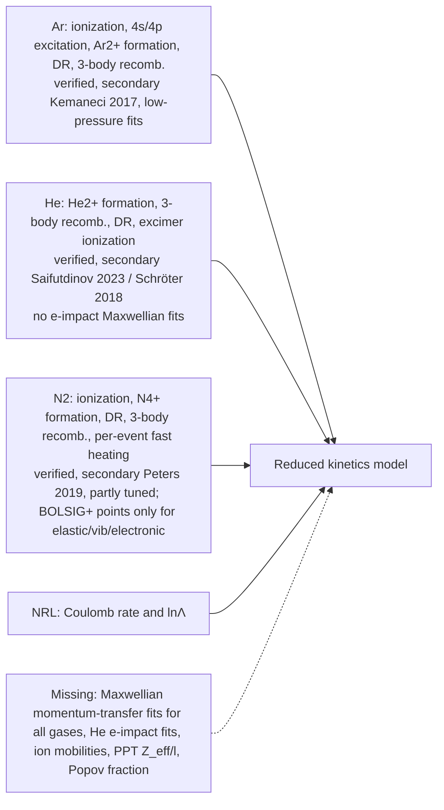

# Gas-kinetics coefficients for laser-induced plasma in He, Ar and N2 (8 bar, 300 K)

**Type:** this is a targeted starting point, not a systematic review. Searched on 2026-11-18.
**Machine-readable version:** [`simulations/rf_plasma/cases/gas_kinetics_literature.json`](../simulations/rf_plasma/cases/gas_kinetics_literature.json)

**Target conditions.** Gas-phase breakdown, not solid ablation.
- He, Ar or N2 at about 8 bar, so N ≈ 1.9e26 m⁻³, with Tg = 300 K.
- Mean electron energy from 0.05 to 20 eV.
- A 3 GHz RF field with E/N up to about 60 Td.
- A 532 nm ns laser pulse.

**Sources searched:**
- NIST ASD, the NIST Chemistry WebBook and the NIST Atomic Weights database.
- The NRL Plasma Formulary 2009, read as the DTIC copy on archive.org.
- Europe PMC and the PMC HTML pages.
- The arXiv API, plus ar5iv and arXiv HTML pages.
- Crossref, for metadata only.

**Access limitations:**
- PDFs could not be parsed.
- MDPI and IOPscience pages were blocked.
- The following were **not opened**:
  - Lieberman & Lichtenberg (2005)
  - Kossyi et al. (1992)
  - Mehr & Biondi (1968)
  - the full text of Couairon & Mysyrowicz (2007)
  - Talebpour et al. (1999)
  - the Ellis/Viehland mobility tables
  - Popov's fast-heating papers

  Nothing from these is given as verified.

**Verification levels.** "Verified" means the value was read in the opened source at the stated location. "Secondary" means the opened source is a compilation that attributes the value to a primary paper I did not open.

## 1. Basic constants (verified, primary)

| Gas | Ionization energy (eV) | Mass (u) | Source |
|---|---|---|---|
| He | 24.587389011 (±2.5e-8) | 4.002602(2) | NIST ASD; NIST Atomic Weights |
| Ar | 15.7596119 (±5e-7) | 39.948(1) | NIST ASD; NIST Atomic Weights |
| N2 | 15.581 ± 0.008 (evaluated, Lias) | 28.0134 | NIST WebBook |

## 2. Argon

All values below are from Kemaneci et al. (2017), Table 3, and are secondary.
- Units are m³/s for two-body and m⁶/s for three-body reactions.
- Te is in eV unless marked T_e[K]. Tg is the gas temperature.
- Kemaneci developed these fits for a **low-pressure** microwave global model. The opened text gives no validity range.

| Process | Coefficient | Attributed primary |
|---|---|---|
| e + Ar → Ar⁺ + 2e | 2.3e-14 Te^0.59 exp(−17.44/Te) | Straub et al. 1995 |
| e + Ar → Ar(4s_m) | 5.0e-15 exp(−12.64/Te); 1.4e-15 exp(−12.42/Te) | Tachibana 1986 |
| e + Ar → Ar(4s_r) | 1.9e-15 exp(−12.60/Te); 2.7e-16 exp(−12.14/Te) | Tachibana 1986 |
| e + Ar → Ar(4p) | 2.1e-14 exp(−13.13/Te) | Eggarter 1975 |
| e + Ar(4s_m) → Ar⁺ + 2e | 6.8e-15 Te^0.67 exp(−4.20/Te) | – |
| Ar⁺ + Ar momentum exchange | 2.2e-16 | – |
| Ar⁺ + 2Ar → Ar₂⁺ + Ar | 2.25e-43 (Tg/300)^−0.4 | Kabouzi et al. 2007 |
| Ar₂⁺ + Ar → Ar⁺ + 2Ar | 5.22e-16 Tg[eV]^−1 exp(−1.304/Tg[eV]) | Kabouzi et al. 2007 |
| e + Ar₂⁺ → Ar(4s_m or 4s_r) + Ar, **per channel** | 1.04e-12 (T_e[K]/300)^−0.67 (1−e^(−418/Tg))/(1−0.31e^(−418/Tg)) | Kabouzi et al. 2007 |
| e + Ar₂⁺ → Ar⁺ + Ar + e | 1.11e-12 exp(−(2.94 − 3(Tg[eV] − 0.026))/Te) | Kabouzi et al. 2007 |
| Ar⁺ + 2e → Ar(4p) + e | 5.00e-39 Te^−4.5 | Bhoj & Kushner 2004 |
| Ar⁺ + 2e → Ar + e | 8.75e-39 Te^**−2.25** (as printed) | Raizer 1991 |

**Flags:**
- **Total dissociative recombination.** Doubling the per-channel value to get the total is my inference.
- **Three-body recombination exponent.** The −2.25 exponent conflicts with the commonly quoted 8.75e-39 Te^−4.5. I did not find the −4.5 form for Ar in any source I opened. There is indirect support, which is my inference only. The Kossyi-derived N2⁺ and N⁺ values in Peters 2019 (R15, R19) are 1e-31 (300/Te[K])^4.5 m⁶/s. Converted to Te in eV, that is about 7.2e-39 Te^−4.5, within about 20 % of 8.75e-39 Te^−4.5. This suggests −2.25 is a misprint, but check Raizer before using either form.
- **Excitation fits.** The energies inside the exponentials are fit parameters, not thresholds.

## 3. Helium

These values are from Saifutdinov & Timerkaev (2023), Tables 1–2, which cite Donnelly-group and Deloche et al. sources, and from Schröter et al. (2018), Table 5. Both models compute electron-impact rates with a Boltzmann solver. Neither gives Maxwellian fits for He ionization or excitation.

| Process | Coefficient | Source |
|---|---|---|
| He⁺ + 2He → He₂⁺ + He | 1.4e-43 (Tg/300)^−0.6 m⁶/s | Saifutdinov R20 |
| e + He⁺ + He → He* + He | 1e-38 (Te/Tg)^−2 m⁶/s | Saifutdinov R22 |
| e + He₂⁺ + He → He₂* + He | 5e-39 (Te/Tg)^−1 m⁶/s | Saifutdinov R23 |
| e + He₂⁺ → He₂* ("dissociative recombination" as labelled) | 5e-15 (Te/Tg)^−1 m³/s | Saifutdinov R24 |
| 2e + He⁺ / 2e + He₂⁺ | 6e-32 / 4e-32 (Te/Tg)^(−4±0.5) | Saifutdinov R21/R25: **units ambiguous, so marked unverified** |
| Penning ionization (metastables) | 2.9e-15 (Tg/300)^0.5 m³/s | Saifutdinov R14–19 |
| e + He₂* → He₂⁺ + 2e (threshold 3.90 eV) | 2.06e-13 exp(−4.28/Te) m³/s | Schröter Table 5 |
| e + He₂* → 2He + e | 3.8e-15 m³/s | Schröter Table 5 |
| Excitation thresholds | 19.80 eV and 20.62 eV; ionization 24.58 eV | Schröter Table 5 |

Saifutdinov's ratio Te/Tg uses both temperatures in kelvin. The product labelling for R24 and the charge balance for R12 should be checked against the source table before use (see the JSON notes).

## 4. Nitrogen

*Added in the follow-up search (2026-11-18).* The source is Peters, Shneider & Miles (2019), Table I, read from the PMC table page's MathML.

This is a **secondary** compilation for femtosecond 800 nm FLEET in pure N2 at room temperature and up to atmospheric density. Several rates are tuned to that experiment (Table IV). The original units are cm³/s or cm⁶/s with T in K; the table below gives SI with Te and Tg in K.

| Process | Coefficient (SI) | Peters row and its stated origin |
|---|---|---|
| e + N2 → 2e + N2⁺ | 1e-6·5.05e-11 (Te^½ + 1.10e-5 Te^1.5) exp(−1.82e5/Te) m³/s | R16 (refs 42, 43) |
| N2⁺ + 2N2 → N4⁺ + N2 | 6.8e-41 (300/Tg)^1.64 m⁶/s | R35 (ref 60) |
| N4⁺ + N2 → N2⁺ + 2N2 | 2.1e-22 exp(Tg/121) m³/s | R27 |
| e + N2⁺ → 2N | 2.8e-13 (300/Te)^0.5 m³/s; heats the gas by 3.5 eV per event | R12 (Kossyi; ref 40) |
| e + N4⁺ → N2(A/B/C) + N2 | 2.4e-12 (300/Te)^0.5 m³/s in total, **tuned**, split 0.025/0.87/0.11 | R7–R9; the literature range in Table IV is 2.6e-13 to 4.6e-12 m³/s |
| 2e + N2⁺ → e + N2 | 1e-31 (300/Te)^4.5 m⁶/s | R15 (Kossyi) |
| 2e + N4⁺ → e + 2N2 | 7e-32 (300/Te)^4.5 m⁶/s | R10 |
| e + N2⁺ + N2 → 2N2 | 6e-39 (300/Te)^1.5 m⁶/s | R14 (Kossyi) |
| e + N2 → e + 2N | **Unverified.** It prints as 1.2e25/(N_A Te^1.6) exp(−113.200/Te) cm³/s, and the activation term is ambiguous | R40 |

**BOLSIG+ single points** at Te = 11 600 K (mean energy about 1.5 eV), in m³/s. These are for cross-checking only; they are not fits.

| Channel | Rate coefficient (m³/s) | Peters row |
|---|---|---|
| Elastic | 8.25e-14 | R41 |
| Vibrational, sum over v = 1–8 | 8.45e-15 | R42 |
| A, v = 0–4 | 1.59e-18 | R44 |
| A, v = 5–9 | 5.63e-18 | R46 |
| A, v > 9 | 4.06e-18 | R50 |
| B | 2.35e-17 | R48 |
| C | 6.18e-18 | R52 |

**Fast heating per event**, from Table III. These values come partly from Popov and partly from Peters's own estimates. They are energies per reaction event, **not** Popov's E/N-dependent heating fraction.

| Reaction | ε_tr (eV) | ε_v (eV) |
|---|---|---|
| R12 | 3.5 | — |
| R40 | 1 | — |
| R5 | 3.5 | 1.5 |
| R6 | — | 1.3 |
| R25 | — | 1.2 |
| R26 | — | 3.7 |

**Still unverified for N2:**
- **Maxwellian fits for elastic, vibrational and electronic channels.** Peters computes these with BOLSIG+ and gives no fits.
- **Ion mobilities.**
- **PPT Z_eff and l.** Peters confirms that a Talebpour PPT-based rate was used at 800 nm and 70 fs, with w ∝ I^~7.5 below 1e18 W/m², but prints neither parameter. Z_eff = 0.9 is still unconfirmed. The femtosecond tunnelling regime does not transfer to a 532 nm nanosecond pulse.
- **Popov's heating fraction.**

**Conditions caveat.** At 8 bar and 300 K, conversion of N2⁺ to N4⁺ occurs at about 2.5e12 s⁻¹, so N4⁺ recombination controls the decay. Three-body e + N2⁺ + N2 recombination gives an effective rate of about 1e-12 m³/s at 300 K. Both figures are my estimates from the coefficients above.

For N2 at 10–60 Td, vibrational excitation dominates electron energy loss, so a model without it will strongly overestimate Te. Treat this as a known modeling requirement, not a value from these sources.

## 5. Common (NRL Plasma Formulary 2009, verified primary)

- **Electron collision rate** (p. 28): ν_e = 2.91e-6 n_e[cm⁻³] lnΛ Te^−3/2 s⁻¹. In SI this is `2.91e-12*n_e_m3*lnL*Te_eV**-1.5`.
- **Electron–ion lnΛ** (p. 34):
  - λ = 23 − ln(n_e^½ Z Te^−3/2) for Te < 10Z² eV.
  - λ = 24 − ln(n_e^½ Te^−1) for Te > 10Z² eV.
  - n_e is in cm⁻³.
- **Electron–electron lnΛ** (p. 34): λ_ee = 23.5 − ln(n_e^½ Te^−5/4) − [1e-5 + (ln Te − 2)²/16]^½.

*Conceptual schematic of what this compilation covers. Dashed arrows mark gaps.*

## 6. Validation advice

These are recommendations, not results from the sources.
- Replace the Maxwellian and low-pressure fits with BOLSIG+ rates tabulated against mean energy, using LXCat cross sections.
- Compare against measured swarm data at the same E/N, such as drift velocity and the ionization coefficient α/N.
- Check post-pulse decay against measured n_e(t) at similar pressures. Keep simulated Te separate from measured quantities.

## References

1. NIST ASD Team, *NIST Atomic Spectra Database – Ionization Energies*. https://physics.nist.gov/cgi-bin/ASD/ie.pl (accessed 2026-11-18). Opened.
2. NIST, *Atomic Weights and Isotopic Compositions*. https://physics.nist.gov/cgi-bin/Compositions/stand_alone.pl (accessed 2026-11-18). Opened.
3. NIST Chemistry WebBook, SRD 69, *Nitrogen*. https://webbook.nist.gov/cgi/cbook.cgi?ID=C7727379. Opened.
4. Huba J.D. (2009), *NRL Plasma Formulary*, DTIC ADA499299. https://archive.org/download/DTIC_ADA499299/DTIC_ADA499299_djvu.txt. Opened as the OCR text layer.
5. Kemaneci E. et al. (2017), "A global model of cylindrical and coaxial surface-wave discharges", *J. Phys. D* 50, 245203. https://doi.org/10.1088/1361-6463/aa7093. Opened as the arXiv:1612.07268 HTML (ar5iv).
6. Saifutdinov A., Timerkaev B. (2023), "Modeling and Comparative Analysis of Atmospheric Pressure Anodic Carbon Arc Discharge in Argon and Helium–Producing Carbon Nanostructures", *Nanomaterials* 13, 1966. https://doi.org/10.3390/nano13131966. Opened via PMC10343802 (CC BY).
7. Schröter S. et al. (2018), "Chemical kinetics in an atmospheric pressure helium plasma containing humidity", *Phys. Chem. Chem. Phys.* 20, 24263. https://doi.org/10.1039/c8cp02473a. Opened via PMC6161623.
7a. Peters C.J., Shneider M.N., Miles R.B. (2019), "Kinetics model of femtosecond laser ionization in nitrogen and comparison to experiment", *J. Appl. Phys.* 125, 243301. https://doi.org/10.1063/1.5098306. Opened via PMC8378216 (NASA author manuscript): Tables I, III and IV, and Secs. IIB–IID.
8. Primary sources cited by the compilations above, **not opened**. This includes Peters's refs 23 (Kossyi 1992), 35/40 (Popov), 60 and 81/82 (Talebpour), as well as:
   - Straub et al., *Phys. Rev. A* 52, 1115 (1995)
   - Tachibana, *Phys. Rev. A* 34, 1007 (1986)
   - Eggarter, *J. Chem. Phys.* 62, 833 (1975)
   - Kabouzi et al., *Phys. Rev. E* 75, 016402 (2007)
   - Bhoj & Kushner, *J. Phys. D* 37, 2510 (2004)
   - Raizer, *Gas Discharge Physics* (Springer, 1991)
9. Requested sources that were **not opened**:
   - Lieberman & Lichtenberg, *Principles of Plasma Discharges and Materials Processing*, 2nd ed. (2005)
   - Kossyi et al., *Plasma Sources Sci. Technol.* 1, 207 (1992)
   - Mehr & Biondi (1968)
   - Couairon & Mysyrowicz, *Phys. Rep.* 441, 47 (2007), https://doi.org/10.1016/j.physrep.2006.12.005
   - Talebpour et al. (1999)
   - Ellis/Viehland ion mobility tables
   - Popov (2001, 2011)
