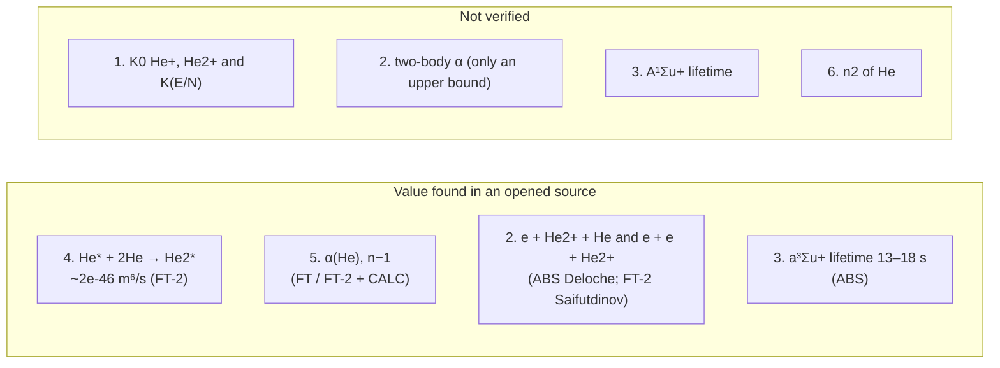

# Helium plasma data: source verification of six model values

**Search date:** 2026-11-20
**Type:** a targeted verification of six specific values. It is **not** a systematic review.
**Sources and databases used:** PubMed Central / Europe PMC (open full text), arXiv / ar5iv (full text), refractiveindex.info, Crossref and OpenAlex metadata and abstracts, Semantic Scholar, and publisher abstract pages (ScienceDirect, Optica).

**Access limitations:**
- APS (PRA) returned HTTP 403.
- RSC returned 403; the same paper was read in PMC instead.
- Optica returned a bot-check page.
- ScienceDirect showed abstracts only.
- LXCat sits behind a Cloudflare challenge and POST-driven pages, so its Viehland ion database could not be reached.
- Crossref intermittently returned HTTP 429, so some lookups (Helm 1977, Emmert 1988) failed.

## Verification levels used below

| Level | Meaning |
|---|---|
| **FT** | Value read in the opened full text of the cited source |
| **FT-2** | Value read in an opened full text that is **secondary** (it cites the primary source, which was not opened) |
| **ABS** | Value read in the primary source's abstract only (via OpenAlex or a publisher page); the tables, conditions and caveats in the body were not seen |
| **UNVERIFIED** | No opened source gives the value |
| **CALC** | My own arithmetic from verified inputs. It is not a published number |

*Conceptual status map only. It shows what was verified in this search, not the physics.*

---

## 1. Low-field reduced mobilities K0 of He⁺ and He₂⁺ in He (300 K)

| | |
|---|---|
| Model values | He⁺/He 10.4 cm²/(V·s); He₂⁺/He 16.7 cm²/(V·s) |
| Status | **UNVERIFIED.** No mobility number or K(E/N) table was opened |
| Sources attempted | Ellis, Pai, McDaniel, Mason & Viehland, "Transport properties of gaseous ions over a wide energy range," *At. Data Nucl. Data Tables* **17**(3), 177–210 (1976), [10.1016/0092-640X(76)90001-2](https://doi.org/10.1016/0092-640X(76)90001-2). Only the abstract was opened (ScienceDirect). It describes room-temperature mobilities of mass-identified ions tabulated against E/N, but gives no numbers in the abstract.  Ellis et al., Part II, ADNDT **22**, 179–217 (1978), [10.1016/0092-640X(78)90014-1](https://doi.org/10.1016/0092-640X(78)90014-1): metadata only.  Viehland & Mason, Part IV, ADNDT **60**, 37–95 (1995), [10.1006/adnd.1995.1004](https://doi.org/10.1006/adnd.1995.1004): metadata only.  LXCat Viehland database: could not be reached.  Helm 1977: not identified (Crossref returned 429) |
| Location | — |
| Recommendation | **Keep 10.4 and 16.7 provisionally, flagged as unverified.** Before relying on them, get the He⁺/He and He₂⁺/He tables from Ellis 1976 (or the LXCat Viehland set) and import K(E/N) directly from about 1 to 50 Td instead of a constant K0. Note that the existing `gas-kinetics-coefficients.md` review also did not open these tables. |

---

## 2. Recombination of He₂⁺ with electrons

### 2a. Primary source: Deloche et al. 1976 (abstract only)

Citation: R. Deloche, P. Monchicourt, M. Cheret & F. Lambert, "High-pressure helium afterglow at room temperature," *Phys. Rev. A* **13**, 1140–1176 (1976), [10.1103/PhysRevA.13.1140](https://doi.org/10.1103/PhysRevA.13.1140).
- **Access:** abstract only, via the OpenAlex record. APS returned 403, and the paper is closed access.
- **Location:** abstract. The table and equation numbers in the body were not seen.

The abstract gives the effective He₂⁺ recombination coefficient in this form:

α₂ = (α_c2 + k₀₂·n₀)·(T_e/293 K)^(−x₂) + k_e2·n_e·(T_e/293 K)^(−y₂)

| Parameter | Value in the abstract | SI conversion (CALC) |
|---|---|---|
| α_c2, two-body | **upper bound only:** < 5×10⁻¹⁰ cm³/s (the abstract prints "<5<10⁻¹⁰", which I read as a typesetting error for 5×10⁻¹⁰) | < 5×10⁻¹⁶ m³/s |
| k₀₂, e + He₂⁺ + He | (5 ± 1)×10⁻²⁷ cm⁶/s | 5×10⁻³⁹ m⁶/s |
| k_e2, e + e + He₂⁺ | (4.0 ± 0.5)×10⁻²⁰ cm⁶/s | 4×10⁻³² m⁶/s |
| x₂ | 1 ± 1 | — |
| y₂ | 4.0 ± 0.5 | — |

- **Measurement conditions (from the abstract):** pure-helium afterglow at room temperature; seven pressures from **5 to 100 Torr**. The coefficients were fitted with a five-equation model that includes non-Maxwellian electrons and spatial non-uniformity.
- **Product channel:** the abstract reports that about 70% of recombined molecular ions produce atomic metastables.

### 2b. Secondary compilations (full text opened)

- **Saifutdinov & Timerkaev**, *Nanomaterials* **13**, 1966 (2023), [10.3390/nano13131966](https://doi.org/10.3390/nano13131966); full text opened via PMC10343802, **Table 2**. Units are given in the header as m³/s or m⁶/s; T is gas temperature and Te electron temperature. The rows cite Deloche et al.
  - **R23:** e + He₂⁺ + He → He₂* + He, 5×10⁻³⁹ (Te/T)⁻¹ m⁶/s. This matches Deloche's k₀₂.
  - **R25:** 2e + He₂⁺ → He* + He + e, 4×10⁻³² (Te/T)^(−4.0±0.5) m⁶/s. This matches Deloche's k_e2.
  - **R24:** e + He₂⁺ → He₂*, 5×10⁻¹⁵ (Te/T)⁻¹ m³/s, labelled "dissociative recombination".
    - This value is **10 times the upper bound** that Deloche's abstract gives for α_c2 (< 5×10⁻¹⁶ m³/s).
    - Its product, He₂*, is also not a dissociative product.
- **Schröter et al.**, *PCCP* **20**, 24263–24286 (2018), [10.1039/c8cp02473a](https://doi.org/10.1039/c8cp02473a); full text opened via PMC6161623. The recombination rows of **Table 5** (R91–R111) contain **no e + He₂⁺ recombination**; they cover water and oxygen ions only. Related entries in Table 5:
  - R8: e + He₂* → He₂⁺ + 2e, 2.06×10⁻¹³ exp(−4.28/Te) m³/s;
  - R55: e + He₂* → 2He + e, 3.8×10⁻¹⁵ m³/s, which cites Deloche.

### 2c. Not opened or mismatched

- **Pack, Voshall, Phelps & Kline**, *J. Appl. Phys.* **71**, 5363 (1992), [10.1063/1.350555](https://doi.org/10.1063/1.350555). Its title is "Longitudinal electron diffusion coefficients in gases: Noble gases", so it is **not a recombination source**. The candidate appears to be mis-cited.
- **Santos, Noël, Belmonte & Alves**, *J. Phys. D* **47**, 265201 (2014), [10.1088/0022-3727/47/26/265201](https://doi.org/10.1088/0022-3727/47/26/265201). Closed access; not opened.
- **Emmert et al. 1988:** not identified (Crossref rate limit).

### 2d. Applicability to 0.1–2 MPa and Te of 0.03–3 eV (inference, not measured)

- **Pressure range:** Deloche's fit covers 5–100 Torr (about 0.7–13 kPa). The requested 0.1–2 MPa is **8 to 150 times higher** than the top of the fitted range.
- **Size of the k₀₂ term at high pressure (CALC):** at 300 K, n₀ ≈ 2.41×10²⁵ m⁻³ at 0.1 MPa. The term k₀₂n₀ is then about 1.2×10⁻¹³ m³/s at 0.1 MPa and about 2.4×10⁻¹² m³/s at 2 MPa.
- **Saturation (physics inference, not from an opened source):** three-body recombination with a neutral third body is generally expected to saturate at high density. A linear extrapolation over this range should therefore be treated as an upper estimate.
- **Electron temperature:** Te of 0.03–3 eV corresponds to Te/293 K ≈ 1.2–119. With y₂ = 4, the k_e2 term falls by about 2×10⁸ across that span. The fit was made for afterglow electrons near room temperature, not at 3 eV.

**Recommendation:**
- **Three-body e + He₂⁺ + He:** keep 5×10⁻³⁹ (Te/T)⁻¹ m⁶/s (ABS plus FT-2 agreement), and flag the extrapolation above 13 kPa.
- **Three-body e + e + He₂⁺:** keep 4×10⁻³² (Te/T)^−4 m⁶/s (ABS plus FT-2 agreement).
- **Two-body α:** **do not use 5×10⁻¹⁵ m³/s** (Saifutdinov R24). The only verified constraint is α_c2 < 5×10⁻¹⁶ m³/s near 293 K. For a two-body α(Te) over 0.03–3 eV, obtain the Deloche full text or a dedicated measurement. Until then, use ≤ 5×10⁻¹⁶ m³/s as a sensitivity bound.

---

## 3. Radiative lifetime of He₂* (a³Σu⁺ vs A¹Σu⁺)

| State | Value | Source | Access | Location |
|---|---|---|---|---|
| a³Σu⁺ (v = 0), theory | ≈ **18 s**, i.e. A ≈ 0.056 s⁻¹ (CALC) | C. F. Chabalowski, J. O. Jensen, D. R. Yarkony & B. H. Lengsfield, "Theoretical study of the radiative lifetime for the spin-forbidden transition a³Σu⁺→X¹Σg⁺ in He₂," *J. Chem. Phys.* **90**, 2504–2512 (1989), [10.1063/1.455993](https://doi.org/10.1063/1.455993) | ABS (OpenAlex). The value is also quoted in the full text of Verdegay et al., arXiv:2505.14798 (2025), Introduction (FT-2) | Abstract |
| a³Σu⁺, measured in **liquid** He | **13 ± 2 s**, i.e. A ≈ 0.077 s⁻¹ (CALC) | D. N. McKinsey et al., "Radiative decay of the metastable He₂(a³Σu⁺) molecule in liquid helium," *Phys. Rev. A* **59**, 200–204 (1999), [10.1103/PhysRevA.59.200](https://doi.org/10.1103/PhysRevA.59.200) | ABS (OpenAlex) | Abstract |
| A¹Σu⁺ | **UNVERIFIED.** No opened source gives a value | — | — | — |

- **Conditions for the 13 s value:** the measurement was made in superfluid liquid helium, in a low-molecular-density regime where two-body reactions do not dominate. It is not a gas-phase value.
- **Physics note (inference):** a lifetime of 13–18 s means the triplet cannot be the fast source of the 60–100 nm continuum in a nanosecond- to microsecond-scale plasma. On those timescales, triplet He₂* is lost by collisions (e.g. Schröter R55 and the Table 8 pooling reactions), not by radiation.

**Recommendation:**
- If the model uses a single "effective" fast VUV rate for He₂*, it must be the **A¹Σu⁺** (singlet) rate. That rate is **unverified here**; obtain a primary measurement or calculation before using it.
- If the model represents the triplet, use A ≈ 0.06 s⁻¹ (effectively non-radiative on plasma timescales).
- Do not assign a fast VUV rate to a lumped He₂* species without separating the singlet and triplet populations.

---

## 4. Three-body conversion He* + 2He → He₂* + He (300 K)

| Source | Value | Access | Location |
|---|---|---|---|
| Schröter et al. 2018, [10.1039/c8cp02473a](https://doi.org/10.1039/c8cp02473a) | **2.0×10⁻⁴⁶ m⁶/s** (= 2.0×10⁻³⁴ cm⁶/s) | FT-2 (PMC6161623) | Table 8, R380. It cites ref. 164, Myers & Cunningham, *J. Chem. Phys.* **67**, 247–253 (1977). That primary source was not opened and its DOI was not confirmed |
| Saifutdinov & Timerkaev 2023, [10.3390/nano13131966](https://doi.org/10.3390/nano13131966) | 8.1×10⁻⁴⁸·T·exp(−650/T) m⁶/s (triplet He(T)), which evaluates to **≈ 2.8×10⁻⁴⁶ m⁶/s at 300 K** (CALC) | FT-2 (PMC10343802) | Table 2, R13 |

**Recommendation:**
- Keep the rate at about 2×10⁻⁴⁶ m⁶/s at 300 K. The two secondary compilations agree within about 40%.
- If the model gas temperature differs from 300 K, use Saifutdinov's T-dependent form, which rises steeply with T.
- Confirm the value against Myers & Cunningham 1977 if a primary source is required.

---

## 5. He static dipole polarizability and refractivity (n − 1)

| Quantity | Value | Source | Access | Location |
|---|---|---|---|---|
| α(He), theory with QED | **1.38376077(14) a₀³** | Puchalski, Szalewicz, Lesiuk & Jeziorski, *Phys. Rev. A* **101**, 022505 (2020), as quoted by Verdegay et al., arXiv:[2505.14798](https://arxiv.org/abs/2505.14798) | FT-2 | arXiv 2505.14798, Sec. 7 |
| α(He), experiment (DCGT) | 1.38376162(27) a₀³ | Gaiser & Fellmuth, *Phys. Rev. Lett.* **120**, 123203 (2018), as quoted in the same paper | FT-2 | Same |
| n − 1 dispersion, 273.15 K and 101 325 Pa | n − 1 = 0.01470091 / (423.98 − λ⁻²), with λ in µm, valid 0.4801–2.0586 µm | C. R. Mansfield & E. R. Peck, "Dispersion of helium," *J. Opt. Soc. Am.* **59**, 199–204 (1969), [10.1364/JOSA.59.000199](https://doi.org/10.1364/JOSA.59.000199), via refractiveindex.info (He, "Mansfield") | Formula read on refractiveindex.info (FT-2). The JOSA abstract page was reached; the full text was not | refractiveindex.info data page |

My calculations from these inputs:
- **Mansfield–Peck formula, 0 °C and 1 atm:**
  - n − 1 = 3.4965×10⁻⁵ at 532 nm;
  - 3.4802×10⁻⁵ at 800 nm;
  - 3.4746×10⁻⁵ at 1064 nm;
  - λ → ∞ limit 3.467×10⁻⁵ (an extrapolation outside the fitted range).
- **Static limit, n − 1 ≈ 2πNα:** using Loschmidt N = 2.6867774×10²⁵ m⁻³ and a₀³ = 1.481847×10⁻³¹ m³:
  - α = 1.38376 gives 3.462×10⁻⁵;
  - α = 1.3832 gives 3.460×10⁻⁵.
  - Real-gas corrections were not evaluated.
- **Comparison with the model:**
  - The model's 1.3832 a.u. is about 0.04% below the QED value.
  - The model's n − 1 ≈ 3.48×10⁻⁵ is **not** the static value. It matches the optical value near 800 nm.

**Recommendation:**
- **Change α to 1.38376 a.u.**, a negligible correction.
- For optical-frequency calculations, **replace the single (n − 1) = 3.48×10⁻⁵** with the Mansfield–Peck dispersion formula: 3.50×10⁻⁵ at 532 nm and 3.48×10⁻⁵ at 800 nm, at 0 °C and 1 atm. Scale linearly with number density for other pressures and temperatures, which is valid to first order for a dilute gas.
- Use about 3.46×10⁻⁵ only for the static or long-wavelength limit.

---

## 6. Nonlinear index n₂ of helium (1 atm, 532–800 nm)

| | |
|---|---|
| Status | **UNVERIFIED.** No opened source gives an n₂ (or γ) value for He |
| Shelton & Rice | D. P. Shelton & J. E. Rice, "Measurements and calculations of the hyperpolarizabilities of atoms and small molecules in the gas phase," *Chem. Rev.* **94**(1), 3–29 (1994), [10.1021/cr00025a001](https://doi.org/10.1021/cr00025a001). The DOI and metadata were confirmed via Crossref; the full text was **not opened** |
| Börzsönyi et al. 2010 | *Opt. Express* **18**(25), 25847–25854, [10.1364/OE.18.025847](https://doi.org/10.1364/OE.18.025847). Only the abstract was opened (Europe PMC). It lists Ar, Ne, Xe, N₂ and air from 0.05 mbar to 1 bar. **Helium is not among the listed gases**, so this is probably not an He source. The full text was bot-blocked |
| Wahlstrand / Milchberg | The papers found (N₂, O₂, Ar) contain no He value. No Wahlstrand 2012 paper with an He value was identified |
| Other | Skomorowski & Moszynski, arXiv:1302.6072, was opened. It treats Kerr *virial* (collision-induced) coefficients of He and gives no single-atom n₂. Koprinkov et al., arXiv:0709.3187, uses an He n₂ in modelling, but the PDF could not be parsed |

**Recommendation:**
- Keep whatever value the model uses, but **flag it as unverified**.
- Obtain the He second hyperpolarizability γ from Shelton & Rice 1994 (or a measured n₂ for He) and convert it with a conversion formula taken from an opened source.
- I deliberately did not quote an order of magnitude from memory.

---

## Compact summary

| # | Quantity | Verified value and conditions | Source (DOI) | Access | Location | Recommendation |
|---|---|---|---|---|---|---|
| 1 | K0 He⁺/He, He₂⁺/He | — | Ellis 1976 [10.1016/0092-640X(76)90001-2](https://doi.org/10.1016/0092-640X(76)90001-2); Viehland & Mason 1995 [10.1006/adnd.1995.1004](https://doi.org/10.1006/adnd.1995.1004) | Abstract / metadata | — | **Unverified.** Keep 10.4 and 16.7 provisionally; get the tables and K(E/N) |
| 2a | two-body α (He₂⁺) | α_c2 < 5×10⁻¹⁰ cm³/s (< 5×10⁻¹⁶ m³/s), 293 K, 5–100 Torr | Deloche 1976 [10.1103/PhysRevA.13.1140](https://doi.org/10.1103/PhysRevA.13.1140) | Abstract | Abstract | **Do not use 5×10⁻¹⁵ m³/s** (Saifutdinov R24 exceeds the bound); use ≤ 5×10⁻¹⁶ |
| 2b | e + He₂⁺ + He | (5±1)×10⁻³⁹ m⁶/s × (Te/293 K)^(−1±1) | Deloche 1976; Saifutdinov 2023 [10.3390/nano13131966](https://doi.org/10.3390/nano13131966) | Abstract + FT-2 | Abstract; Table 2, R23 | Keep; flag the extrapolation above about 13 kPa |
| 2c | e + e + He₂⁺ | (4.0±0.5)×10⁻³² m⁶/s × (Te/293 K)^(−4.0±0.5) | Same | Abstract + FT-2 | Abstract; Table 2, R25 | Keep |
| 3 | He₂* a³Σu⁺ lifetime | 18 s, theory, v = 0 (0.056 s⁻¹); 13±2 s measured in liquid He | Chabalowski 1989 [10.1063/1.455993](https://doi.org/10.1063/1.455993); McKinsey 1999 [10.1103/PhysRevA.59.200](https://doi.org/10.1103/PhysRevA.59.200) | Abstract | Abstracts | The triplet is not a fast VUV source; **the A¹Σu⁺ rate is unverified** |
| 4 | He* + 2He → He₂* + He | 2.0×10⁻⁴⁶ m⁶/s at 300 K (≈2.8×10⁻⁴⁶ from Saifutdinov R13) | Schröter 2018 [10.1039/c8cp02473a](https://doi.org/10.1039/c8cp02473a) | FT-2 | Table 8, R380 | Keep about 2×10⁻⁴⁶ m⁶/s |
| 5 | α(He); n − 1 | 1.38376 a₀³; n−1 = 3.50e-5 (532 nm), 3.48e-5 (800 nm), at 0 °C and 1 atm; static about 3.46e-5 (CALC) | Mansfield & Peck 1969 [10.1364/JOSA.59.000199](https://doi.org/10.1364/JOSA.59.000199); Puchalski 2020 (via arXiv 2505.14798) | FT-2 (refractiveindex.info; arXiv) | refractiveindex.info formula; arXiv Sec. 7 | Change α to 1.38376; use the λ-dependent formula |
| 6 | n₂(He) | — | Shelton & Rice 1994 [10.1021/cr00025a001](https://doi.org/10.1021/cr00025a001) (not opened); Börzsönyi 2010 [10.1364/OE.18.025847](https://doi.org/10.1364/OE.18.025847) (no He in the abstract) | Metadata / abstract | — | **Unverified.** Get γ(He) from Shelton & Rice |

## Measured vs theoretical vs calculated

- **Measured:**
  - Deloche 1976 recombination coefficients (afterglow fit, 5–100 Torr);
  - McKinsey 1999 lifetime of 13 s (liquid He);
  - Mansfield & Peck 1969 refractivity (interferometry, 0 °C);
  - Gaiser & Fellmuth 2018 polarizability.
- **Theoretical:**
  - Chabalowski 1989 lifetime of 18 s;
  - Puchalski 2020 polarizability.
- **Compiled (secondary):** Schröter 2018 and Saifutdinov 2023 rate tables.
- **My calculations (CALC):**
  - all SI unit conversions;
  - s⁻¹ rates from lifetimes;
  - n − 1 at specific wavelengths;
  - the static n − 1;
  - the 300 K evaluation of Saifutdinov R13;
  - the high-pressure k₀₂n₀ magnitudes.

## Annotated bibliography

- **Deloche, Monchicourt, Cheret & Lambert (1976)**, *PRA* 13, 1140, [10.1103/PhysRevA.13.1140](https://doi.org/10.1103/PhysRevA.13.1140). Fits a model to a room-temperature He afterglow at 5–100 Torr and gives an effective He₂⁺ recombination law and metastable rates. Abstract only.
- **Schröter et al. (2018)**, *PCCP* 20, 24263, [10.1039/c8cp02473a](https://doi.org/10.1039/c8cp02473a). A He/H₂O/O₂ chemistry set. The full text was read; it has no e–He₂⁺ recombination.
- **Saifutdinov & Timerkaev (2023)**, *Nanomaterials* 13, 1966, [10.3390/nano13131966](https://doi.org/10.3390/nano13131966). A He reaction set that reproduces Deloche's three-body terms; its R24 two-body value is inconsistent with Deloche's bound. Full text read.
- **Chabalowski et al. (1989)**, *JCP* 90, 2504, [10.1063/1.455993](https://doi.org/10.1063/1.455993). Calculates the spin–orbit-induced a³Σu⁺ → X lifetime (about 18 s, v = 0). Abstract only.
- **McKinsey et al. (1999)**, *PRA* 59, 200, [10.1103/PhysRevA.59.200](https://doi.org/10.1103/PhysRevA.59.200). Measures the a³Σu⁺ lifetime in superfluid He (13 ± 2 s). Abstract only.
- **Mansfield & Peck (1969)**, *JOSA* 59, 199, [10.1364/JOSA.59.000199](https://doi.org/10.1364/JOSA.59.000199). Interferometric He dispersion at 15 wavelengths; the formula was read via refractiveindex.info.
- **Verdegay et al. (2025)**, arXiv:[2505.14798](https://arxiv.org/abs/2505.14798). Full text read. A secondary source for the QED and DCGT polarizability values and the a-state lifetime.
- **Ellis et al. (1976)**, ADNDT 17, 177, [10.1016/0092-640X(76)90001-2](https://doi.org/10.1016/0092-640X(76)90001-2). The standard ion-mobility compilation; abstract only, so no values were verified.
- **Viehland & Mason (1995)**, ADNDT 60, 37, [10.1006/adnd.1995.1004](https://doi.org/10.1006/adnd.1995.1004). Metadata only.
- **Shelton & Rice (1994)**, *Chem. Rev.* 94, 3, [10.1021/cr00025a001](https://doi.org/10.1021/cr00025a001). A hyperpolarizability review and the likely source for γ(He). Not opened.
- **Börzsönyi et al. (2010)**, *Opt. Express* 18, 25847, [10.1364/OE.18.025847](https://doi.org/10.1364/OE.18.025847). Pressure-dependent n₂ of inert gases; He is not listed in the abstract. Abstract only.
- **Pack et al. (1992)**, *JAP* 71, 5363, [10.1063/1.350555](https://doi.org/10.1063/1.350555). An electron diffusion paper, not a recombination source; mis-cited as a candidate.
