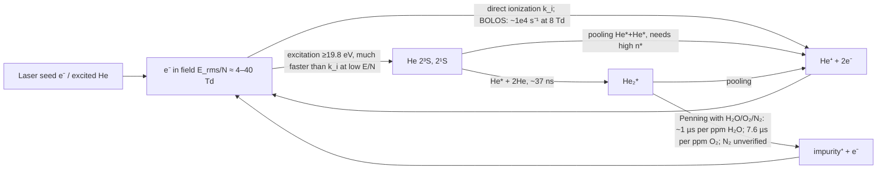

# Helium at low reduced field (≈4–40 Td): measured ionization data, Penning/impurity effects, microwave breakdown, and Technion high-pressure He work

**Purpose.** Check the pure-He BOLOS + LXCat (Biagi/Morgan) ionization rates at 4–40 Td against measured data. The application is laser-triggered 2.9 GHz breakdown of 99.999 % He at 200 psig (1.48 MPa abs.), 20–200 kV/cm peak.

**Review type.** This is a targeted starting point, not a systematic review.

**Search date.** 2026-11-21.

**Sources searched:**
- OpenAlex API (metadata and abstracts)
- Crossref and the doi.org handle API (DOI checks)
- Europe PMC REST (open full text)
- Internet Archive copy of A. V. Phelps' JILA collision-data directory
- Existing workspace reviews: [experimental-data-krasik-leopold.md](experimental-data-krasik-leopold.md), [he-rate-data-verification.md](he-rate-data-verification.md), [gas-kinetics-coefficients.md](gas-kinetics-coefficients.md)

**Access limitations (important):**
- APS (Phys. Rev.) returned HTTP 403.
- IOP PDFs (Proc. Phys. Soc., J. Phys. B, J. Phys. D) could not be parsed.
- LXCat swarm pages are behind an interactive form or turnstile.
- The archived JILA transport file (`eletrans.txt`) covers N₂, Ar, H₂, O₂ and air only, not He.
- **As a result, I could not extract any numeric measured α/N value for He from a source I opened.** All α/N statements below come from abstracts. They give the ranges measured and the qualitative conclusions, but no tabulated numbers.

Labels used throughout:
- **FT** – checked in the full text
- **ABS** – checked in the abstract only
- **META** – metadata only
- **CALC** – my own arithmetic from the cited rates
- **INF** – inference
- **UNVERIFIED** – not checked against any source

---

## 1. Operating point (CALC)

Assumptions:
- p = 1.48 MPa and T = 293 K give N = p/(k_BT) = **3.66 × 10²⁶ m⁻³** (3.66 × 10²⁰ cm⁻³; about 11 100 Torr).
- 1 ppm of impurity is 3.66 × 10²⁰ m⁻³.
- ω = 2π × 2.9 GHz = 1.82 × 10¹⁰ s⁻¹.
- At about 11 000 Torr, the electron momentum-transfer frequency in He is far above ω (INF; this is the order-of-magnitude regime in MacDonald & Brown's analyses [11,12]). Therefore E_eff ≈ E_rms, and the DC swarm data (α/N vs E/N) apply locally with E/N = E_rms/N.

| E_peak (kV/cm) | E_rms/N (Td) | E_peak/N (Td) |
|---|---|---|
| 20 | 3.9 | 5.5 |
| 30 | 5.8 | 8.2 |
| 50 | 9.7 | 13.7 |
| 100 | 19.3 | 27.3 |
| 200 | 38.6 | 54.7 |

**Required growth rates (CALC):**
- Growing from 10⁴ to 10¹² electrons takes ln(10⁸) = 18.4 e-folds.
- Doing that in 100 ns needs ν_i,net ≥ 1.8 × 10⁸ s⁻¹, i.e. k_i = ν_i/N ≥ **5 × 10⁻¹⁹ m³/s**.
- Doing it in 1 µs needs ν_i,net ≥ 1.8 × 10⁷ s⁻¹, i.e. k_i ≥ **5 × 10⁻²⁰ m³/s**.

**Your BOLOS results expressed the same way:**
- 8 Td: ν_i ≈ 10⁴ s⁻¹, so k_i ≈ 2.7 × 10⁻²³ m³/s.
- 14 Td: ν_i ≈ 10⁷ s⁻¹, so k_i ≈ 2.7 × 10⁻²⁰ m³/s.

The rate coefficient k_i(E/N) is the quantity to compare with α/N × v_d from swarm data, because both are independent of pressure.

---

## 2. Measured first Townsend coefficient α/N in pure He

### 2.1 Coverage of the measurements

| Source | E/N range measured | N or pressure | Purity / conditions | Main finding relevant here | Access |
|---|---|---|---|---|---|
| [1] Chanin & Rork 1964 | E/p₀ = 3–300 V cm⁻¹ Torr⁻¹ (≈ 8.5–850 Td) | low pressure (Torr range) | cataphoretically purified He | Agrees with [2] within combined errors. Agrees with MacCallum except at the lowest E/p₀, where MacCallum's values are lower. Dunlop's calculation is "considerably smaller" than experiment at very low E/p₀. | ABS |
| [2] Davies, Llewellyn Jones & Morgan 1962 | E/p = 6–100 V cm⁻¹ Torr⁻¹ (≈ 17–280 Td) | 3–115 Torr | spectroscopically pure He, Ag electrodes | α/p is lower than earlier values, especially at low E/p. It depends on E/p only. It agrees with calculations by Dunlop, Abdelnabi & Massey, and Phelps. | ABS |
| [3] Dutton, Hughes & Tan 1969 | 22.4–112 Td | — | He, Ne and He–Ne mixtures | In mixtures, α/N rises above the pure-Ne value, by up to about 50 % (Penning/mixture effect). | ABS |
| **[4] Dutton & Powell 1971** | **8.4–15 Td** | N = 4.4 × 10¹⁸ – 2.8 × 10¹⁹ cm⁻³ | ultra-high-vacuum system, purified He | **At fixed E/N, α/N increases as N decreases.** The results are quantitatively consistent with Penning ionization of an impurity at about **1 vpm**, judged by comparison with computed α/N. | ABS |
| [5] Dutton & Powell 1972 | low E/N | — | He from superfluid He: 0.9 vpm impurity. Cylinder He with charcoal traps and cataphoresis: 2.6 vpm. | Shows that ppm-level impurities are measurable through α/N. | ABS |
| [6] Dutton 1975 (J. Phys. Chem. Ref. Data) | survey | — | — | Critical compilation of swarm data, including rare-gas α/N tables. **This is the place to get numbers.** | ABS (Crossref) |
| [7] Ran et al. 2014 | atmospheric-pressure Townsend dielectric-barrier discharge (DBD) | 1 atm | He, N₂, air | Optical (ICCD) α at 1 atm agrees with low-pressure data at the same E/p. α is sensitive to purity. | ABS |
| [8] Talviste et al. 2023 | 40–1000 Td | 10–800 Torr | He:O₂ | Apparent α/N is compared with BOLSIG+. He metastables, via Penning ionization, affect net ionization for O₂ fractions up to 10 %. | ABS |
| [9] Alves et al. 2013 | — | — | — | Compares He cross-section sets with swarm data. | ABS/META |

### 2.2 Requested table: α/N vs E/N

**No numeric values could be verified.** Rather than give figures from memory, each row states what the measurements cover.

| E/N (Td) | Measured α/N (m²) | Which measurement covers it | Status |
|---|---|---|---|
| 5 | — | **None found.** The lowest measured E/N in the sources found is about 8.4 Td. | No data |
| 8 | — | Edge of [1] (≈ 8.5 Td) and [4] (8.4 Td). Impurity-affected and N-dependent. | Values not extracted |
| 10 | — | [1], [4] | Values not extracted |
| 15 | — | [1], [4] (upper end) | Values not extracted |
| 20 | — | [1], [2], [6] | Values not extracted |
| 30 | — | [1], [2], [3], [6] | Values not extracted |

**How to fill the table (manual step):**
- Download Dutton 1975 [6], Table "Ionization coefficients – helium", together with [1] and [4] through institutional access.
- Alternatively, use the LXCat swarm database ("Dutton" entries for He α/N; https://www.lxcat.net).
- Convert units with E/N [Td] ≈ 2.83 × E/p₀ [V cm⁻¹ Torr⁻¹] and α/N [cm²] = (α/p₀ [cm⁻¹ Torr⁻¹]) / (3.54 × 10¹⁶ cm⁻³ Torr⁻¹). Multiply by 10⁻⁴ to get m². Both conversions assume p₀ is reduced to 0 °C.

### 2.3 Are pure-He swarm rates at 5–15 Td consistent with the data? (INF)

1. **Below about 8.4 Td there is no measured α/N in the sources found**, so the BOLOS values at 4–8 Td cannot be validated directly. They are extrapolations of the cross-section set.
2. **At 8.4–15 Td the measured α/N is not pure-He α/N.**
   - Dutton & Powell [4] showed it depends on N and is enhanced by Penning ionization of about 1 vpm impurity.
   - Chanin & Rork [1] noted that the pure-He calculation of the time (Dunlop) fell "considerably" below experiment at the lowest E/p₀.
   - The measured steady-state α/N is therefore an **upper bound** on direct electron-impact α/N.
   - A pure-He Boltzmann calculation that lies *below* the measured values at 8–15 Td is **consistent** with the data. It is not evidence that the cross sections are wrong.
3. **Steady-state Townsend α and the fast-pulse growth rate measure different things.**
   - A steady-state Townsend α counts every Penning ion, however late it is produced.
   - In a breakdown lasting 100 ns – 1 µs, a delayed (metastable → Penning) ion contributes only if its formation time is short compared with the growth time.
   - At 1.48 MPa the relevant time constants are tenths of µs to µs per ppm (Section 3). The *effective* low-field ionization in your experiment therefore lies between the pure-He BOLOS value and the impurity-enhanced swarm value, and that position depends on time.
4. **Conclusion.** The BOLOS pure-He rates (≈ 10⁴ s⁻¹ at 8 Td and ≈ 10⁷ s⁻¹ at 14 Td) are not contradicted by any measurement I could access. The user-reported nominal 20–50 kV/cm breakdown range is not an independently calibrated local-field measurement. If those fields and the assumed short delay are confirmed, possible explanations include the following (INF; not established for the setup):
   - a laser-produced seed count well above 10⁴ electrons (not a density);
   - local field enhancement;
   - the peak field rather than the rms field mattering near threshold (ionization is strongly nonlinear in E/N);
   - impurity Penning or stepwise (metastable) ionization, which depends on density.

---

## 3. Impurity (Penning / Jesse) effects and timescales at 1.48 MPa

### 3.1 Rate coefficients (Schröter et al. 2018 [10], FT, Europe PMC PMC6161623; 300 K)

| Reaction | k | Units |
|---|---|---|
| He* + H₂O → H₂O⁺ + He + e | 6.08 × 10⁻¹⁶ | m³/s |
| He* + H₂O → OH⁺ + H + He + e | 1.39 × 10⁻¹⁶ | m³/s |
| He* + O₂ → O₂⁺ + He + e | 2.54 × 10⁻¹⁶ | m³/s |
| He₂* + H₂O → Penning | 2.2 × 10⁻¹⁵ | m³/s |
| He₂* + O₂ → Penning | 3.6 × 10⁻¹⁶ | m³/s |
| He* + He* → He⁺ + He + e (pooling) | 4.5 × 10⁻¹⁶ | m³/s |
| He* + He* → He₂⁺ + e | 1.05 × 10⁻¹⁵ | m³/s |
| He* + He₂* → He⁺ / He₂⁺ + … | 5 × 10⁻¹⁶ / 2 × 10⁻¹⁵ | m³/s |
| He* + 2He → He₂* + He | 2.0 × 10⁻⁴⁶ | m⁶/s |
| He* + He + H₂O → … (three-body) | 1.48 × 10⁻⁴¹ | m⁶/s |
| He* + He + O₂ → … (three-body) | 8.2 × 10⁻⁴² | m⁶/s |

Notes on the table:
- The three-body conversion rate He* + 2He agrees with the workspace check in [he-rate-data-verification.md](he-rate-data-verification.md) §4, where Saifutdinov gives about 2.8 × 10⁻⁴⁶ m⁶/s.
- **N₂, Ar, Hg: UNVERIFIED.** I opened no source giving the He(2³S) + N₂ or He₂* + N₂ Penning rate. Lindinger, Schmeltekopf & Fehsenfeld 1974 [13] measured He(2³S) quenching by N₂, O₂, Ar and others at 300–900 K, but I saw only the abstract, which has no numbers.
- Ar (ionization energy 15.76 eV) and Hg (10.44 eV) are both Penning-ionizable by He(2³S) (19.82 eV) and He₂* (about 18 eV). INF, from energetics only. No rates were verified.

### 3.2 Timescales at N = 3.66 × 10²⁶ m⁻³ (CALC)

| Process | Frequency | Time constant |
|---|---|---|
| He* → He₂* (three-body, 2 × 10⁻⁴⁶ × N²) | 2.7 × 10⁷ s⁻¹ | **≈ 37 ns** |
| He₂* + H₂O Penning, per 1 ppm | 8.1 × 10⁵ s⁻¹ | 1.2 µs |
| He₂* + O₂ Penning, per 1 ppm | 1.3 × 10⁵ s⁻¹ | 7.6 µs |
| He* + H₂O two-body, per 1 ppm | 2.7 × 10⁵ s⁻¹ | 3.7 µs (but He* is converted to He₂* first, at 37 ns) |
| He* + He + H₂O three-body, per 1 ppm (1.48 × 10⁻⁴¹ × N × n_H₂O) | ≈ 2 × 10⁶ s⁻¹ | ≈ 0.5 µs. **Unreliable:** an extrapolation of an atmospheric-pressure fit to 15 bar. |
| He₂* + H₂O, **10 ppm** | 8 × 10⁶ s⁻¹ | ≈ 0.12 µs |

**Interpretation (INF):**
- At 1.48 MPa, He(2³S) is converted to He₂* in about 40 ns, so Penning ionization of impurities runs mainly through He₂*.
- For 99.999 % He (≤ 10 ppm total impurity, with an unknown split between H₂O, O₂ and N₂), the Penning delay is roughly **0.1–1 µs or longer**. This is consistent with the simulated He₂* lifetime of 1.93 µs at 10 ppm H₂O and 1 atm in [10] (Table 2).
- The Jesse/Penning channel can therefore add ionization late in a ~1 µs window, but very little within the first ~100 ns.
- In He, excitation thresholds (≈ 19.8 eV) lie below ionization (24.6 eV), so at low E/N the excitation rate is much larger than the direct ionization rate. If even a fraction of the excitations become ions within the growth time, the effective rate can be much higher than the direct ionization rate alone (qualitative; see the Dutton & Powell observation [4]).
- Metastable pooling (He* + He*, He₂* + He₂*) is a second, density-dependent stepwise channel. It matters only once metastable densities are high, for example inside the laser-seeded volume.

---

## 4. Microwave breakdown in He (collision-dominated regime)

| Source | What it gives | Access |
|---|---|---|
| [11] MacDonald & Brown 1949, Phys. Rev. 75, 411 | Microwave breakdown fields in He, measured in cavities of various sizes over a large pressure range. Theory from a Boltzmann EEDF with no adjustable parameters agrees within a maximum error of 6 %. This is a **low-pressure (diffusion-controlled)** regime. | ABS |
| [12] MacDonald & Brown 1949, Phys. Rev. 76, 1629 | Limits of diffusion theory. Uses the similarity variables pΛ, pλ, EΛ. Correlates published data for λ = 10–17 000 cm. Identifies the uniform-field, mean-free-path and oscillation-amplitude limits. | ABS |
| [14] Herlin & Brown 1948, Phys. Rev. 74, 291 | Introduces the high-frequency ionization coefficient and relates it to DC Townsend α. Energy transfer at high pressure (ν_m ≫ ω) equals the DC case. | ABS |
| MacDonald, *Microwave Breakdown in Gases* (Wiley, 1966); "Heg" (He + Hg) data | **Not found or accessed.** I cannot confirm the Heg breakdown curves or their numbers. | UNVERIFIED |

**Implication (INF):**
- Classical MacDonald-type data are CW, diffusion-limited measurements at pressures from about 1 Torr to roughly 100 Torr.
- At 11 000 Torr with ns–µs pulses, the breakdown criterion is avalanche growth versus pulse length (Section 1), not ionization balancing diffusion.
- Following [14], the right validation quantity is the DC α/N or k_i at E_eff = E_rms.
- I found no He microwave-breakdown data at tens of bar with ns–µs pulses.

---

## 5. Technion (Krasik, Leopold, Shlapakovski, Beilin, Yatom, Bliokh, Hadas) – laser-triggered He breakdown

- **No paper found with He above ~1 MPa.**
- The closest data are the S-band compressor plasma-switch papers with He at **0.2 MPa**, summarized in detail in [experimental-data-krasik-leopold.md](experimental-data-krasik-leopold.md) §3.2. Key values:
  - calculated fields at the switch of about 16.6–22.3 kV/cm (peak vs rms not clear; ≈ 34–46 Td);
  - delay jitter ±6 to ±9 ns;
  - Stark-broadening n_e ≈ 6 × 10¹⁶ cm⁻³;
  - He breaks down at a field 5–6× lower than air.
- Other Technion and related items are listed in that file (TPS 2015 He with an unfocused beam, PoP 2016 air with a focused beam, Maksimov 2024 X-band He threshold at 1.8 × 10⁵ Pa, Krasik et al. Plasma 2025 [15] META).
- **I found no reported breakdown probability vs laser energy or focus position in He.**
- Note that 0.2 MPa at 34–46 Td is well above your 4–10 Td rms regime. Their He operating point is therefore *not* evidence of fast breakdown at < 10 Td (INF).

---

## 6. Conceptual pathway map (schematic, not to scale; time constants CALC at 1.48 MPa, 293 K)

---

## 7. Suggested validation steps

1. Get the numeric α/N(E/N) for He from Dutton 1975 [6] or LXCat (Dutton/Phelps swarm entries) at 8.4–40 Td. Convert α/N × v_d into k_i and overlay it on BOLOS (Biagi and Morgan sets).
   - Expect BOLOS ≤ measured at 8–15 Td, because of the impurity enhancement in [4].
   - Expect agreement within about 10–20 % above roughly 20 Td (INF).
2. Run BOLOS for **He + 1–10 ppm N₂/O₂/H₂O**. Pair it with a 0-D kinetics model containing He* → He₂* (37 ns) and the Penning rates in §3.1. Then compute the *time-dependent* effective growth rate over 0–1 µs and compare it with the observed delay distribution.
3. Compare both the rms-based and the peak-based E/N (Section 1 table). Near threshold, the cycle-averaged growth rate should use ⟨k_i(E(t)/N)⟩ only if energy relaxation is fast compared with 1/ω (INF; check the energy-relaxation time in BOLOS).
4. Measure or bound the actual impurity content of the cell, for example with an RGA, or from the outgassing history of the sealed cavity. Over time, outgassing can push the impurity level above the 10 ppm bottle specification.

---

## 8. Annotated bibliography

1. **A. W. Chanin and G. D. Rork**, "Experimental determinations of the first Townsend ionization coefficient in helium," *Phys. Rev.* **133**, A1005–A1009 (1964). https://doi.org/10.1103/PhysRev.133.1005 (note: the DOI has no "A"). **ABS.** Covers E/p₀ 3–300 V cm⁻¹ Torr⁻¹ in cataphoretically purified He. This is the key low-E/N dataset.
2. **D. K. Davies, F. Llewellyn Jones and C. G. Morgan**, "Primary ionization coefficient of helium," *Proc. Phys. Soc.* **80**, 898–908 (1962). https://doi.org/10.1088/0370-1328/80/4/312 **ABS.** Covers 17–280 Td at 3–115 Torr. α/p depends on E/p only.
3. **J. Dutton, M. H. Hughes and B. C. Tan**, *J. Phys. B* **2**, 890–897 (1969). https://doi.org/10.1088/0022-3700/2/8/310 **ABS.** Ionization coefficients in He, Ne and He–Ne at 22.4–112 Td.
4. **J. Dutton and D. B. Powell**, *J. Phys. B* **4**, 1506–1515 (1971). https://doi.org/10.1088/0022-3700/4/11/014 **ABS.** He at 8.4–15 Td in an ultra-high-vacuum system. α/N depends on N, consistent with Penning ionization of about 1 vpm impurity.
5. **J. Dutton and D. B. Powell**, *J. Phys. B* **5**, 1236–1240 (1972). https://doi.org/10.1088/0022-3700/5/6/025 **ABS.** Impurity levels of 0.9 vpm (He from superfluid He) and 2.6 vpm (purified cylinder He) inferred from ionization data.
6. **J. Dutton**, "A survey of electron swarm data," *J. Phys. Chem. Ref. Data* **4**, 577–856 (1975). https://doi.org/10.1063/1.555525 **ABS.** Reference compilation and the recommended source of numeric He α/N.
7. **H. Ran, H. Luo, Y. Yue and X. Wang**, *J. Phys. Soc. Jpn.* **83**, 074503 (2014). https://doi.org/10.7566/JPSJ.83.074503 **ABS.** α at 1 atm in He, N₂ and air from a Townsend DBD (optical method). Sensitive to purity.
8. **I. Talviste et al.**, *Phys. Scr.* **98**, 045613 (2023). https://doi.org/10.1088/1402-4896/acc2f8 **ABS.** He:O₂ apparent α/N at 40–1000 Td versus BOLSIG+. Penning effects of metastables.
9. **L. L. Alves et al.**, *J. Phys. D* **46**, 334002 (2013). https://doi.org/10.1088/0022-3727/46/33/334002 **ABS/META** (open-access PDF not parsable here). Comparison of He cross-section sets on LXCat against swarm data.
10. **S. Schröter et al.**, "Chemical kinetics in an atmospheric pressure helium plasma containing humidity," *Phys. Chem. Chem. Phys.* **20**, 24263 (2018). https://doi.org/10.1039/c8cp02473a (open access, PMC6161623) **FT.** Source of the Penning, pooling and three-body rates in §3.1, and of the He*/He₂* lifetimes vs H₂O (10 ppm: 2.54/1.93 µs at 1 atm; simulated).
11. **A. D. MacDonald and S. C. Brown**, "High frequency gas discharge breakdown in helium," *Phys. Rev.* **75**, 411–418 (1949). https://doi.org/10.1103/PhysRev.75.411 **ABS.**
12. **A. D. MacDonald and S. C. Brown**, "Limits for the diffusion theory of high frequency gas discharge breakdown," *Phys. Rev.* **76**, 1629–1633 (1949). https://doi.org/10.1103/PhysRev.76.1629 **ABS.**
13. **W. Lindinger, A. L. Schmeltekopf and F. C. Fehsenfeld**, *J. Chem. Phys.* **61**, 2890–2895 (1974). https://doi.org/10.1063/1.1682429 **ABS (no numbers).** He(2³S) quenching by N₂, O₂, Ar and others, 300–900 K. The N₂ rate is **UNVERIFIED** here.
14. **M. A. Herlin and S. C. Brown**, "Breakdown of a gas at microwave frequencies," *Phys. Rev.* **74**, 291–296 (1948). https://doi.org/10.1103/PhysRev.74.291 **ABS.**
15. **Ya. E. Krasik et al.**, *Plasma* **8**, 35 (2025). https://doi.org/10.3390/plasma8030035 **META** (not opened).
16. **A. D. MacDonald**, *Microwave Breakdown in Gases* (Wiley, New York, 1966). **UNVERIFIED** (not accessed; no "Heg" data checked).

Technion He (0.2 MPa) and X-band references: see the bibliography in [experimental-data-krasik-leopold.md](experimental-data-krasik-leopold.md) §8.
