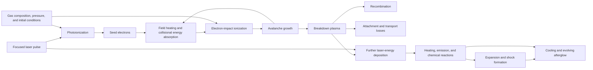
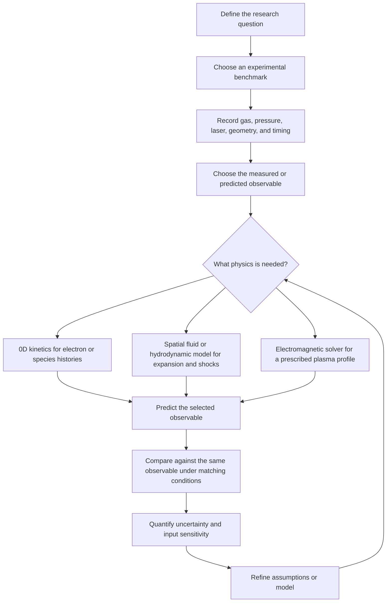

# Laser-induced plasma in gases

## Purpose and scope

The research objective is to review laser-induced plasma in gases and then develop a suitable plasma model and simulation. The initial focus is breakdown within a gas, not a plasma plume produced by ablating a solid target into an ambient gas.

This is a **targeted introductory review**, not an exhaustive or systematic review. The references were selected from targeted Crossref, publisher, Semantic Scholar, and U.S. Department of Energy Office of Scientific and Technical Information (OSTI) records on 18 November 2026. Findings below are based mainly on publication metadata and abstracts; the complete papers were not systematically reviewed. Consult the full papers before relying on specific model parameters or detailed experimental results.

No simulation has been built or run yet. The gas, pressure, laser parameters, desired observables, and software remain to be selected.

For the focused research direction involving an applied RF field inside a metallic waveguide, see [Laser-induced gas plasma in an RF waveguide](laser-induced-plasma-rf-waveguide.md).

## Physical picture

A sufficiently intense laser pulse can create free electrons by photoionization. Existing electrons can gain energy from the laser field, for example through collisional absorption, and then ionize neutral particles through electron-impact collisions. This can produce avalanche growth. Photoionization and impact ionization compete with processes that remove electrons, including recombination, transport, and electron attachment in suitable gases such as oxygen-containing mixtures [1].

The relative importance of these mechanisms is not universal. It depends on gas composition and pressure, the laser wavelength and pulse duration, focusing, initial ionization, and other experimental conditions. With femtosecond pulses, there is less time during the pulse for an avalanche to develop than with nanosecond pulses, but the importance of each mechanism remains case-dependent. Ultrafast propagation can also involve filamentation and nonlinear optical effects [3].

Once formed, the plasma may absorb more laser energy, expand, produce a shock wave, emit radiation, and cool. Its properties are time-dependent, so the laser pulse and observation window must be stated when comparing results [6-9].

### Conceptual sequence: gas breakdown and afterglow

The diagram summarizes pathways discussed in the breakdown review [1] and air-plasma studies [5-9]. It is a conceptual schematic; it does not prescribe universal rates or imply that every pathway is equally important in every gas.

### Effects of gas and laser conditions

| Factor | Relevance to a study |
| --- | --- |
| Gas composition | Changes ionization thresholds, collision processes, chemistry, and electron-loss pathways. Sircar et al. studied breakdown in argon, nitrogen, and oxygen at multiple wavelengths [2]. |
| Gas pressure | Changes neutral number density, collision rates, and the conditions for plasma expansion and cooling. |
| Pulse duration | Affects the time available for photoionization, electron heating, and avalanche growth. |
| Wavelength and focusing | Affect the photon energy and intensity distribution, among other mechanisms. |
| Initial conditions | Background electrons, gas temperature, humidity, and impurities may affect the outcome and should be recorded when relevant. |
| Diagnostic and time gate | Determine which physical quantity is observed and at what stage of the plasma evolution. |

### Breakdown and observation are not the same thing

The measured breakdown threshold depends on the chosen criterion, such as visible emission or detectable laser-energy absorption. In the ultraviolet and near-infrared air-plasma experiments of Dumitrache et al., ultraviolet absorption did not necessarily coincide with visible emission [5]. A simulation and an experiment should therefore use the same threshold definition.

## Plasma evolution and diagnostics

Laser-generated air plasmas can be out of equilibrium. Electron temperature, gas temperature, and temperatures inferred from different atomic or molecular spectra are distinct quantities and should not be assumed equal without justification [7, 10]. Harilal et al. examined changes in air-plasma spectra and species over microsecond time scales and compared measurements with equilibrium estimates [7].

In one near-atmospheric-pressure study of laser-breakdown plumes, van den Bekerom et al. used nitric oxide planar laser-induced fluorescence to obtain gas-temperature distributions. Under their conditions, the reported plume temperature remained above 1,000 K for roughly 100 microseconds and fell below 500 K by 500 microseconds [8]. These are examples from a particular experiment, not universal plasma temperatures or measurements of electron temperature.

| Observable | Possible diagnostic | Comparison caution |
| --- | --- | --- |
| Electron density | Interferometry or suitable spectral line broadening | Account for line-of-sight integration, neutral-gas effects, spectral broadening, and diagnostic assumptions. Thiyagarajan and Scharer used two-color interferometry in air [4]. |
| Gas or molecular temperature | Optical emission spectroscopy or laser-induced fluorescence | Identify the species and temperature inferred; it need not equal electron temperature [7, 8, 10]. |
| Plasma and shock-wave evolution | Imaging, shadowgraphy, or schlieren methods | Compare the same spatial feature, geometry, and time after the pulse [5, 6]. |
| Deposited and transmitted laser energy | Optical energy measurements | Match the energy definition and account for uncertainty and energy partitioning [5, 9]. |

Electron density is a local or spatially averaged quantity, whereas the total number of electrons is an integral over a volume. They cannot be compared directly without a spatial model or measured volume.

## Candidate research questions

These are starting points, not established claims of novelty:

1. How does electron-density decay in a selected gas change with pressure under a specified laser pulse and observation window?
2. How sensitive are predicted electron-density histories to uncertainty in initial seed electrons, attachment, and recombination rates?
3. For a selected measured plasma, how does a prescribed electron-density profile affect its electromagnetic response?

A practical first case is a nanosecond laser pulse in ambient air. It should be tied to a specific published experiment before assigning numerical parameters.

## Modeling and simulation roadmap

### 1. Select the benchmark

Choose a paper and record gas composition and pressure, initial gas temperature, laser wavelength, pulse duration and energy, focal geometry, detection criterion, measurement time and uncertainty. Select the observable first: for example, electron density, gas temperature, or shock position. Do not use a temperature measurement as direct validation of an electron-density prediction.

Thiyagarajan and Scharer [4] provide an example of time-resolved electron-density and neutral-density measurements in ultraviolet-induced air plasma. Dumitrache et al. [5] provide absorption and temperature measurements, while van den Bekerom et al. [8] provide later-time gas-temperature and flow observations. These experiments have different conditions and should not be treated as interchangeable.

### 2. Start with a zero-dimensional kinetic model

An illustrative electron balance is

$$
\frac{dn_e}{dt}
= S_{\mathrm{photo}}
+ \nu_{\mathrm{ion}} n_e
- \nu_{\mathrm{attach}} n_e
- L_{\mathrm{recomb}}
- L_{\mathrm{transport}} .
$$

Here $n_e$ is electron density in $\mathrm{m^{-3}}$; $S_{\mathrm{photo}}$ is a photoionization source; $\nu_{\mathrm{ion}}$ and $\nu_{\mathrm{attach}}$ are effective rates in $\mathrm{s^{-1}}$; and the $L$ terms represent electron losses per unit volume and time. The terms depend on the chosen gas and conditions. Quantitative predictions require defensible rate coefficients, initial conditions, and appropriate electron-energy and species balances; recombination generally depends on ion densities, and attachment can create negative ions.

A zero-dimensional model has no resolved spatial profile. It does not by itself predict the plasma shape, shock radius, laser propagation, or temperature. Check time-step convergence, physical bounds, and sensitivity to uncertain inputs, then compare the predicted quantity with matching experimental data.

### 3. Add spatial and electromagnetic physics only when needed

For plasma expansion or shock-wave predictions, consider a spatial fluid or hydrodynamic model with suitable energy deposition and gas dynamics. Sai Shiva et al. report a two-dimensional nanosecond air-plasma model and results over approximately 25 ns to 8 microseconds [6].

If electromagnetic response is the objective, an electromagnetic solver such as CST may be used for a prescribed plasma material or density profile, subject to the installed solver's capabilities. A prescribed material response is not, by itself, a self-consistent model of laser-driven ionization or plasma chemistry.

### Suggested modeling workflow

This workflow connects a study to evidence that can actually validate its predictions. Choose the model branch based on the requested observable; branches are alternatives, not a requirement to build a single multiphysics solver.

### Data resources

- [LXCat](https://nl.lxcat.net/instructions/categories.php) provides electron-scattering cross sections and related data from contributing databases. Cite the particular datasets used.
- [BOLSIG+](https://www.bolsig.laplace.univ-tlse.fr/) calculates electron transport and collision-rate coefficients from cross sections. Check its field, energy-distribution, and other assumptions before applying its outputs to a rapidly varying laser-driven plasma.

## Annotated references

1. **C. G. Morgan (1975).** [Laser-induced breakdown of gases](https://doi.org/10.1088/0034-4885/38/5/002). *Reports on Progress in Physics*, 38, 621-665. Foundational review of breakdown and competing ionization and loss processes.
2. **A. Sircar, R. K. Dwivedi, and R. K. Thareja (1996).** [Laser induced breakdown of Ar, N2 and O2 gases using 1.064, 0.532, 0.355 and 0.266 μm radiation](https://doi.org/10.1007/BF01831003). *Applied Physics B*, 63, 623-627. Gas and wavelength comparison; publication metadata was verified, but the full paper was not reviewed.
3. **A. Couairon and A. Mysyrowicz (2007).** [Femtosecond filamentation in transparent media](https://doi.org/10.1016/j.physrep.2006.12.005). *Physics Reports*, 441, 47-189. Review of ultrashort-pulse filamentation, including air and other media.
4. **M. Thiyagarajan and J. Scharer (2008).** [Experimental investigation of ultraviolet laser induced plasma density and temperature evolution in air](https://doi.org/10.1063/1.2952540). *Journal of Applied Physics*. Reports density diagnostics and comparison with a simplified electron-density decay model.
5. **C. Dumitrache, C. M. Limbach, and A. P. Yalin (2016).** [Threshold characteristics of ultraviolet and near infrared nanosecond laser induced plasmas](https://doi.org/10.1063/1.4963248). *Physics of Plasmas*, 23, 093515. Compares absorption, emission, temperature, and flow in air. [Accepted manuscript record](https://www.osti.gov/biblio/1468934).
6. **S. Sai Shiva et al. (2017).** [Numerical investigation of nanosecond laser induced plasma and shock wave dynamics from air using 2D hydrodynamic code](https://doi.org/10.1063/1.4997449). *Physics of Plasmas*, 24, 083110. Spatial model of plasma and shock-wave evolution.
7. **S. S. Harilal, B. E. Brumfield, and M. C. Phillips (2018).** [An evaluation of equilibrium conditions and temperature-dependent speciation in a laser-produced air plasma](https://doi.org/10.1063/1.5041987). *Physics of Plasmas*, 25, 083303. Time-resolved air-plasma spectra and equilibrium comparisons. [Accepted manuscript record](https://www.osti.gov/biblio/1491739).
8. **D. C. M. van den Bekerom, E. R. Jans, and I. V. Adamovich (2021).** [NO PLIF flow visualization and time-resolved temperature distributions in laser induced breakdown plumes](https://doi.org/10.1088/1361-6463/abf36f). *Journal of Physics D: Applied Physics*, 54, 265201. Later-time plume imaging and gas-temperature measurements. [Accepted manuscript record](https://www.osti.gov/biblio/1877134).
9. **H. Qayyum et al. (2023).** [Laser energy partitioning in nanosecond pulsed laser-induced air breakdown: effect of incident laser energy](https://doi.org/10.1364/AO.494577). *Applied Optics*. Examines deposited, transmitted, and shock-wave energy under the studied conditions.
10. **X. Zhang et al. (2025).** [Time-resolved molecular non-equilibrium spectra in nanosecond laser induced air plasma](https://doi.org/10.1088/1674-1056/ade24a). *Chinese Physics B*, 34, 094701. Analyzes time-resolved molecular spectra and non-equilibrium temperatures.
