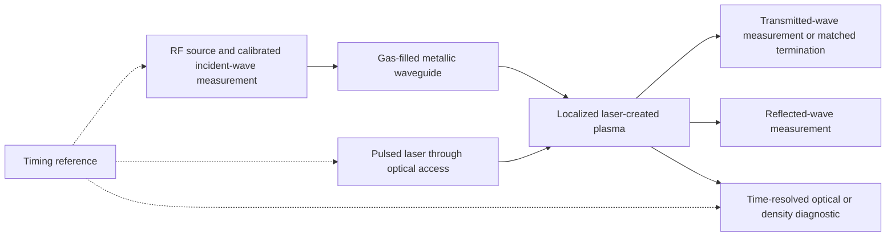
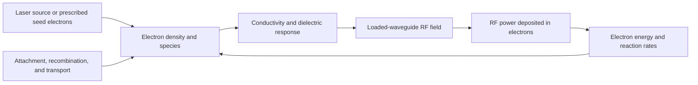

# Laser-induced gas plasma in an RF waveguide

## Research scope

**Working question:** How does a laser-created plasma in a gas interact with an RF field inside a metallic waveguide, and when does the RF field substantially change the plasma?

This extends the [introductory gas-plasma review](laser-induced-plasma-in-gases.md). The working geometry is a gas-filled metallic waveguide with optical access, not an optical waveguide or a waveguide formed by plasma filaments. Since this review was written, illustrative cavity, waveguide, prescribed-plasma, and reduced transient benchmarks have been run; see the [simulation report](rf-plasma-simulation-benchmarks.md). These are not a validated, gas-specific plasma-dynamics prediction or measured apparatus specification.

**Search date:** 18 November 2026. **Method:** targeted Crossref and OSTI searches combining laser-induced plasma, microwave enhancement, waveguide, and laser-triggered gas discharge; publisher metadata and abstracts were checked. This is not a systematic review. The directly relevant papers below were assessed at abstract/metadata level, not through a complete full-text review. An Optica full-text access attempt encountered an access challenge. Obtain the full papers before adopting their experimental details, rate coefficients, or boundary conditions.

Here RF includes microwave frequencies. A conventional hollow metallic guide must support propagation at the selected frequency; a small microwave guide cannot simply be driven at a much lower RF frequency and assumed to support the same mode [6].

## 1. Separate two research regimes

| Regime | Role of the laser | Role of the RF field | Suitable first observable |
| --- | --- | --- | --- |
| Weak-probe interaction | Creates the initial plasma | Measures scattering without appreciably changing plasma evolution | Complex reflection and transmission versus delay |
| RF-assisted plasma | Seeds or initiates a gas discharge | Changes electron energy, ionization, excitation, or plasma lifetime | Electron-density history and RF energy absorption, with independent diagnostics |

These are not interchangeable. In particular, a fixed electron-density material model answers an electromagnetic scattering question, not whether RF can sustain the plasma.

**Recommended sequence:** establish weak-probe behavior first, then test whether increasing RF drive causes a departure from that baseline. This is a proposed research strategy, not a claim that the system must pass through a sharp universal threshold.

### Conceptual configuration

The diagram is an original functional schematic, not a scale drawing or a construction plan. It separates optical triggering, RF measurement, and plasma diagnostics; actual windows, coupling, and containment require their own electromagnetic and safety assessment [1, 2].

## 2. Most relevant literature

### Direct evidence: gas discharge in a metallic waveguide

**Shlapakovski et al. (2016) [1]** studied laser triggering of a pressurized dry-air discharge in a waveguide side arm of a resonant microwave system. The abstract reports dependence on laser focusing and beam position. This is a direct geometry match to laser-created gas plasma in an RF-bearing metallic waveguide.

**Limitation:** their resonant switching system is not the same as a straight, matched two-port test section. Its performance and operating conditions should not be transferred without reproducing the geometry and discharge physics.

**Shlapakovski et al. (2015) [2]** modeled coupled plasma and electromagnetic evolution in a related waveguide/cavity system using a gas-conductivity model in MAGIC. In a laser-seeding approximation, the initial electrons were prescribed near an RF-field antinode. The reported evolution includes filament growth, field screening, and a reduction in avalanche growth as the electromagnetic field changes.

**Modeling lesson:** the field and the plasma can modify each other; imposing electron density does not predict that feedback. Prescribing seed electrons also does not simulate laser propagation or laser breakdown from first principles.

### Supporting evidence: microwave enhancement of laser-created gas plasma

**Ikeda and Soriano (2022) [3]** investigated microwave-enhanced laser-induced air plasma at atmospheric pressure. Their abstract reports enhanced emission and unequal rotational and vibrational temperatures. It also reports no corresponding microwave-induced change in the rotational-temperature history under the studied conditions and interprets the enhancement in terms of re-excitation.

**Modeling lesson:** brighter or longer-lasting emission is not, on its own, proof of a larger electron density, a hotter gas, or a conducting plasma that persists equally long. This is relevant gas-phase evidence, but the abstract alone does not establish a match to the proposed metallic-waveguide geometry.

**Ikeda and Soriano (2023) [4]** explicitly compare microwave-enhanced atmospheric air plasma and aluminum-target ablation plasma. The title and bibliographic record were verified; detailed results have not been assessed here. This is a useful full-text retrieval lead for keeping gas breakdown separate from solid ablation, not evidence for a specific result in our system.

### Related but geometrically different literature

**Alshershby et al. (2012) [5]** analyze microwave guiding by a column of laser-generated plasma filaments. The plasma forms the guiding structure, unlike plasma inserted into a metallic guide. This is relevant background but not a direct validation benchmark.

| Source | Gas-phase relevance | Metallic RF waveguide relevance | Use in this project |
| --- | --- | --- | --- |
| [1] | Laser-triggered dry-air discharge | Direct, in a resonant side-arm configuration | Experimental precedent |
| [2] | Laser ignition approximated by seed electrons | Direct coupled waveguide/cavity model | Feedback-model precedent |
| [3] | Direct laser-created air plasma | Exact geometry not established here | Diagnostics and non-equilibrium caution |
| [4] | Air plasma compared with target ablation | Not established here | Further-reading lead only |
| [5] | Laser-produced air filaments | Plasma is the guide, not its load | Related geometry; do not conflate |

## 3. Physical model for the first simulation

### Waveguide baseline

For an ideal, nearly vacuum-filled rectangular guide with broad dimension $a$, the dominant-mode cutoff is

$$
f_{c,10}=\frac{c}{2a}.
$$

Select frequency and dimensions so that the intended incident mode propagates, and check higher-mode cutoffs [6]. For the empty-guide TE10 mode with width coordinate $x$ and propagation direction $z$, the transverse electric-field magnitude varies as $\sin(\pi x/a)$, with its width maximum at $x=a/2$. This does not imply a longitudinal antinode in a pure traveling wave: longitudinal standing-wave maxima require reflections or a resonant structure. Loading and optical-access features can alter the field.

### Collisional plasma response

As an initial electromagnetic approximation, assume an unmagnetized, isotropic plasma with prescribed electron density $n_e$ and effective momentum-transfer collision rate $\nu_m$. With phasors proportional to $e^{-i\omega t}$, the electron momentum equation gives

$$
\sigma(\omega)=\frac{n_e e^2}{m_e(\nu_m-i\omega)}, \qquad
\omega_p^2=\frac{n_e e^2}{\epsilon_0m_e},
$$

$$
\epsilon_r(\omega)=1-\frac{\omega_p^2}{\omega(\omega+i\nu_m)}.
$$

These are the elementary collisional Drude relations, stated here as a model assumption rather than a fit to any cited experiment. The neutral/background relative permittivity is approximated as one, ions are taken as immobile on the RF cycle, and density is held fixed during each solve. Check the solver's phasor and damping conventions rather than copying the imaginary-part sign blindly. $\omega$, $\omega_p$, and $\nu_m$ have units of inverse seconds; $\omega=2\pi f$, while $\nu_m$ is a collision rate, not an ordinary frequency that should automatically be multiplied by $2\pi$.

For a peak-amplitude electric-field phasor, the cycle-averaged local absorbed power density is

$$
q_{\mathrm{RF}}=\frac{1}{2}\operatorname{Re}(\sigma)|E|^2
=\frac{n_e e^2\nu_m}{2m_e(\nu_m^2+\omega^2)}|E|^2.
$$

This expression exposes why both electron density and collision rate matter, and why incident power is not the same as absorbed plasma power. In a loaded guide, the local $E$ must be solved rather than assumed independent of density.

The collisionless bulk critical-density condition $\omega_p=\omega$ is not a universal switching or sustainment criterion for a finite plasma inside a waveguide. Geometry, collision losses, field overlap, and waveguide cutoff also matter. Likewise, a negative real permittivity does not by itself specify the measured transmission of a short, partially filled test section.

### RF-assisted evolution

If RF appreciably changes the plasma, add electron-energy and species balances to the electromagnetic solution. An illustrative continuity equation is

$$
\frac{\partial n_e}{\partial t}+\nabla\cdot\Gamma_e
=S_{\mathrm{laser}}+k_{\mathrm{ion}}n_eN-L_{\mathrm{attach}}-L_{\mathrm{recomb}}.
$$

Here $N$ is neutral number density, $\Gamma_e$ is electron flux, and the loss terms are volumetric rates. The ionization coefficient depends on an appropriate electron-energy distribution; it is not determined by the RF frequency alone. Include $q_{\mathrm{RF}}$ in the electron-energy balance, relevant collision data and chemistry, and boundary losses. This equation is not a complete solver. In a 0D model, transport and wall losses require a justified closure.

The feedback diagram is conceptual. It summarizes the coupled behavior reported in [2], not a universal statement that RF always increases density.

## 4. Recommended simulation and validation sequence

1. **Empty and gas-only guide:** validate cutoff, modal field, phase, port normalization, and conductor/dielectric losses. Include any gas-cell walls or optical windows that materially affect the RF field. Use mode-aware waveguide ports and a controlled termination.
2. **Prescribed plasma:** introduce a localized volume with a justified shape; sweep density, collision rate, position, dimensions, and orientation relative to the field. Record complex reflection and transmission, fields, and absorbed power. This is the appropriate first electromagnetic study in CST, subject to confirming the installed material model and solver support.
3. **Delay-dependent snapshots:** use measured or independently modeled $n_e(\mathbf r,t)$ and $\nu_m(\mathbf r,t)$. Snapshots are only justified if evolution is slow compared with both the RF cycle and the relevant electromagnetic settling time. They are separate stationary solves, not a time-varying-material simulation.
4. **RF-assisted model:** couple absorbed power to kinetics when weak-probe behavior no longer holds. Recompute the field as conductivity changes. Do not claim that a static Drude sweep predicts ignition or lifetime. A kinetic/fluid solver or a verified coupling workflow may be needed beyond a standard electromagnetic material definition.

**Validation controls:** compare gas-only, laser-only, RF-only, and combined cases where experimentally feasible. Use synchronized RF amplitude/phase and independent plasma diagnostics. Resolve detector response and timing jitter before attributing a transient to plasma kinetics.

**Power balance:** for a stationary passive model with one normalized incident mode, sum reflected and transmitted powers over all propagating modes, plus conductor/dielectric/plasma dissipation and any radiation channels. The shortcut $1-|S_{11}|^2-|S_{21}|^2$ represents plasma absorption only if other channels and losses are absent or independently removed. A time-varying plasma may exchange energy with its drive and generate sidebands, so stationary carrier S-parameters need not close that energy balance.

**Parameter identification:** attenuation alone generally cannot identify density and collision rate uniquely when geometry is uncertain. Use complex RF data, frequency dependence where possible, and independent constraints on density or plasma dimensions.

## 5. Proposed first research question and remaining inputs

**First study:** "How do a localized laser-created plasma's density, collisionality, position, and orientation control complex RF transmission and reflection in a single-mode metallic waveguide?"

**Follow-on study:** "Under what conditions does RF deposition measurably alter the decay or re-excitation of the laser-created plasma?"

These questions are proposed scope, not established novelty claims. Start with a defined gas and a well-characterized plasma profile rather than assuming a laser pulse energy uniquely fixes electron density.

Before creating a numerical geometry, establish:

- Waveguide type and internal dimensions; straight test section or resonant structure.
- RF frequency, mode, incident power, pulse duration, and RF/laser delay.
- Gas composition, pressure, temperature, flow, and enclosure.
- Laser wavelength, pulse duration, energy, focus, access direction, and intended plasma shape.
- Primary objective: RF probing, plasma sustainment, or a controlled change in transmission.
- Available diagnostics, numerical tools, and validation data.

Any physical experiment also needs institutional assessment of laser exposure, RF leakage/reflection, gas containment, and reactive byproducts. This review is not an operating procedure.

## References and evidence access

1. **A. Shlapakovski, S. Gorev, and Ya. E. Krasik (2016).** [Improved operation of a microwave pulse compressor with a laser-triggered high-pressure gas plasma switch](https://doi.org/10.1063/1.4960981). *Physics of Plasmas*, 23. [OSTI abstract and metadata](https://www.osti.gov/biblio/22599933). Direct experimental precedent; full paper not assessed.
2. **A. S. Shlapakovski et al. (2015).** [Self-consistent evolution of plasma discharge and electromagnetic fields in a microwave pulse compressor](https://doi.org/10.1063/1.4926819). *Physics of Plasmas*, 22, 073111. [OSTI abstract and metadata](https://www.osti.gov/biblio/22490985). Direct coupled-model precedent; full paper not assessed.
3. **Y. Ikeda and J. K. Soriano (2022).** [Microwave-enhanced laser-induced air plasma at atmospheric pressure](https://doi.org/10.1364/OE.470072). *Optics Express*, 30(19), starting page 33756. Crossref metadata and deposited abstract assessed; publisher full text not accessed.
4. **Y. Ikeda and J. K. Soriano (2023).** [Analysis of the characteristics of microwave-enhanced laser-induced atmospheric air plasma and ablation plasma for Al target](https://doi.org/10.1016/j.talo.2022.100172). *Talanta Open*. Metadata-only lead; no detailed findings inferred.
5. **M. Alshershby et al. (2012).** [Analysis of microwave leaky modes propagating through laser plasma filaments column waveguide](https://doi.org/10.1063/1.4771595). *Physics of Plasmas*, 19, 123504. [OSTI abstract and metadata](https://www.osti.gov/biblio/22072666). Different guiding geometry; full paper not assessed.
6. **M. Steer.** [Rectangular Waveguide](https://eng.libretexts.org/Bookshelves/Electrical_Engineering/Electronics/Microwave_and_RF_Design_II_-_Transmission_Lines_%28Steer%29/06%3A_Waveguides/6.04%3A_Rectangular_Waveguide), in *Microwave and RF Design II: Transmission Lines*, Engineering LibreTexts. Open textbook section consulted for waveguide modes and cutoff; not a laser-plasma experiment.
