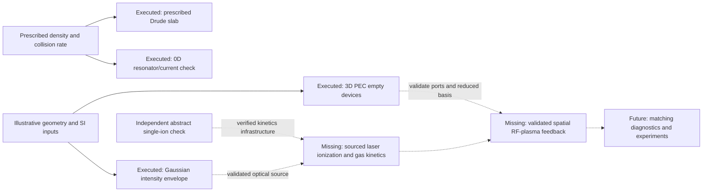

# Laser-plasma RF cavity and waveguide: simulation benchmarks

## Status and scope

**Partial numerical benchmarks have been run here.** The follow-up
self-consistent 3D laser-plasma simulation is reported in
[coupled-3d-rf-laser-plasma-simulation.md](coupled-3d-rf-laser-plasma-simulation.md).
It adds gas-specific kinetics, PPT laser ionization and resolved 3D plasma
feedback. This document's statements about what is "missing" refer to the
openEMS benchmarks below.

The 3D electromagnetic models use perfect electric
conductor (PEC) walls. Copper losses are estimated separately for idealized
reference geometries, not modeled in the 3D cavity or transition. No
experimental comparison is available.

The [simulation project](../simulations/rf_plasma/README.md) contains the
inputs, code, tests, saved results, and reproducible Windows commands. The
[RF-waveguide review](laser-induced-plasma-rf-waveguide.md) provides the
literature context; its dry-air experiment and coupled model are not validation
data for these illustrative He, N2, or Ar cases.

### Actual and intended model links

This original schematic separates executed benchmarks from the missing
scientific coupling. It is not a scale drawing or an experimental result.

## Illustrative inputs

| Quantity | Value or treatment |
| --- | --- |
| Gas and pressure | Planned separately for He, N2, and Ar at 100 psig. With 1 atm ambient and 300 K assumed, this is 0.7908 MPa absolute and an ideal-gas density of 1.909e26 m^-3. The 3D solves use a vacuum background approximation, not gas-specific permittivities. |
| RF | 3 GHz; 10 MV/m peak empty-device focus field is an illustrative normalization, not a loaded field or measured source setting. Its ideal peak E/N is about 52 Td. |
| Cavity | WR-284, 72.136 mm by 34.036 mm; ideal closed length 69.27 mm. The separate through-guide cavity has illustrative 45 mm iris openings. |
| Transition | 90 mm circular guide, 100 mm circular-to-WR-284 taper. The circular TE11 and TM01 cutoffs are approximately 1.952 and 2.550 GHz; both TE11 polarizations and TM01 propagate at 3 GHz. |
| Laser | 532 nm, 1 mJ at focus, 300 ps or 3 ns Gaussian intensity FWHM; illustrative 20 micrometre 1/e^2 waist with a 10–50 micrometre sensitivity scan. |
| Copper | Illustrative conductivity 5.8e7 S/m, relative permeability 1. All executed 3D device walls are PEC. |

These are study assumptions, not an approved device design or experimental
operating procedure. Window transmission, window geometry, cavity coupling,
actual gas properties, pulse shape, source waveform, and timing are unknown.

## 1. Empty electromagnetic references

The official openEMS rectangular-waveguide example at about 24 GHz gives
reflection amplitude 0.00289, modal power sum 1.000027, and a 0.58% impedance
error. This checks the local solver installation, not the experimental device.

| Test at nominal 3 GHz | Result | Interpretation |
| --- | --- | --- |
| Straight WR-284 PEC guide, 2 mm mesh | TE10 cutoff 2.078 GHz analytically; \|S11\| = 0.00181; same-mode power sum 1.000002; transmission phase error 0.00190 rad | Numerical empty-guide reference in a TE10-only analysis band. |
| Closed PEC cavity, 2 mm mesh | 2.999618 GHz simulated versus 3.000098 GHz analytical; relative error 0.016% | The ideal isolated cavity agrees in frequency; it has no apertures or wall loss. |
| Iris-coupled PEC cavity | Transmission peak changes from 2.592 to 2.586 GHz between 3 and 2 mm; \|S11\| at 3 GHz changes by 0.0141 | This is an illustrative coupled geometry, not the ideal closed cavity. Half-power points were not both bracketed, so no loaded Q is reported. |
| Circular straight guide, 3 mm Cartesian mesh | Same-mode power sums are 0.999740, 0.999794, and 1.000497 for TE11-0, TE11-90, and TM01 | Useful single-mode controls; cross-mode normalization and the custom TM01 port still require independent validation. |

*The field map is an executed 2 mm-grid simulation. The bright region at the
input does not define the focus calibration; the iris edges and boundary fields
are mesh dependent.*

The 2 mm iris-cavity run gives an approximately calibrated numerical incident
power of 116 MW to reach the illustrative focus value, based on a matching
straight-guide correction. Port normalization still differs from the
analytical guide benchmark by several percent, and the iris geometry and RF
frequency are not measured. This number is a solver diagnostic, **not** a
power-source specification.

### Copper is not PEC

For ideal smooth copper at 3 GHz, the analytical good-conductor estimates are
1.207 micrometre skin depth, 0.0195 dB/m TE10 straight-guide power attenuation,
and an isolated TE101 cavity copper Q of approximately 14,364. The attenuation
and Q expressions were checked against numerical integrations of the
corresponding ideal wall fields. They do **not** include iris currents, curved
taper walls, roughness, joints, dielectric/window loss, or measured conductivity.
They must not be used as if the executed 3D PEC device had finite wall loss.

The [documented openEMS conducting-sheet property](https://docs.openems.de/en/latest/python/CSXCAD/CSProperties/CSPropConductingSheet.html)
is for thin 2D sheets; it is not automatically a validated thick-copper
boundary. A [proposed 3D lossy-metal extension](https://github.com/thliebig/openEMS/pull/242)
is an open development pull request, not a capability assumed available in the
installed release. Any future 3D copper implementation needs a guide-attenuation
or cavity-Q benchmark first.

## 2. Prescribed plasma and optical envelope

The full-cross-section, 12 mm slab uses **prescribed test values**
`n_e = 1e17 m^-3` and collision rate `nu = 2e10 s^-1`; it is not a predicted
plasma for any gas. At 1 mm mesh the simulated \|S11\| and \|S21\| are 0.26661
and 0.76947, compared with analytical TE10 slab values 0.25036 and 0.78621.
The absolute errors are 0.01624 and 0.01674; refining from 1.5 to 1 mm changes
each amplitude by less than 0.008. The zero-density control recovers the empty
guide. This tests a static Drude implementation, not laser breakdown, plasma
shape, or self-consistent screening.

*The dashed line is a 0.02 absolute slab-amplitude tolerance. The taper panel
changes both grid spacing and staircase representation; it does not establish
complete multimode convergence.*

*The energy-normalized optical envelope integrates to the specified focal
energy. For 20 micrometre waist, its ideal Rayleigh length is 2.36 mm and its
300 ps peak intensity is about 4.98e11 W/cm^2. The 3 ns peak is ten times
smaller for the same focal energy and waist. These are ideal optical
intensities, not plasma density, deposited energy, or a damage assessment.*
The illustrative 20 micrometre waist is 50 times smaller than a 1 mm RF grid
spacing, so the existing 3D meshes do not resolve a plasma filament at that
scale. A spatially resolved source and mesh-independence study are required
before drawing conclusions about local screening.

## 3. Exploratory taper and multimode checks

At nominal 3 GHz, the TE11-90 input \|S11\| is 0.07568 for 3 mm/20 slices,
0.05726 for 2 mm/20 slices, and 0.06557 for 2 mm/40 slices. Thus the raw
reflection changes by 0.0184 and 0.0083 respectively, but the result is not
monotonic and does not by itself prove full taper convergence.

A separate 2 mm/20-slice forward/reverse check compares circular TE11-90 and
rectangular TE10. The raw power-wave magnitudes are 0.99117 and 1.00646,
respectively, an absolute reciprocity difference of 0.0153; the complex
amplitude difference is also 0.0153. Independent node-interpolated E/H
integrals differ between the two cross sections by about 1.1%, and the
rectangular-side flux differs from the corresponding modal net power by
approximately 3.2%. Refining to 1.5 mm/40 slices reduces the direct flux
imbalance to 0.67–0.69% and the complex reciprocity difference to 0.0119, but
the raw modal power-sum errors remain 1.09–1.12% and the rectangular flux/modal
discrepancy remains 2.35%. At 1 mm/40 slices, the forward \|S11\| is 0.05316,
raw modal power-sum errors fall to 0.79–0.81%, E/H flux imbalance to 0.41–0.47%,
and complex reciprocity difference to 0.00866. However, the independent
rectangular flux still differs from its modal net power by **1.56%**, exceeding
the 1% diagnostic target in both directions. These are numerical discrepancies,
not a physical gain or plasma loss. Additional mode calibration, flux
convergence, and reciprocity checks are necessary before treating the taper as
validated.
The [openEMS 0.37 mode-matching implementation](https://raw.githubusercontent.com/thliebig/openEMS/v0.37.0/Common/processmodematch.cpp)
normalizes each template on the discrete mesh, so agreement of raw modal
voltages alone is not an independent power calibration.

*The first two diagnostics meet the illustrated target at 1 mm; the
rectangular flux/modal discrepancy does not. The 2 mm point also uses a
different slice count, so not every change isolates mesh spacing.*

## 4. Prescribed-density transient and reaction check

The 0D resonator demonstration retains a time-resolved Drude current and
prescribes a density rise from 1e15 to 1e22 m^-3, with collision rate
2e11 s^-1 and assumed external Q values of 400. These are numerical test
inputs, not gas-derived rates. For both 300 ps and 3 ns cases, the maximum
integrated energy residual is below 1.6e-8 of initial stored plus incident
energy. Tests also compare timestep refinement and the steady Drude heating
limit.

*The plotted density is imposed, not calculated from the laser. The initially
prefilled resonator can release stored energy, so incident energy alone is not
the complete energy denominator. Birth mixing tracks dilution of electron
drift energy when electrons are added at rest; excitation, ionization energy,
gas heating, charge transport, and spatial screening are not modeled.*

An independent closed, single-ion reaction benchmark matches analytic
photoionization, recombination, and impact-ionization limits while conserving
charged-particle and neutral counts. Its externally supplied coefficients are abstract
verification inputs; it is not a He, N2, or Ar network and is not coupled to
the transient resonator.

## 5. Verification and what remains

The Python suite contains 28 passing tests covering units, Gaussian-energy
normalization, analytical waveguides and copper integrals, Drude passivity,
reaction limits, and reduced-current energy conservation. The
[saved partial-check summary](../simulations/rf_plasma/results/validation/benchmark-status/benchmark-summary.json)
records 22 selected baseline comparisons that pass their illustrative
thresholds and explicitly records the two failing 1 mm taper flux/modal
checks. Passing the selected checks is not equivalent to satisfying all
requested physics or all acceptance gates.

To reach a defensible simulation of the requested system:

1. Supply measured cavity and taper geometry, optical window, gas conditions,
   RF source/delay, and matching diagnostics; validate a copper-wall model.
2. Obtain attributable, applicable He, N2, and Ar electron-collision and
   reaction data and separately justify the laser-ionization and energy
   deposition models. [LXCat's redistribution policy](https://us.lxcat.net/instructions/redistribution.php)
   requires users to obtain and properly reference contributor data; no
   cross-section dataset has been copied into this project.
3. Finish power-normalized circular multimode scattering and reciprocity,
   including both polarizations and TM01, flux closure, and refinement.
4. Couple a validated laser source, species/electron-energy model, and the
   evolving RF field with charge and energy conservation. Validate any
   reduced model against 3D cases before relying on it; include spatial
   screening and transport when required.
5. Only then run the two geometries by three gases by two pulse durations,
   with laser-only, RF-only, combined, and numerical control cases and
   uncertainty/experimental comparisons.

The illustrative field, pulsed laser, and pressurized gases require independent
institutional laser, RF, electrical, gas, and pressure-vessel safety assessment.
