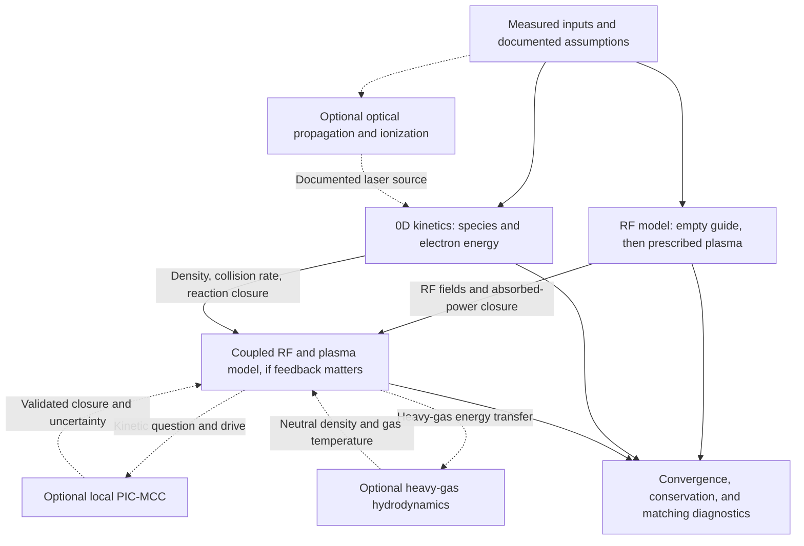

# Open-source simulation agents for laser-induced gas plasma

## Scope and status

Seven physics-agent profiles support the [RF-waveguide research](laser-induced-plasma-rf-waveguide.md). They complement the existing Academic Literature Researcher and the user's existing CST agent; the CST agent is not duplicated or modified.

**These are agent instructions, not installed simulation packages or completed simulations.** No backend was installed and no physics calculation was run as part of creating these profiles. Frontmatter and local links can be checked statically; discovery and execution in the VS Code agent picker require a separate runtime check.

Subsequent work installed a project-local openEMS environment and ran partial
benchmarks; see the [simulation report](rf-plasma-simulation-benchmarks.md).
The profiles themselves still do not guarantee package availability or complete
the coupled plasma simulation.

This is a tool-selection and workflow guide, not a systematic literature review. Backend capabilities were checked against the official documentation and source repositories listed below. Recheck APIs, platform support, and licenses for the version selected when implementing a model.

## Choose an agent

| Agent profile | Starting open-source backend | Main question and outputs | Important limit |
| --- | --- | --- | --- |
| [Open-Source RF Simulation Engineer](../.github/agents/open-source-rf-simulation.agent.md) | Meep, Python | How does a prescribed plasma scatter RF? Complex modal S-parameters, fields, power accounting. | Does not predict plasma creation or sustainment. |
| [Plasma Kinetics Engineer](../.github/agents/plasma-kinetics.agent.md) | Python, SciPy; optional BOLOS | How do species and electron energy evolve? Density, energy, collision-rate histories. | A 0D model has no resolved filament or sheath geometry. |
| [Coupled RF-Plasma Engineer](../.github/agents/coupled-rf-plasma.agent.md) | Custom Meep/kinetics coupling; optional FiPy or MOOSE/Zapdos | Does RF heating change conductivity and then the field? Feedback, deposition, density evolution. | Coupling is numerical development, not an assumed built-in feature. |
| [Plasma PIC Engineer](../.github/agents/plasma-pic.agent.md) | WarpX with supported MCC | Are nonlocal distributions or sheath kinetics important? Distribution functions and particle/energy fluxes. | Dense, collisional full-device PIC may be prohibitively expensive; chemistry support must be checked. |
| [Plasma Hydrodynamics Engineer](../.github/agents/plasma-hydrodynamics.agent.md) | Clawpack/PyClaw | Does gas heating/expansion matter? Neutral density, pressure, temperature, shocks. | Compressible Euler alone is not plasma chemistry or non-equilibrium thermodynamics. |
| [Laser Propagation Engineer](../.github/agents/laser-propagation.agent.md) | Luna.jl, Julia | Where does an applicable ultrafast pulse create electrons? Optical fields and ionization-source/density maps. | Optical-guide capabilities do not imply metallic RF-guide modeling or nanosecond avalanche physics. |
| [Collisional-Radiative Plasma Engineer](../.github/agents/collisional-radiative-plasma.agent.md) | Python, SciPy/Numba; verified state-resolved atomic data | How do charge states, superelastic exchange and photon trapping change RF response? Species, atomic/electron/photon energy and radiation escape. | Requires level-specific data and a justified radiation reduction; a small network is not complete atomic physics. |

For departmental compute infrastructure, use the [HPC Farm Engineer](../.github/agents/hpc-farm.agent.md). This profile complements the seven physics specialists; selecting it does not connect to the farm or start a job.

### Specialist scientific reviewers

Three additional read-only AI profiles use doctoral-level review standards. They
are not human professors and do not claim academic credentials. Creating their
files does not by itself prove discovery in the VS Code agent picker.

| Reviewer | Main checks |
| --- | --- |
| [Plasma Physics Reviewer](../.github/agents/plasma-physics-reviewer.agent.md) | Chemistry, PIC statistics, gas expansion, radiation, particle and energy conservation. |
| [RF Physics Reviewer](../.github/agents/rf-physics-reviewer.agent.md) | Maxwell-plasma coupling, geometry, peak/RMS fields, cavity calibration and RF diagnostics. |
| [Optical Physics Reviewer](../.github/agents/optical-physics-reviewer.agent.md) | Laser normalization and propagation, seed assumptions, emission and visual interpretation. |

Each reviewer returns an evidence-based scope decision and severity-ranked
findings. A successful numerical run is not experimental validation.
All three performed initial and final read-only AI reviews of the
[restricted RF/optics/PIC/afterglow study](standing-wave-helium-plasma-reflector.md).
Their final acceptance is limited to that exploratory scope, with unconverged
velocity peaks explicitly retained. The PIC drift/work checks that first
failed were traced to snapshot sampling noise and a net-work normalization;
the rerun with WarpX reduced diagnostics passes them at unchanged thresholds.

### Recommended order

1. **Start with RF simulation:** validate an empty guide, then a prescribed collisional Drude plasma. This defines measurable scattering without claiming to explain how the plasma forms.
2. **Add kinetics:** calculate laser-only and prescribed-RF histories with sourced reaction data. Map a 0D result into the RF model only through an explicit spatial assumption.
3. **Add feedback only if needed:** couple RF deposition and plasma evolution when the RF materially changes the plasma. Check timescale separation before using frozen snapshots.
4. **Use the other three selectively:** PIC for a kinetic closure problem; hydrodynamics when heavy-gas motion matters; laser propagation when an uncertain optical source dominates the result. They are not mandatory steps in one monolithic simulation.
5. **Resolve atomic states when needed:** use the Collisional-Radiative Plasma Engineer for multiple charge states, superelastic exchange or radiation trapping. A restricted demonstration and a validated dense-gas mechanism are different deliverables; see the [standing-wave gas-sheet example](standing-wave-helium-plasma-reflector.md).

### Conceptual data-exchange map

This original workflow schematic shows model interfaces, not an experimentally established time sequence. Solid links are a proposed baseline workflow; dashed links are optional refinements. Backend capabilities are supported by [1-7]; the physical rationale and evidence limits are discussed in the [focused review](laser-induced-plasma-rf-waveguide.md).

The optical source must be counted only once. The coupled model internally exchanges conductivity/density and RF deposition; the diagram does not imply a built-in coupling interface between these packages.

## Shared requirements for all physics agents

These are persistent working requirements referenced by every profile.

- **Bound the question.** Read the existing reviews and any simulation code before adding a new solver. Record what is measured, prescribed, solved, or omitted. Do not guess missing experimental values: use explicitly labeled example parameters for demonstrations and do not present them as the user's experiment.
- **Check software before installation.** Verify the current version's API, license, platform support, and examples. Prefer open-source backends; do not replace them with CST or another proprietary dependency by default. Software licenses and cross-section/data licenses are separate.
- **Respect the host.** Use isolated project environments and explicit dependency specifications when implementation is requested. Do not install software just to inspect a profile, enable WSL, change system settings, consume cloud resources, or launch large production jobs without appropriate user authorization. Inspect existing environments first. Expose errors and unmet dependencies.
- **Handle Windows honestly.** Verify a supported execution route. Meep's documented Conda binaries do not run in native Windows; an available, authorized Linux/WSL environment may be needed [1]. Do not assume WSL exists or that an unrelated PyPI package named `meep` is the electromagnetic solver. PyClaw may require compiled Riemann solvers [5].
- **Preserve units and conventions.** Use SI at interfaces unless explicitly documented otherwise. Define axes, time origin, spatial averaging, normalization, peak versus RMS fields, and exp(-i omega t) versus exp(+i omega t). Keep electron density, total particle count, electron temperature, and gas temperature distinct.
- **Validate the actual observable.** Begin with a small analytic or published benchmark, then test grid/timestep/tolerance or particle-number convergence as appropriate. Define numerical acceptance thresholds before production runs. Report numerical errors, conservation residuals, and uncertainty. A successful process exit is not physical validation; agreement with another unvalidated code is not an experiment.
- **Make results reproducible.** When asked to implement/run, save the input/configuration, minimal driver, dependency versions, data citations, exact commands, boundary/initial conditions, solver settings, and random seeds where relevant. Keep raw numerical outputs with units and metadata. Do not overwrite unrelated work or silently substitute fabricated rates/results.
- **Include useful visuals.** Research reports belong in `literature` unless requested otherwise. Include a relevant geometry/workflow diagram and, after calculations, labeled plots of the requested observable and validation/convergence. Label conceptual schematics, illustrative data, and actual simulation results distinctly; cite sources near literature-derived claims.
- **Report execution status precisely.** Separate proposed, implemented, executed, converged, and experimentally validated work. If the software is unavailable, state that explicitly rather than generating success-shaped outputs.
- **Keep responsibilities separate.** Use the existing CST agent only for an explicitly requested CST task. Recommend another specialist when the physics leaves your scope, but do not automatically spawn agents or install their tools.

## How to use

Open the workspace in VS Code and select a profile by its `name` in the agent picker if it is discovered by the installed version. If it is not shown, reload the window and check VS Code's current custom-agent discovery documentation/settings. The definitions are stored in the standard `.github/agents` location; picker availability is not asserted here.

Example requests:

- **RF:** "Build a minimal empty rectangular-guide Meep case, then a prescribed Drude-plasma case. Use labeled illustrative dimensions if needed, document SI conversions, and validate cutoff and power balance before any sweep."
- **Kinetics:** "Build a sourced 0D afterglow model for my selected gas and pressure. First list the experimental inputs still needed; validate attachment and recombination limits before adding RF heating."
- **Coupled:** "Review the validated RF and kinetics cases, assess RF-cycle and settling times, then implement the simplest justified energy-conserving coupling."
- **PIC:** "Estimate the cost of a local kinetic test before building a WarpX case. Identify which requested collision processes the selected version actually supports."
- **Hydrodynamics:** "Use the supplied gas-deposition profile to model expansion. Verify source-energy normalization and a shock-tube benchmark before interpreting results."
- **Laser:** "Assess whether Luna.jl fits the specified pulse regime, then export a documented ionization source for kinetics without claiming to model the RF device."
- **Collisional-radiative:** "Build a state-resolved helium network with sequential ionization, detailed-balance superelastic exchange and a conservative reduced radiation operator. Identify missing dense-gas channels before coupling it to RF."

Selecting a profile does not install its backend. Profile creation and the research guide are the deliverables at this stage.

## Backend sources

1. **Meep:** [source and GPL-2.0 license](https://github.com/NanoComp/meep), [Drude/dispersive materials](https://meep.readthedocs.io/en/latest/Materials/), and [installation/platform support](https://meep.readthedocs.io/en/latest/Installation/). Supports electromagnetic FDTD and dispersive material models; evolving gas chemistry is a separate problem.
2. **SciPy:** [solve_ivp documentation](https://docs.scipy.org/doc/scipy/reference/generated/scipy.integrate.solve_ivp.html). Includes BDF and Radau for stiff ODEs; reactions, rates, and closure must be supplied.
3. **BOLOS:** [source and project description](https://github.com/aluque/bolos). Describes an LGPLv2 Python electron Boltzmann solver with an algorithm related to BOLSIG+. Verify modern environment compatibility. BOLSIG+ is not treated as an open-source dependency here.
4. **WarpX:** [algorithms](https://warpx.readthedocs.io/en/latest/theory/intro.html), [collision documentation](https://warpx.readthedocs.io/en/latest/theory/multiphysics/collisions.html), and [MCC benchmark](https://warpx.readthedocs.io/en/latest/usage/examples/capacitive_discharge/README.html). Background MCC uses a fixed thermal neutral reservoir; documented channels do not amount to a complete arbitrary-gas chemistry package.
5. **Clawpack/PyClaw:** [capabilities and examples](https://www.clawpack.org/pyclaw/), [open-source status and BSD-style license](https://www.clawpack.org/pyclaw/about.html). Provides hyperbolic PDE solvers and compressible-flow examples, not automatic plasma thermochemistry.
6. **Luna.jl:** [source and MIT license](https://github.com/LupoLab/Luna.jl), [documentation](https://lupo-lab.com/Luna.jl). Supports nonlinear optical propagation and photoionization/plasma effects for applicable pulse models and geometries.
7. **Spatial fluid options:** [FiPy documentation](https://pages.nist.gov/fipy/en/stable/) describes a finite-volume PDE framework; [Zapdos source and LGPL-2.1 license](https://github.com/shannon-lab/zapdos) identifies a MOOSE plasma application. Neither reference establishes an out-of-the-box Meep/metallic-waveguide coupling.

For research evidence rather than software capability, start with the citations and access limitations in the [RF-waveguide review](laser-induced-plasma-rf-waveguide.md) and [introductory gas-plasma review](laser-induced-plasma-in-gases.md).
