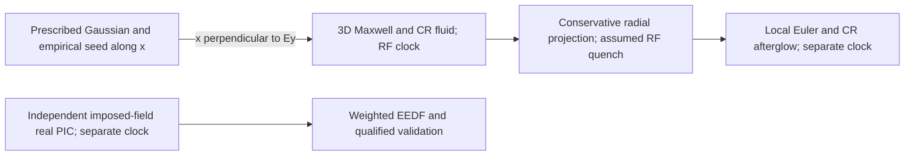

# Dynamic standing-wave cavity and an ionized-helium reflector

## New RF, optics, gas-expansion, emission and real-PIC dynamics study

**Status: implemented and executed, with explicitly limited validation.**
The [interactive dynamics viewer](../simulations/rf_plasma/results/dynamics/dynamics.html)
shows three distinct calculations. It does not claim a full-device PIC
simulation, a measured seed source, calibrated optical emission, or complete
experimental validation. The public viewer is at
[RF/optics/plasma dynamics](https://emaguidetal.github.io/plasma-viewer/dynamics/).

### What is solved, and what is assumed

| Stage | Solved | Prescribed or omitted |
|---|---|---|
| Short cavity RF window | 3D transient Yee Maxwell fields, Drude current, bulk helium CR species/electron energy and exact heavy-gas energy transfer | 1-mm grid; no diffusion in this restricted driver; gas is isochoric during the 18-ns RF window |
| Focal optics and seed | Number-conserving bulk-grid insertion; displayed Gaussian intensity versus position/time | Vacuum Gaussian, not a propagated optical solution; empirical saturated sixth-order seed; sub-grid attenuation/refraction unverified |
| Local RF-off afterglow | Cylindrical HLL finite-volume Euler gas expansion/compression, advected plasma species, electron pressure/compression work, CR chemistry and energy sinks | Axisymmetric conservative projection; assumed RF quench at handoff; no continued 5-us drive, drift diffusion, conduction, wall echoes or full 3D flow |
| Radiation | Lumped resonance/excimer power and separately accumulated modeled radiative energy | Fixed-radius Holstein escape reduction, unverified excimer rate; not line-resolved radiation transport |
| Visible continuum | Conditional 400-700 nm optically thin Maxwellian free-free estimate | Constant Gaunt factor 1.2; diagnostic only, not an extra sink or calibrated camera signal |
| Local PIC | Actual WarpX 1D3V PIC/MCC particles, weighted EEDF and electron-count histories | Separate imposed sinusoidal field, fixed thermal neutral reservoir, dilute seed; not the cavity solution or dense-gas chemistry |

The implemented interfaces are in
[cavity_dynamics.py](../simulations/rf_plasma/src/rf_plasma/cavity_dynamics.py),
[gas_dynamics.py](../simulations/rf_plasma/src/rf_plasma/gas_dynamics.py),
[radial_afterglow.py](../simulations/rf_plasma/src/rf_plasma/radial_afterglow.py)
and [radiation_diagnostics.py](../simulations/rf_plasma/src/rf_plasma/radiation_diagnostics.py).
Reaction sources and verification flags are carried in the run metadata;
the continuum formula uses Rybicki & Lightman (1979), Eq. 5.15b, converted to SI.



This is a **model-interface schematic**, not a measured discharge sequence.
The PIC run is not driven by exported time-dependent cavity fields.


**Inputs.** He at 200 psig = 1,480,276.4 Pa absolute and 300 K; RF at
2.95037 GHz; empty-cavity focus peak targets 50 and 200 kV/cm.
The example laser is 532 nm, 0.75 mJ, 1 ns intensity FWHM, with an **assumed**
20-um waist. Its Gaussian peak power is 0.705 MW, peak intensity
1.121e15 W/m2 and Rayleigh range 2.36 mm. It propagates along x, perpendicular
to Ey; it is not the earlier longitudinal conducting-wire surrogate.

The saturated seed contains 2,948.2 **expected** electrons. Its unsaturated
reference amplitude is 1e17 m^-3 at 1 mJ, while the saturated reference
on-axis density is 9.99955e15 m^-3; these are not interchangeable. The
Gaussian-CDF injection time profile is empirical, not a derived multiphoton
rate. This is a different seed assumption from the older unsaturated
probability scans below.

The saved prefill RF clock is retained: offset 114.007 ns, laser at 2 ns of
the short continuation, source-phase convention sin(2*pi*f*t), laser-center
source phase 1.65544 rad. This is not a simulation of the measured 4.9-us
laser timing or its unknown RF phase. The viewer exports every-step focus
probes (1.887 ps); maps average approximately 2 mm and sample approximately
98 ps. Maps alone give only about 3.5 frames per carrier cycle. Cases share
RF/density/UV color scales with numerical legends; optical z is a signed
transverse coordinate, not a radial coordinate.


### Actual results and numerical checks

| Quantity at the end of the short RF window | 50 kV/cm | 200 kV/cm, single-step coupling |
|---|---:|---:|
| Total fluid electrons | 4.62e3 | 3.98e14 |
| Net field-to-plasma work, integral J dot E | 7.19e-13 J | 2.097e-2 J |
| Electron/chemistry-to-heavy-gas heat | 4.32e-13 J | 1.517e-2 J |

The laser seed energy is 1.185e-14 J and is separately booked. Net J dot E
work is not automatically irreversible absorption. Material-weighted edge
work reaches only occupied kinetic nodes; edge-to-kinetic discrepancies
are below 7e-17 J. The plasma energy ledger closes to approximately 2e-15
relative. Ground-state neutrals are distinguished from total helium nuclei,
and species exceeding the available nuclei are rejected.

**RF coupling refinement:** blocks of 4, 2 and 1 FDTD steps were run.
The focus-field waveform NRMSE decreases from 6.82% (4 versus 2) to 3.93%
(2 versus 1); the one-step case is the displayed strong-field case. This is
coupling refinement, not a completed spatial/timestep convergence proof.
The primary RF energy/flux diagnostic residual is 5.91e-4 J, about 0.75%
of initial field energy and 2.82% of plasma work. It uses staggered fields
and approximate flux quadrature, so it is not an exact discrete identity.
The empty continuation has a 0.677% field-energy residual with **exactly
zero seed, electron production and plasma work**. Consequently the very
weak 50-kV/cm plasma loading is below this RF diagnostic's resolution.
The existing matched-guide Drude reference still passes:
|S11| 0.25104 versus 0.25074 analytical, |S21| 0.78636 versus 0.78590.

**Local gas study:** the strong-case handoff is at 18.001 ns; the subsequent
1-us afterglow assumes RF is quenched. Its maximum gas temperature is
327.82 K. Maximum velocities are 33.87, 39.00 and 44.63 m/s at 160, 320 and
640 radial cells. The last refinement changes the peak by **12.6%**, so
the peak is **not mesh-converged**. The final pressure-perturbation weighted
L1 difference is 4.13%. Halving the source-splitting limit changes the
160-cell peak by 1.44%; changing the assumed trapping radius from 5 to
10 mm changes modeled radiative energy by 0.17%, not a validation of either
the rates or geometry.

Mass errors are about 1e-16 relative; strong-case excess-energy ledger
errors are below 1e-13 relative. The 50-kV/cm gas perturbation is below
the conservative floating-point resolution bound against ambient gas
energy; its tiny computed velocity is **not resolved physical motion**.
At 160 cells the strong-case modeled radiation is 0.01074 J per metre of
beam, while the **total sink is 0.05850 J/m**. The difference is unresolved
recombination-energy disposal, not a predicted photon signal.

**Shock validation, separately:** the dimensionless Sod benchmark
(gamma = 1.4, not this helium experiment) converges in shock-position
error from 0.002069 at 200 cells to 0.000819 at 400 cells. The pressure
plateau is 0.303037 versus 0.303130 exact; mass/energy residuals are at
roundoff. Computed helium gas speeds are subsonic; this alone does not
determine a front's Mach number. No converged shock-speed or jump-condition
validation is claimed for the helium example.


**Software verification:** 88 existing/focused tests passed, including
sparse edge-work deposition, accepted kinetic work, neutral inventory,
composition-consistent gas-energy handoff, electron compression work,
explicit kinetic substep exhaustion, denormal continuum diagnostics,
uniform cylindrical equilibrium and the existing RF regressions.
The [machine-readable refinement results](../simulations/rf_plasma/results/dynamics/validation.json)
retain failures and scope limits, not just passed checks.

### Real PIC diagnostics: qualified agreement, not full validation

The [PIC execution guide](../simulations/pic/DYNAMICS_README.md) and
[executed report](../simulations/pic/results/dynamics_validation/20261121T111757Z_6804/REPORT.md)
document the real local calculations. There are 65 frames per run; the
viewer displays a fixed sample of up to 200 initial macroparticle IDs,
retaining survivors without newborn replacement. The full weighted EEDF
and count histories include newborn electrons. Particle weights are
counts per m2 transverse area, not full 3D particle totals.

| Imposed RF peak | PIC cycle mean energy | Fluid mean-energy NRMSE | Fluid drift NRMSE (phase windows) | Electron energy-budget residual | Final multiplication | Ionization events |
|---|---:|---:|---:|---:|---:|---:|
| 50 kV/cm | 5.769 eV | 5.06% | 8.15% | +1.39% | 1.020 | 40 |
| 100 kV/cm | 7.169 eV | 3.80% | 6.04% | -2.54% | 2.1185 | 2,237 |

The runs cover two RF periods, not the 18-ns cavity evolution. Halving
dt (2 to 1 fs), doubling initial macroparticles (2,000 to 4,000), and
changing the random seed give last-cycle sensitivities of 1.29%, 1.27%
and 1.36% in mean energy (limit 10%) and 4.69%, 3.87% and 4.53% in drift
(limit 15%). Energy-budget residuals for all five RF cases lie between
-5.4% and +1.7% (limit 10%). Acceleration/collision-relaxation checks pass;
histogram normalization errors are about 2e-16, with zero particle
escape/overflow and zero charge-accounting residual.

**How the earlier drift/work failures were resolved.** A first suite
(run `20261121T095936Z_13652`) reported drift NRMSE 0.28-0.47 and large
work residuals. Both were diagnostic defects, not physics:
(1) it compared single 65-frame snapshots of the 2,000-macro mean v_z,
whose standard error (v_th/sqrt(N) ~ 2e4 m/s) is ~30% of the drift
amplitude, so two independent runs differ by ~0.3 x sqrt(2) ~ 0.44 by
construction; (2) it normalized the energy residual by the *net*
(work minus collisional losses), a near-zero difference in quasi-steady
state. The rerun records WarpX `ParticleMomentum`/`ParticleEnergy`/
`ParticleNumber` totals every 20 steps, averages drift in fixed 1/32-period
RF phase windows (~265 decorrelated samples each), computes field work
from step-resolved total momentum, and normalizes the budget by gross
field work. Thresholds were not relaxed; seeds, particle counts and
time steps are unchanged, and the ionization counts reproduce exactly.

**Remaining limits:** collision sinks in the energy budget are EEDF-expected
values (frame EEDF x tabulated sigma), not per-event MCC tallies, so the
budget confirms consistency to a few percent rather than exact
conservation. At 50 kV/cm only 40 ionization events occur:
the one-sided 95% effective-rate upper bound is 3.807e7 s^-1, not a
validated low-field ionization rate. Grid/domain, sheath, impurity and
dense-plasma validation remain absent. Agreement using shared cross-section
data is not independent experimental validation.


### Specialist AI reviews and resolved defects

Three requested read-only profiles use doctoral-level scientific review
standards: [Plasma Physics Reviewer](../.github/agents/plasma-physics-reviewer.agent.md),
[RF Physics Reviewer](../.github/agents/rf-physics-reviewer.agent.md) and
[Optical Physics Reviewer](../.github/agents/optical-physics-reviewer.agent.md).
They are AI agents, not human professors or holders of academic credentials.

Their initial reviews found substantive defects, not just presentation issues:

| Review | Corrected implementation or claim | Remaining qualification |
|---|---|---|
| Plasma | Ground-neutral argument, nuclei guards, exact heavy-gas energy handoff, explicit kinetic exhaustion, radiative versus unresolved sink, denormal diagnostic arithmetic | Local assumed-quench flow; uncertain CR escape/rates; unconverged peak velocity; PIC energy budget uses EEDF-expected (not per-event) collision sinks |
| RF | Population-weighted conservative edge work, unsupported-current guard, independent work ledgers, phase/dense probe exports, coupling refinement, shared scales | Approximate staggered RF budget; unresolved weak loading; no full spatial-convergence or measured-field claim |
| Optics | Accurate Gaussian peak/units, saturated-reference labels, signed transverse coordinate, fixed-ID PIC labels, removal of physical attenuation/refraction validation claim | Prescribed optics and empirical seed; no resolved visible spectrum or camera prediction |

All three final AI re-reviews returned **acceptable within stated scope**
with no remaining blocking defect in this active pipeline. They inspected
source, tests and saved metrics; they did not independently rerun the tests
or browser playback. The parent execution supplied those checks.

One medium legacy limitation remains outside the new path:
`plasma3d_cr.bulk_update_cr` still adds heat using the new particle heat
capacity rather than evolving composition-consistent gas internal energy.
Do not reuse that older caller for conservative heavy-gas predictions
before correcting it. The new `advance_cells` path does not use that update.
The review does not retroactively validate earlier gas-temperature results.

The earlier 3.91x illustrative fit is **not applied** to these RF/PIC runs
and is not evidence of measured local field enhancement. None of these
additions settles the unknown experimental seed, actual impurity mixture,
or the low-field discrepancy.

### Laser orientation relative to the RF field, in 3D (perpendicular vs parallel)

- **[3D orientation viewer](../simulations/rf_plasma/results/dynamics/orientation3d.html)**
  ([online](https://emaguidetal.github.io/plasma-viewer/dynamics/orientation3d.html)):
  - two orbitable 3D cavity views with E arrows and the laser line;
  - front views of the focus plane, matching slide 9 of the Magid et al. talk;
  - electron density along each laser line, and time histories.
- Data: [orientation_metrics.json](../simulations/rf_plasma/results/dynamics/orientation_metrics.json).
- Code: [orientation_visuals.py](../simulations/rf_plasma/src/rf_plasma/orientation_visuals.py)
  and `cavity_dynamics.py --laser-axis {x,y}`.

**Geometry.** WR-284 has a = 72.14 mm along x (broad wall) and b = 34.04 mm along y (narrow gap).
- In TE10 the RF field points only along y, across the short gap between the two broad walls.
  It varies as sin(πx/a), so it is largest at mid-width.
- In the experiment (Magid, Hadas, Zorkin, Elkabets, Ginzburg, Cohen, Leopold & Krasik, IPSTA
  talk, slides 9 and 13):
  - the laser enters through the narrow side walls and crosses the guide along x, so it is
    **perpendicular** to E;
  - the plasma appears as a rod along E that bridges the two broad walls;
  - the camera looks down through the broad wall.
- The cavity dynamics model above and the breakdown-probability model use this perpendicular
  geometry.
- The `coupled3d` laser-trigger runs and the axisymmetric `streamer2d` model below put the laser
  along y, **parallel** to E (as in the parallel-beam variant of Yatom et al. 2016).
- The earlier dynamics map showed Ey in the x–z plane, so E pointed out of the screen; this made
  the two geometries hard to tell apart.

**Matched runs.** Both geometries use the same model:
- He at 200 psig, 0.75 mJ, 1 ns, 20 µm waist;
- an 18 ns RF window and a 1 mm mesh;
- the same seed kernel and coupling.

Only the laser axis changes.

| 200 kV/cm empty-cavity focus peak | Perpendicular (experiment) | Parallel |
|---|---|---|
| Injected seed electrons | 2,948 | 2,952 |
| Final electrons | 3.98e14 | 1.11e14 |
| Peak ne on the laser line | 8.2e21 m⁻³ | 3.5e23 m⁻³ |
| Line ne reaches 1e19 / 1e21 m⁻³ | 2.85 / 3.34 ns | 2.85 / 3.34 ns |
| Ionized length (ne ≥ 1e19 m⁻³) at the end | 37 mm along x | 33 mm, the full gap wall to wall |
| Max \|Ey\| in focus plane / empty-cavity peak | 1.78 (357 kV/cm at 3.6 ns) | 3.97 (795 kV/cm at 4.0 ns) |
| Late focus field / pre-laser | 0.115 | 0.151 |
| Net RF work on the plasma | 0.021 J | 0.079 J |
| Gas heating | 0.015 J | 0.031 J |

At 50 kV/cm neither geometry breaks down: final electrons are 4,730 (perpendicular) and 4,752
(parallel). The seed is confined to about ±5 mm around the focus, where the field is the same in
both cases.

**Interpretation**
- **Parallel beam.** The beam itself ionizes a conducting rod across the gap. That rod shorts the
  field across the gap and absorbs about 4× more RF energy. The field at its ends rises to about
  4× the empty-cavity value.
- **Perpendicular beam.** The beam ionizes a line along x. The field along that line, and so the
  plasma, falls off as sin(πx/a) away from the centre. In the experiment the reflecting rod must
  then grow along E from the laser line to the broad walls.
  - This 3D model cannot show that growth: plasma develops only on laser-seeded nodes, and there
    is no drift, diffusion or streamer transport.
  - The axisymmetric channel-growth model (below) covers the growth separately.
- The two geometries reach 1e19 and 1e21 m⁻³ at the same times. This means the avalanche
  starts at the focus in both, so the axis does not change the onset. Yatom 2016 reported plasma a
  few ns earlier with a parallel beam; this mesh does not resolve a difference of that size.
- The field enhancement is limited by the 1 mm mesh, which cannot resolve sub-mm channel tips.
  Treat it as a lower bound.


## Breakdown probability vs laser energy and focus position (He 200 psig, laser ⟂ E)

**Experimental observations to explain**
- With large RF fields, changing the laser energy does not change whether breakdown happens.
- At peak cavity fields of 20–50 kV/cm, raising the laser energy raises the breakdown probability from about 70 % to 100 %. The laser energy also changes the delay.
- Moving the focus along the beam axis (up to about 10 mm) moves the probability from 0 to 100 %.
- The laser with the RF off makes no visible plasma.
- Conditions: 99.999 % He at 1.48 MPa absolute; 0.5–1 mJ, 1 ns, 532 nm pulse focused by an f = 150 mm lens; the laser fires at 4.9 µs of a 5 µs RF pulse.

**Model** ([breakdown_probability.py](../simulations/rf_plasma/src/rf_plasma/breakdown_probability.py), tests in [test_breakdown_probability.py](../simulations/rf_plasma/tests/test_breakdown_probability.py))
- **Laser seed.**
  - The seed density scales as I^k with k = 6. An optional saturation density is available but is not used in these runs.
  - The beam is Gaussian with w0 = 20 µm, so the Rayleigh range z_R = 2.4 mm.
  - The seed is normalised to 1e16 m⁻³ on axis at the focus for 1 mJ. This gives 33, 380 and 2100 seed electrons for 0.5, 0.75 and 1 mJ.
- **RF field along the beam.** The field follows the cavity mode profile along the beam line. The analytic profile agrees with the 3D cavity prefill field to within 2 % over ±15 mm.
- **Field timing.** The field stays constant until the RF pulse ends 100 ns after the laser. It then rings down with τ = 2Q_L/ω = 36 ns, using Q_L = 331 from the 3D cavity calibration.
- **Avalanche.** The electron growth rate is the pure-He Boltzmann ionization rate at the effective RF field (BOLOS with LXCat cross sections). There is no attachment.
- **Breakdown condition.** Breakdown happens when the sum of seed × e^(∫ν dt) over the beam line reaches N_br = 1e12 electrons.
- **Shot-to-shot fluctuations.**
  - Magnetron power: 2 % rms.
  - Laser energy: 3 % rms.
  - Poisson statistics for the number of seed electrons.
  - Yule (Furry) statistics for the avalanche.
- 400 shots per point. Data are in `results/breakdown_probability/breakdown_probability.json`.


**Result 1: with the computed pure-He rates, the model breaks down only above about 70 kV/cm, not at 20–50 kV/cm.**
- At 1.48 MPa, 20–50 kV/cm peak is only E_rms/N ≈ 4–10 Td.
- There, ν_iz is between 0.05 and 1e7 s⁻¹, so the avalanche cannot grow from about 1e3 electrons to 1e12 within about 100 ns plus ring-down.
- The model's threshold is between 60 and 80 kV/cm; at 80 kV/cm the delay is 77–92 ns.
- An **illustrative 3.91x field multiplier** was fitted to an assumed P = 0.7 for 0.5 mJ at 20 kV/cm. This is not a measured calibration and does not prove that electrons see a larger local field; it can compensate for errors in the seed, rates, timing or breakdown criterion.
- The literature check is in [helium-low-field-ionization-data.md](helium-low-field-ionization-data.md):
  - No accessible numerical measured helium alpha/N values below 8.4 Td were found in the examined sources. This does not establish that no measurements exist.
  - Between 8.4 and 15 Td the measured values are raised by about 1 ppm of impurity through Penning ionization.
  - Penning ionization through He₂* at 1.48 MPa takes about 0.1–1 µs at 1–10 ppm, too slow to drive a 100 ns avalanche.
- The model-observation discrepancy remains unresolved. Possible explanations (not ranked or established by this fit):
  1. The calculated cavity field (from power and Q) underestimates the local field, for example through field enhancement near the plasma or the window, or an error in the Q used.
  2. The breakdown window is longer than 100 ns + 36 ns. This happens if Q_L is larger or if the laser timing relative to the RF is different.
  3. An unknown low-E/N ionization channel, such as stepwise ionization through He metastables made by the laser or by impurities.

**Result 2: with the illustrative field rescaling, the model shows the reported trends qualitatively; this is not experimental validation.**
- **Laser energy matters only near threshold.**
  - At nominal 20 kV/cm (illustratively rescaled), P = 0.70, 0.99 and 1.00 for 0.5, 0.75 and 1 mJ.
  - At ≥ 25 kV/cm, P = 1 for every energy.
  - The energy also shortens the delay (101 → 86 ns at 20 kV/cm; about 3 ns at 50 kV/cm). Both match the reported behaviour.
- **Focus position: P drops from 1 to 0 within about ±5–8 mm (about 2–3 z_R).**
  - The total seed hardly depends on where the focus is. What matters is that a defocused beam puts the electrons where the cavity field is a few percent lower.
  - Near threshold ν_iz(E) is very steep, so this small drop in field is enough.
  - This matches the observed "0 to 100 %" effect at about 10 mm.
  - Far above threshold (30–50 kV/cm calibrated), the focus has no effect, as observed for large fields.
- **Laser with RF off:** the seed is about 1e3 electrons, which is invisible. This is consistent with the observation.
- **Disagreement in the width of the 70→100 % band.** The model's band is narrow (about 15–25 kV/cm after calibration), while the experiment spans 20–50 kV/cm. Possible reasons:
  - larger shot-to-shot spread than assumed (power or timing);
  - a less steep low-field ionization rate than the pure-He Boltzmann table.

  With 5 % power jitter the probabilities become 0.55, 0.86 and 0.94.
- **Delays below about 1 ns at high calibrated fields are not physical.** They come from applying the 3.9× factor everywhere; the 3D model limits them through field collapse.

**Sensitivity** (illustratively rescaled, nominal 20 kV/cm; P for 0.5 / 0.75 / 1 mJ; last column is P with the focus 10 mm off-centre at 0.75 mJ)

| Change | P(0.5 / 0.75 / 1 mJ) | P at focus +10 mm |
|---|---|---|
| Baseline | 0.70 / 0.99 / 1.00 | 0.00 |
| τ = 10 ns | 0.41 / 0.96 / 1.00 | 0.00 |
| τ = 200 ns | 1.00 / 1.00 / 1.00 | 0.26 |
| k = 4 | 0.98 / 1.00 / 1.00 | 0.02 |
| k = 8 | 0.20 / 0.94 / 1.00 | 0.00 |
| Seed ×1e-4 (1e12 m⁻³) | 0.00 / 0.00 / 0.01 | 0.00 |
| Seed ×1e4 (1e20 m⁻³) | 1.00 / 1.00 / 1.00 | 1.00 |
| w0 = 10 µm | 0.08 / 0.66 / 0.96 | 0.00 |
| w0 = 30 µm | 0.95 / 1.00 / 1.00 | 0.23 |
| N_br = 1e13 | 0.14 / 0.77 / 0.98 | 0.00 |
| Power jitter 5 % | 0.55 / 0.86 / 0.94 | 0.01 |

**What would settle the open questions**
- A measured breakdown threshold with no laser (RF only, long pulse) at 200 psig. This would calibrate the field factor directly.
- The breakdown delay vs laser energy at a fixed field.
- The input beam diameter, which fixes w0. The width of P vs focus scales as about z_R.

Reproduce: `python -c "from rf_plasma.breakdown_probability import main; main(n_shots=400)"` from `simulations/rf_plasma` with `PYTHONPATH=src` (about 20 min).

## Parameter scans and comparison with the Technion helium experiments

- **[Interactive scan explorer (scans.html)](../simulations/rf_plasma/results/coupled3d/figures_scan/scans.html)**
  is also online at <https://emaguidetal.github.io/plasma-viewer/scans.html>. It has:
  - a p × E map with a metric selector (click a cell to plot that run);
  - multi-run histories of |Γ|, n_e, r50, Te and N;
  - the comparison with experiment;
  - all the figures;
  - a table of every run.
- Data: [scan_summary.json](../simulations/rf_plasma/results/coupled3d/figures_scan/scan_summary.json),
  [table of all runs](<../simulations/rf_plasma/results/coupled3d/table_scan_pE+scan_laser+anchor+conv.csv>),
  [exp_compare.md](../simulations/rf_plasma/results/coupled3d/figures_scan/exp_compare.md).
- All numbers below are solver output: coupled 3D FDTD + bulk kinetics + sub-cell laser filament.
  The guide is a matched WR-284 at 2.95 GHz. The cavity anchors use the Beilin et al. 2015 / Yatom
  et al. 2016 conditions: He 0.2 MPa, 16.6 and 22.3 kV/cm.
- All 44 analysed runs report filament energy closure ≤ 1.9 × 10⁻¹² and bulk closure 0.

### 1. Fixes to what limited the earlier results

1. **Seed floor removed.** The earlier runs had a hidden uniform background seed. It produced
   breakdown without the laser and set a floor on the delay. The seed is now only the laser seed: a
   localized k-order model, N0 ∝ `laser_seed_m3`, with N0 ≈ 3.2 × 10¹⁰ electrons for the nominal
   pulse. The no-laser control stays dark.
2. **Filament energy leak fixed.** In `_fil_diffuse_cr`, near-empty rings with a capped Te produced
   a zero pivot or leaked 0.3–1.3 % of the energy at high field. Rings below `FIL_CNT_MIN` are now
   zeroed, Te is capped only in the transport coefficients, and each face flux is limited by the
   donor ring. Closure is now exact (10⁻¹⁴–10⁻¹²).
3. **Cavity delay metrics added.** In the cavity, `delay03` (|Γ| > 0.3) is meaningless because
   |Γ| ≈ 1 with no plasma. Two new metrics replace it:
   - `t_Ecollapse`: the focus field falls below half its pre-laser value;
   - `t_Nhalf`: the electron number reaches half its final value.
4. **Run naming fixed.** `scan_runner --tag` had replaced the auto run name. Runs differing only in
   E then wrote to one directory, and the later run overwrote the earlier one. The tag is now
   appended, and the affected anchors were rerun.

### 2. Random seed electrons and jitter


- **Seed number (3D guide, 100 psig, 80 kV/cm).** N0 = 10⁶, 10⁸ and 10¹⁰ give delays of 9.0, 6.6
  and 4.8 ns. The slope is close to the 0D avalanche value −1/ν_iz, which is 0.54 ns per e-fold.
  A 100× change in N0 therefore moves breakdown by only about 2 ns at this field. At weak fields
  the shift is much larger.
- **Random seeds and jitter (0D Monte Carlo, `stochastic_seed`).** The Monte Carlo includes:
  - Poisson seed and avalanche (Yule) statistics;
  - laser-energy, magnetron-power and trigger fluctuations;
  - natural background ionization.

  Results with the weak seed that the 3D anchors need (N0 = 10⁵,
  [anchor_weakseed.json](../simulations/rf_plasma/results/stochastic_seed/anchor_weakseed.json),
  [jitter_sensitivity.png](../simulations/rf_plasma/results/stochastic_seed/jitter_sensitivity.png)):

  | σ_P (magnetron power) | 16.6 kV/cm | 22.3 kV/cm |
  |---|---|---|
  | 5 % | ±7 ns | ±2.4 ns |
  | 10 % | ±15 ns | ±4.6 ns |
  | Measured | ±9 ns | ±6 ns |

  - The model reproduces the larger jitter at the lower field and its order of magnitude.
  - At 22.3 kV/cm it underestimates the jitter, which suggests another source, such as
    laser-pointing or seed-position fluctuations.
  - Laser-energy noise (3 %) matters little because the seed enters only through ln N0.

### 3. Channel growth


- **3D sub-cell filament.**
  - The half-electron radius r50 grows from the 20 µm laser core to 45–100 µm by the end of the
    runs.
  - It is largest near threshold (90–99 µm at 22–31 Td), where the avalanche has more time to
    spread before the field collapses.
  - Channel heating in the 20 µm core reaches Tg ≈ 1–3 × 10⁵ K. This is a known overestimate of a
    thin, unexpanded core; read it as qualitative.
- **2D axisymmetric streamer.** The channel axis lies along E, so it describes the rod that bridges
  the broad walls; the seed is the parallel-geometry laser line. This model has
  photoionization-free ionization-front propagation along E ([radius/length](../simulations/rf_plasma/results/streamer2d/figures/radius_length_vs_time.png),
  [diameter vs measured](../simulations/rf_plasma/results/streamer2d/figures/diameter_vs_measured.png)).
  - The diameter is 0.15–0.21 mm at 10 ns.
  - The front speed is 4.5–7 × 10⁵ m/s at 22.3 kV/cm and about 1 × 10⁵ m/s at 16.6 kV/cm.
  - The measured values are for air: diameter 0.2–0.6 mm and front speed about 5 × 10⁵ m/s. No
    helium diameter has been published.

### 4–5. Comparison with the Krasik / Leopold (Yohanan) experiments and other data

| Quantity | Measured | Model | Comment |
|---|---|---|---|
| Delay difference, 16.6 vs 22.3 kV/cm (He 0.2 MPa) | +30 ± 15 ns [Beilin 2015] | nominal seed (N0 3 × 10¹⁰): 0.7 ns; N0 10⁸: 8.2 ns; **N0 10⁵: 31.3 ns; wide weak beam (N0 8 × 10⁵): 36.7 ns** | Only a weak seed, N0 ≲ 10⁶, reproduces the measurement |
| Delay jitter | ±6 ns (22.3), ±9 ns (16.6) | ±2–5 ns (22.3), ±7–15 ns (16.6) for σ_P 5–10 % | Order and trend right; the 22.3 kV/cm jitter is low |
| Channel n_e (He) | 6 × 10²² m⁻³ (Stark) [Yatom 2016] | wide beam: peak axis 4.4 × 10²² (22.3 kV/cm); 20 µm core: up to 3 × 10²⁴ | The wide (unfocused) case matches; a 20 µm core is denser than the chord-averaged Stark value |
| Channel diameter | 0.2–0.6 mm (air) | 3D r50 45–100 µm; wide beam 210–270 µm; 2D streamer 0.15–0.21 mm | Consistent order; no helium data |
| Ionization-front speed | 5 × 10⁵ m/s (air) | 2D: 4.5–7 × 10⁵ (22.3), about 1 × 10⁵ (16.6) m/s | Consistent order |
| Focused laser along E [Shlapakovski 2016] | delay < 1 ns | 1–4 ns at ≥ 75 Td, 20 µm focus, strong seed | Qualitative: a strong local seed gives a short delay |

**The key result is that the seed sets the field dependence.**

- With the nominal focused seed (3 × 10¹⁰ electrons), the field collapses 6–7 ns after the laser at
  both fields. Their difference is below 1 ns, far below the measured 30 ns.
- The experiment used an unfocused 50 mJ beam, which deposits few electrons in helium. Runs with a
  weak seed reproduce the measured delay difference:
  - a 400 µm, 50 mJ beam with a linear seed of 10¹⁴ m⁻³ (N0 ≈ 8 × 10⁵): 24 ns at 22.3 kV/cm and
    61 ns at 16.6 kV/cm, a difference of **37 ns**;
  - a 20 µm focus with N0 = 10⁵: 21 and 52 ns, a difference of **31 ns**.
- The wide beam also gives a peak n_e of 4.4 × 10²² m⁻³ at 22.3 kV/cm, close to the Stark value of
  6 × 10²² m⁻³.
- The 0D surrogate gives the right trend but is about 20 ns too high for weak seeds. In 3D the field
  already collapses when about 10¹² electrons have formed, not 2.5 × 10¹³, because the plasma
  detunes the cavity.

### 6. Laser focus, pulse length and energy (guide, 100 psig, 80 kV/cm)


| Varied | Values | Delay to \|Γ\| > 0.3 (ns) |
|---|---|---|
| Waist, 1 mJ 1 ns | 20 / 50 / 100 / 200 µm | 6.6 / 10.9 / 13.5 / 16.2 |
| Pulse FWHM, 1 mJ, w 20 µm | 0.5 / 1 / 2 ns | 5.1 / 6.6 / 8.5 |
| Pulse FWHM, 1 mJ, w 100 µm | 0.5 / 1 / 2 ns | 12.2 / 13.5 / 14.9 |
| Energy, w 20 µm | 0.5 / 1 mJ | 8.8 / 6.6 |
| Seed order k, w 100 µm | 6 / 3 | 13.5 / 9.0 |

- A tighter focus and a shorter pulse both raise the peak intensity. The k-order seed then
  produces more electrons and breakdown comes earlier.
- A wider waist gives a thicker, cooler channel. Tg falls from 1.7 × 10⁵ K to 3 × 10⁴ K.
- The reflection reached at the end, |Γ| ≈ 0.39–0.44, depends little on the laser.
- In pure He, 532 nm multiphoton ionization is negligible, so the real seed comes from impurities
  or the windows. k and N0 are therefore model parameters, not measured values.

### 7. Pressure and electric field (guide, 50–250 psig, 40–200 kV/cm, 1 mJ 1 ns w 20 µm)


- **Threshold.** There is no breakdown within 15–25 ns at E/N ≤ 21 Td:
  - 100 psig at 40 kV/cm;
  - 200 psig at 60 kV/cm;
  - 250 psig at 80 kV/cm.

  Breakdown occurs from 22 Td up:
  - 200 psig at 80 kV/cm (22 Td): 22 ns;
  - 250 psig at 100 kV/cm (23 Td): 18 ns.

  The threshold is therefore **E/N ≈ 21–22 Td** for this pulse and seed.
- **Delay.** It falls steeply above threshold, from 13 ns at 29–37 Td to 1.3 ns at 186 Td. It is
  mainly a function of E/N, as the 0D avalanche predicts.
- **Reflection and channel.** The final reflection is |Γ| ≈ 0.39–0.46 in every case with breakdown.
  The peak axis n_e rises from 5 × 10²⁴ to 1.5 × 10²⁶ m⁻³ with E.

### Numerical convergence and open limits

- **Time step and seed.** Halving dt changes the peak density and RF absorption by less than 5 %.
  Seed ×0.01 and ×100 move the delay as the avalanche predicts.
- **Mesh (0.5 mm vs 1 mm, guide 100 psig, 80 kV/cm, closure 2 × 10⁻¹⁵).**

  | Metric | 1 mm | 0.5 mm | Change |
  |---|---|---|---|
  | Delay to \|Γ\| > 0.3 | 6.6 ns | 7.2 ns | +8 % |
  | t_Ecollapse | 4.5 ns | 4.2 ns | −8 % |
  | Electrons at breakdown | 2.06 × 10¹⁵ | 2.14 × 10¹⁵ | +4 % |
  | Peak axis n_e | 2.5 × 10²⁵ m⁻³ | 2.9 × 10²⁵ m⁻³ | +15 % |
  | Final \|Γ\| | 0.40 | 0.31 | −22 % |
  | r50 | 53 µm | 38 µm | −28 % |

  - The breakdown timing, and therefore all delay conclusions, is converged to about 8 %.
  - The late reflection magnitude and the channel radius are **not mesh-converged**. Coupling the
    sub-cell channel to a finer Yee cell changes how strongly it shorts the field. Read the
    |Γ| ≈ 0.4 plateau values as 1 mm-mesh values with an uncertainty of about 25 %.
  - [conv results](../simulations/rf_plasma/results/coupled3d/conv/).
- **Open limits.**
  - The laser seed in He is prescribed. The experimental seed source (impurities, windows) is
    unknown.
  - The 20 µm core temperature is overestimated (no hydrodynamic expansion of the sub-cell
    filament).
  - The streamer-2D recombination α is unverified.
  - The 3D runs are deterministic; the statistics come from the 0D Monte Carlo.
  - The guide scans use 2.95 GHz and the experiments used 2.767 GHz.

**Reproduce** (from `simulations/rf_plasma`, `PYTHONPATH=src`):

```powershell
& $py results\scan_queue.py results\plan_pE.txt          # also plan_laser / plan_anchor / plan_anchor2 / plan_wide / plan_n1e8 / plan_conv / plan_dx
& $py results\scan_analysis.py scan_pE scan_laser anchor conv
& $py results\scan_figures.py                            # PNGs, exp_compare.md, scans.html
& $py results\jitter_weakseed.py                         # 0D jitter at the weak-seed anchors
```

## Coupled physics runs: laser-triggered breakdown (computed, not prescribed)

- **[Physics viewer](../simulations/rf_plasma/results/coupled3d/laser_trigger_He_1MPa/viewer/laser_trigger.html)**
  — selectable case, 2D Ey + ne maps (RF-only vs RF + laser), a rotatable 3D view of the
  laser cone and computed filament, the standing-wave envelope, radial filament profiles,
  histories and milestones. All data are solver output.
- **Online version: <https://emaguidetal.github.io/plasma-viewer/>** (GitHub Pages, repository
  [Emaguidetal/plasma-viewer](https://github.com/Emaguidetal/plasma-viewer); public, no login needed).
- **[Single-file version for sharing](../simulations/rf_plasma/results/coupled3d/laser_trigger_He_1MPa/viewer/laser_trigger_standalone.html)**
  (about 5 MB, data embedded, works offline). Send it as a document, for example over WhatsApp or email.
- GIFs:
  [cavity 8 MV/m](../simulations/rf_plasma/results/coupled3d/laser_trigger_He_1MPa/viewer/laser_trigger_cavity_E8.gif),
  [guide 8 MV/m](../simulations/rf_plasma/results/coupled3d/laser_trigger_He_1MPa/viewer/laser_trigger_guide_E8.gif),
  [guide 6 MV/m](../simulations/rf_plasma/results/coupled3d/laser_trigger_He_1MPa/viewer/laser_trigger_guide_E6.gif);
  [histories](../simulations/rf_plasma/results/coupled3d/laser_trigger_He_1MPa/viewer/histories.png);
  [milestones.json](../simulations/rf_plasma/results/coupled3d/laser_trigger_He_1MPa/viewer/milestones.json).


**Setup.** `coupled3d.run_case` runs a 3D Yee FDTD solve of WR-284 at 3 GHz, 1 mm mesh, with
PEC (copper) walls. The laser runs along y, **parallel** to the RF field, not in the
perpendicular experimental geometry (see the orientation section above). The plasma current
feeds back as a Drude term on every step. Bulk electron
kinetics use Boltzmann swarm tables for helium. A subgrid laser filament has 48 radial rings per
cell along y. The filament model covers:

- Gaussian-beam absorption;
- PPT multiphoton/tunnel ionization;
- inverse bremsstrahlung and RF Joule heating;
- avalanche and electron energy;
- He⁺ + 2He → He₂⁺ + He conversion;
- recombination;
- electron–gas heating and radial expansion.

The gas is helium at 1 MPa, with a seed density of 10⁹ m⁻³. The laser is 532 nm with a 20 µm
waist, centred at 5 ns: either 1 mJ / 500 ps or 10 mJ / 3 ns. Two geometries were run:

- an iris-coupled cavity, with 8 MV/m at the focus;
- a matched guide (CPML load), at 8 MV/m and at 6 MV/m.

| Case | Filament peak ne (m⁻³) | Filament reaches 10²⁰ (RF-only → 10 mJ) | Laser absorbed | Port \|Γ\| start → end | Global RF effect of laser |
|---|---|---|---|---|---|
| Cavity 8 MV/m | 2×10²⁰ → 6.1×10²⁴ | 20.1 → 11.6 ns | 1.6×10⁻¹² J | 0.995 → 0.47 | none (stored energy identical) |
| Guide 8 MV/m | 8×10¹⁹ → 4.8×10²⁴ | — → 11.5 ns | 1.7×10⁻¹² J | 0.002 → 0.50, T ≈ 5% | none (only a local dip at the focus) |
| Guide 6 MV/m | 5×10¹³ → 3.3×10¹⁷ | not reached | 9×10⁻¹⁶ J | 1.6×10⁻⁴ (unchanged) | none: **no reflector** |

**What the physics says.**

1. *The laser alone cannot ionize 1 MPa helium usefully.* At 532 nm, ionization takes 11 photons,
   so the absorbed fraction is only 10⁻¹⁶–10⁻¹⁰.
2. *RF and laser are synergistic.* RF-heated seed electrons absorb about 1000× more laser energy
   (1.6×10⁻¹² J at 8 MV/m against 9×10⁻¹⁶ J at 6 MV/m). The channel avalanches to about 5×10²⁴ m⁻³
   about 5 ns ahead of the RF-only breakdown, with Tgas up to about 2.5×10⁴ K. It shorts Ey only
   locally.
3. *The effective reflector is the RF-driven volume plasma (10²⁰–10²¹ m⁻³), not the thin channel.*
   - The channel radius is only 5–13 µm. With ν ≈ 2–3×10¹³ s⁻¹, its resistance is of order MΩ/m,
     far too high to act as an inductive post at 3 GHz.
   - Because νm ≫ ω at 1 MPa, the bulk plasma is a lossy conductor. In the matched guide about 25%
     of the power is reflected and about 70% is absorbed.
   - The laser therefore does not change |Γ| or the transmission. It changes them only if the RF
     already exceeds the self-breakdown field.

**Caveats.**

- The base coupled run above has no He²⁺, no superelastic collisions and no radiation transport.
  They are added, behind flags, in the full-physics runs below.
- No ionization-wave or streamer model widens the channel, so a real channel could grow and
  reflect more.
- The results depend on the seed density, the RF amplitude and the 1 mm mesh.
- Reproduce with `results/laser_trigger_runner.py <cavity|guide> <rfonly|L1mJ500ps|L10mJ3ns> [field_MVm]`
  and `python -m rf_plasma.laser_trigger_visuals`.

## Full-physics runs: CR kinetics, transport, gas heating, laser propagation and PIC check

The four missing stages are now implemented in `src/rf_plasma/plasma3d_cr.py`. They are switched
on by flags in `coupled3d.run_case`; the base kernels are unchanged, so the runs above still
reproduce.

1. **Bulk transport and gas heating.**
   - Effective free or ambipolar diffusion of electrons and ions.
   - Electron-energy convection and conduction, and gas heat conduction.
   - Isochoric gas heating from elastic and chemical energy release.
   - The schemes are conservative, with zero flux at inactive nodes.
2. **Helium CR physics in the 3D kinetics** (bulk and every filament ring). The state is He⁺,
   He₂⁺, He* (n = 2 manifold, lumped), He₂* and He²⁺. Processes:
   - excitation stored as He*, and superelastic e + He* → e + He (Klein–Rosseland, from the
     LXCat cross sections);
   - stepwise and Penning (pooling) ionization, and He* + 2He → He₂* + He;
   - He₂* quenching and ionization;
   - Holstein-trapped resonance radiation, and He₂* radiation;
   - He⁺ → He²⁺ (Voronov) and its recombination.
3. **Laser propagation.** A radially resolved paraxial field is marched through the filament with
   a Crank–Nicolson scheme. It includes:
   - diffraction;
   - plasma refraction (−ne/2nc);
   - neutral depletion and Kerr refraction;
   - ring-by-ring absorption with exact energy accounting.
4. **PIC spot check.** WarpX 1D PIC/MCC swarms use the same LoKI helium cross sections
   (elastic, 42 excitations, ionization). They are compared with the fluid EEDF closure.


Full table: [fp_table.md](../simulations/rf_plasma/results/coupled3d/full_physics_He_1MPa/figures/fp_table.md).
Other figures:
[CR and heating](../simulations/rf_plasma/results/coupled3d/full_physics_He_1MPa/figures/fp_cr_heating.png),
[beam](../simulations/rf_plasma/results/coupled3d/full_physics_He_1MPa/figures/fp_beam.png),
[maps](../simulations/rf_plasma/results/coupled3d/full_physics_He_1MPa/figures/fp_maps.png).

In the table, "nocr" is the full model with the CR stage switched off.

| Case | Physics | \|Γ\| at 24 ns | Bulk ne max | Filament ne max | Filament Te / Tg max | Bulk Tg max | Bulk He* max |
|---|---|---|---|---|---|---|---|
| Guide RF only, 8 MV/m | base / nocr / full | 0.497 / 0.497 / **0.687** | 4.9e21 / 4.9e21 / 1.8e22 | 8.4e19 / 8.4e19 / 1.1e20 | 9.5 eV / 300 K | 307 / 318 K | 1.5e22 |
| Guide + 10 mJ/3 ns, 8 MV/m | base / nocr / full | 0.497 / 0.497 / **0.686** | 4.9e21 / 4.9e21 / 1.9e22 | 4.8e24 / 5.6e23 / 1.6e25 | 11.8 eV / 1.1e5 K (full) | 307 / 319 K | 1.5e22 |
| Guide + 10 mJ/3 ns, 6 MV/m | base / full | 0 / 0 | 4.9e13 | 3.3e17 / 1.0e17 | 7.7 eV / 300 K | 300 K | 5.8e14 |
| Cavity + 10 mJ/3 ns, 8 MV/m | base / full | 0.475 / **0.926** | 2.6e20 / 1.7e21 | 6.1e24 / 1.6e25 | 12.4 eV / 1.1e5 K (full) | 303 K | 5.6e21 |

Densities are in m⁻³.

**What changes.**

1. *Metastables accelerate the avalanche, so reflection is stronger.*
   - The bulk late-time density rises about 4×; the guide |Γ| rises from 0.50 to 0.69 and the
     cavity |Γ| from 0.48 to 0.93.
   - The "nocr" ablation (full model minus CR) is identical to the base. The gain is therefore
     entirely due to the excited-state chemistry: stepwise and Penning ionization from up to
     1.5×10²² m⁻³ He*.
   - Transport and gas heating do not change it.
2. *The laser is still only a seed.*
   - 10 mJ is delivered but only about 1.5×10⁻¹² J is absorbed.
   - The peak intensity is about 5×10¹⁵ W/m², and P/Pcr ≈ 3×10⁶ W / 10¹⁰ W ≪ 1.
   - During the pulse, the propagated beam radius equals the vacuum Gaussian.
   - The radius growth seen after about 15 ns is the weak pulse tail probing the dense channel,
     which acts as a negative lens. It does not affect the energy budget.
   - The RF-only and laser runs give the same |Γ|, so the conclusion above is unchanged: the
     laser does not create a reflector below self-breakdown. The 6 MV/m case still does not
     break down within 24 ns.
   - Without CR, the channel peak is lower than in the base model (5.6×10²³ against
     4.8×10²⁴ m⁻³). Two candidate causes are the propagated beam (about 10% less absorbed
     energy) and the conservative filament diffusion. They were not ablated separately, and
     neither changes |Γ|.
3. *Bulk gas heating is negligible within 24 ns.* The bulk gas reaches only 303–319 K. The
   acoustic length per cell is about 0.025, so the isochoric treatment is justified.
4. *The channel becomes hot in the full model.*
   - Filament Te reaches about 12 eV and Tg about 1.1×10⁵ K, against about 2.5×10⁴ K in the base
     model. This follows from the higher density (1.6×10²⁵ m⁻³) and strong elastic and
     chemical heating.
   - An isolated harness reproduces it, so it is not a bookkeeping artefact.
   - At those temperatures the filament's isochoric/expansion model and its Maxwellian tables
     (see item 5) are stretched. Read the channel temperature as qualitative.
5. *PIC validates the bulk closure.*
   - [Comparison figure](../simulations/pic/results/pic_vs_fluid.png),
     [comparison.json](../simulations/pic/results/comparison.json).
   - DC swarms at 16.5–33 Td: mean energy within 1%, drift within 3%, ionization frequency
     within 5–6% (statistical error 1–6%).
   - 3 GHz RF swarms at 6 and 8 MV/m (25–33 Td peak): cycle-mean energy within 2–3% and
     ionization within 4–6%. The mean energy modulates between about 6 and 8.5 eV each half
     period, as in the fluid model.
   - At 10 Td there were only 8 ionization events, so ν_iz is noise-limited.
   - The PIC EEDF tail above about 20 eV lies well below a Maxwellian of the same mean energy.
     The bulk uses BOLOS tables and is validated. The filament uses Maxwellian tables, so its
     ionization (and the channel density above) is probably an upper bound.

**Numerical verification.**

- All energy closures hold: filament closures are ≤1.4×10⁻⁶ in every run (≤10⁻¹³ above 10²⁰ m⁻³),
  laser closures about 10⁻¹⁵, bulk closures about 10⁻¹⁵.
- The first full runs showed a −1.3×10⁻³ filament leak. Its cause was the base radial diffusion
  `_fil_diffuse`: it rebuilt the electron energy as 1.5·Te_local × the new count, which is not
  conservative when Te varies radially. It also ignored the two electrons per He²⁺.
- The extended path now uses `_fil_diffuse_cr`, which uses upwind face fluxes of the particle
  count and mean energy. A regression test covers it. The base kernel is kept so the earlier runs
  stay reproducible.
- The base 6 MV/m run shows the same 1.3×10⁻⁶ low-density residual, so the remaining 1.4×10⁻⁶
  at 6 MV/m is not specific to the new kernels.

**Assumptions and unverified inputs.**

- The CR model is a lumped n = 2 manifold with statistical internal populations. He* and He₂* are
  not diffused radially in the filament (diffusion length below 1 µm in 24 ns).
- The bulk is isochoric and the laser is quasi-static and paraxial.
- The PIC is swarm-only: no space charge, a fixed background and WarpX's ionization
  energy-sharing model.
- The following inputs are flagged `verified: false` in `cases/gas_kinetics_model.json` and are
  sensitivity parameters:
  - ion mobilities (Ellis et al. 1976, as commonly quoted);
  - helium refractivity and n2;
  - the He₂* radiative rate;
  - He²⁺ recombination (Z³ scaling);
  - the He₂⁺ binding energy (2.47 eV);
  - the Holstein constant (1.115).
- Per-entry rate sources are Schröter et al. 2018 (PCCP 20, 24263, DOI
  [10.1039/c8cp02473a](https://doi.org/10.1039/c8cp02473a)) and Saifutdinov & Timerkaev 2023 [7].

**Reproduce** (from `simulations/rf_plasma`, `PYTHONPATH=src`):

```powershell
& $py results\laser_trigger_runner.py guide L10mJ3ns 8 2 full      # also: rfonly, cavity, 6; physics nocr|notransport|noheat|norefr
& $py -m rf_plasma.full_physics_figures
# PIC (WarpX environment), from simulations/pic:
python export_he_xs.py; python he_swarm_mcc.py dc 24.7; python he_swarm_mcc.py rf 8e6 3e9
& $py compare_fluid.py
```

The prescribed-sheet demonstration below is kept as an electromagnetic illustration of what a
reflector of given density does. It does not compute breakdown.

## Open the animation (prescribed-sheet demonstration)

- **[Interactive 2D and rotatable 3D viewer](../simulations/rf_plasma/results/standing_wave_helium_1MPa/standing_wave.html)**: play/pause, time slider, no-sheet comparison, two orthogonal field slices inside the 3D cavity, density and power diagnostics. Open the HTML in a browser; all animation data are embedded and no internet connection is needed.
- [Portable 2D animation (GIF)](../simulations/rf_plasma/results/standing_wave_helium_1MPa/standing_wave.gif).
- [Inputs and metrics](../simulations/rf_plasma/results/standing_wave_helium_1MPa/summary.json), [RF histories](../simulations/rf_plasma/results/standing_wave_helium_1MPa/histories.npz), and [3D field samples](../simulations/rf_plasma/results/standing_wave_helium_1MPa/sheet_fields.npz).

**This is a laser-timed, prescribed-growth ionized-gas-sheet electromagnetic
demonstration.** A short laser pulse (drawn in red in the viewer and GIF)
enters through an optical port in the narrow wall at x = 0. It crosses the
72 mm guide along +x at the speed of light in 0.24 ns, and each point of the
sheet begins ionizing when the pulse reaches it. The laser therefore sets
*where and when* the plasma forms. The local growth to the final density and
the collision closure are prescribed; laser breakdown is not calculated. The
optical field is not part of the RF solve, and the port itself is not meshed
(the wall stays PEC). **No metal sheet or new PEC boundary is inserted. It is
not a prediction that a particular laser can create or sustain the sheet.** As
agreed, the additional atomic/radiation physics is demonstrated and tested
separately, not presented as a high-pressure chemical-lifetime calculation.

## Executed 3D electromagnetic case

| Quantity | Value and interpretation |
|---|---|
| Geometry | Existing iris-coupled WR-284 cavity; nominal 72.136 by 34.036 mm cross-section, discretized to 72 by 34 mm |
| Cavity length and iris | 69 mm on the grid, 20 mm aperture, 2 mm iris thickness |
| Walls | PEC as in the earlier calibrated model; not a new copper-loss simulation |
| Drive | 2.9503658 GHz, the earlier numerical cavity resonance |
| Initial RF field | Prefilled standing wave, 0.1 MV/m peak at the empty-cavity center; reduced from 10 MV/m to isolate the prescribed trigger |
| Helium | 1 MPa **absolute**, initially 300 K; above the requested 800 kPa |
| Plasma geometry | Full cross-section, 6 mm effective integrated thickness, centered at z = 96.5 mm |
| Laser trigger | Illustrative 30 ps FWHM pulse; its peak enters at x = 0 at 1.5 ns and reaches x = 72 mm at 1.74 ns; it sets the local ionization onset only |
| Prescribed electron density | At each x, half-cosine rise from zero to 1e22 m^-3 over 0.6 ns, starting when the laser pulse arrives (1.5 ns at x = 0, 1.74 ns at x = 72 mm); held thereafter |
| Collision closure | nu = 1.28615e13 s^-1, evaluated from the existing helium Maxwellian conductivity-equivalent momentum table at a prescribed 1 eV |
| Grid and time step | 72 by 34 by 132 cells; dx = 1 mm, dt = 1.8873 ps |
| Duration and saved fields | 10.01 ns, 443 frames per case; full-resolution x-z/y-z cuts, coarsened 3D field volumes at every frame, and the final full-resolution Ey volume |

The density is changed only in the Drude constitutive coefficients. Both cases
use the identical geometric PEC masks, drive, starting field and RF-current
update. The no-laser and laser-fired fields agree **exactly before 1.5 ns**
(maximum difference 0 over 67 frames). The current retains its memory as
density rises.


*Figure 1. Actual 3D FDTD field slices and downstream energy, plus an
independent analytic matched-guide slab calculation. The dotted plane in the
control is only a positional reference. The cyan band in the triggered case
identifies ionized gas, not metal.*

## Why the ionized gas reflects

The sheet carries an RF current,

    dJ/dt + nu J = epsilon_0 omega_p^2 E,
    omega_p^2 = n_e e^2 / (epsilon_0 m_e).

The electric field drives electrons; their current modifies the field through
Maxwell's equations. The resulting conductive sheet has a substantially
different wave impedance from neutral gas. Part of an incident wave is
reflected, part is absorbed collisionally, and little penetrates the sheet.

At the final density, the independent uniform-slab reference gives:

| Power fraction | Analytic matched-guide reference |
|---|---:|
| Reflected, R | 84.02% |
| Transmitted, T | 0.01192% |
| Absorbed, A | 15.97% |

These are **not cavity S-parameters**. An already shorted, lossless cavity
reflects all incident steady power even without plasma. In the actual cavity,
the useful evidence is field exclusion and isolation of the region beyond the
sheet, not an assertion that the input reflection rises from zero.

At the end of the run, downstream EM energy, averaged over the last RF
period, is **1.96e-4 of the no-laser control**, approximately 37 dB lower.
(With a spatially uniform, simultaneous turn-on the ratio was 3.9e-5. The
sweeping laser front closes the far side of the sheet 0.24 ns later, so
slightly more field is trapped behind it. That trapped field then decays only
by collisional absorption in the plasma.)
Initial stored energy is dissipated/released while the inserted gas
conductivity detunes and partitions the resonator. This stored-energy ratio
is not a through-transmission coefficient.

Here nu is much greater than omega_RF. At the final density,
epsilon_r = 0.808 + 133.49 i under the exp(-i omega t) convention. Thus a
negative real permittivity is **not required** for strong reflection by this
highly collisional sheet. Its field-amplitude attenuation length is about
1.98 mm.

The primary 1 mm mesh only marginally resolves that length. The 3D cavity
movie is therefore a qualitative explanation, not a fully mesh-converged
design prediction. A separate [3D matched-guide slab check at 1 and
0.5 mm](../simulations/rf_plasma/results/standing_wave_helium_1MPa/slab_validation.json)
compares against the analytic reference; it does not replace a full cavity
mesh study.

| Independent matched-guide slab | 1 mm mesh | 0.5 mm mesh | Analytic |
|---|---:|---:|---:|
| Reflected power R | 0.846636 | 0.839502 | 0.840219 |
| Transmitted power T | 0.00010720 | 0.00011551 | 0.00011918 |

The fine-mesh reflection error is 0.000716 in absolute power fraction
(0.072 percentage points), versus 0.006418 on the coarse grid.

### A trigger-energy constraint

For this full-area sheet, merely creating 1e22 singly ionized helium atoms
per cubic meter requires **at least 0.579 J** of ionization energy. Electron
heating, inefficiency and other losses require additional energy. This is
far larger than 30 mJ: the earlier tightly focused laser filament must not be
silently reinterpreted as this full-aperture sheet.

## Additional physics: separate restricted demonstration

The new [Collisional-Radiative Plasma Engineer](../.github/agents/collisional-radiative-plasma.agent.md)
handles atomic charge states, detailed-balance energy exchange, radiation
trapping, provenance and validation.

The [implemented module](../simulations/rf_plasma/src/rf_plasma/helium_cr.py)
resolves:

- neutral ground-state He;
- He 1s2s singlet S and 1s2p singlet P;
- atomic He+ and bare He++ (not molecular He2+);
- electron energy and escaped radiative energy.

It includes sequential electron-impact ionization, resolved excitation and
the inverse superelastic collisions. A nonlocal, reduced plane-parallel
resonance-transport operator transfers excitation between cells through
emission and absorption. The weak 1s2p singlet P to 1s2s singlet S radiative
branch is retained rather than incorrectly returning it to ground.


*Figure 2. Restricted atomic-physics example at N = 1e20 m^-3, equivalent
initial pressure 0.414 Pa at 300 K, over 20 microseconds. This is deliberately
not the 1 MPa RF sheet. Initial electrons are prescribed at 80 eV with 10%
singly ionized atoms and localized singlet excitation. The peak bare-He++
fraction is 0.002465. The figure illustrates implemented processes, not a
validated helium experiment.*

### Atomic inputs and radiation reduction

| Input | Value or method | Source |
|---|---|---|
| Ground and He+ ionization energies | 24.587389011 and 54.4177655282 eV | NIST ASD [1] |
| Singlet S / singlet P levels | 166277.4403 / 171134.8970 cm^-1 above ground | NIST [2] |
| Singlet P to ground resonance | 58.433436 nm; A = 1.7989e9 s^-1 | NIST [3] |
| Singlet P to singlet S branch | A = 1.97e6 s^-1 | NIST [3] |
| Resolved excitation cross sections | Local IST-Lisbon/LXCat He(2S1) and He(2P1) channels, not the aggregate excitation-energy-loss column | [4] |
| Superelastic rates | Maxwellian detailed balance, k_down = (g_ground/g_excited) exp(Delta/Te) k_up | Klein-Rosseland relation [4] |
| Sequential ionization | Voronov ground-target fits; converted from cm^3/s to m^3/s | [5] |
| Resonance absorption | Einstein relations with statistical weights 1 and 3, normalized natural+Doppler Voigt profile | [3, 6] |
| Radiation transport | Frequency and angular quadrature of Beer-Lambert single-flight probabilities, uniform emission within cells, complete frequency redistribution | Derived reduction, not a universal fitted escape law |

The cross-section energy axes are explicitly shifted to the NIST thresholds
by -0.00422485 eV for the singlet S channel and +0.00002303 eV for the singlet P
channel. Forward and inverse rates then use the **same** thresholds and
energy ledger. This small, declared alignment is not new measured data.

For each emitter cell, single-flight probabilities comprise local
reabsorption, absorption in another cell, and optical-boundary escape.
Local reabsorption cancels emission analytically; nonlocal absorption raises
the receiving singlet P population. Escaping resonance and infrared photons
enter the energy ledger once. Boundaries are black **optical** boundaries;
RF PEC walls do not imply EUV mirrors.

The model assumes fixed ground-state opacity, infinite transverse extent,
negligible stimulated emission, quasi-static photon flight and complete
redistribution. It is reduced spatial transport, not frequency/time-resolved
3D radiation transport. It omits collisional broadening, excited-state
ionization, triplets, molecular/excimer chemistry, recombination and elastic
gas heating. All these restrictions are in the saved
[atomic summary](../simulations/rf_plasma/results/standing_wave_helium_1MPa/atomic_demonstration/restricted_cr_summary.json).
Integration stops if Te reaches the 3 eV lower bound common to the retained
ionization fits; this run remained above it.

### Why it is not coupled to the 1 MPa sheet

The published secondary coefficient for

    He+ + He + He -> molecular He2+ + He

is 1.4e-43 (Tg/300 K)^-0.6 m^6/s [7, Table 2, reaction 20]. At 1 MPa and
300 K, its screening estimate is a **0.123 ns association timescale**.
Association changes the ion identity without immediately removing electrons,
but subsequent molecular recombination matters to lifetime.

The coefficient's validated 1 MPa range was not established. Verified
excited-state ionization, molecular-ion recombination and pressure broadening
of the resonance line remain missing. An atomic-only afterglow would
therefore be misleading at this pressure. The approved boundary is to keep
the electromagnetic density history prescribed and the restricted atomic
example separate.

## Validation and reproducibility

- All **61 unit/regression tests pass** (97 s). This includes the 10 full-physics tests in
  `tests/test_full_physics.py`:
  - CR-off reproduces the base kernel;
  - CR energy closure and positivity, metastable build-up and superelastic heating;
  - transport conservation and the ambipolar limit;
  - the gas-heating ledger;
  - the vacuum Gaussian and plasma defocusing of the propagated beam;
  - radial-gradient energy conservation of the filament diffusion.

  The
  earlier 50 tests include the five laser-front, trigger, sequential-ionization, superelastic
  and nonlocal-radiation tests (recorded log for those 50:
  [test_results.txt](../simulations/rf_plasma/results/standing_wave_helium_1MPa/test_results.txt)).
- Nuclei conservation and atomic/electron/radiation energy conservation are
  tested. The executed restricted example's relative energy residual is
  **3.46e-13**.
- The radiation tests verify nonlocal absorption, positive probabilities,
  transparent escape, stronger trapping at higher opacity, and exact
  excitation-plus-escaped-energy balance.
- Control and laser-fired 3D fields match exactly before the laser arrives.
- The GIF contains 159 frames, including every stored frame while the laser
  crosses the guide (shown slower). The interactive viewer uses all 443 stored
  frames and slows playback 6x during the crossing. Colors use a shared fixed
  scale, and RF oscillations are slowed only in playback.

From `simulations/rf_plasma`, in PowerShell, using a **new output directory**
for each EM rerun:

```powershell
$env:PYTHONPATH = 'src'
$py = '.\.venv\Scripts\python.exe'
$out = '.\results\standing-wave-rerun'
& $py -m rf_plasma.sheet_cavity --output $out --threads 2
& $py -m rf_plasma.helium_cr --output "$out\atomic_demonstration"
& $py -m rf_plasma.sheet_visuals $out
& $py -m rf_plasma.sheet_validation $out --threads 2
& $py -m unittest discover -s tests
```

These are numerical demonstrations with illustrative inputs, not apparatus
operating instructions or experimentally validated predictions.

## Sources

1. NIST ASD, [He I and He II ionization energies](https://physics.nist.gov/cgi-bin/ASD/ie.pl?spectra=He+I%3BHe+II&units=1&format=0), DOI [10.18434/T4W30F](https://doi.org/10.18434/T4W30F).
2. NIST Handbook, [He I energy levels](https://physics.nist.gov/PhysRefData/Handbook/Tables/heliumtable5.htm).
3. NIST Handbook, [persistent He I lines](https://physics.nist.gov/PhysRefData/Handbook/Tables/heliumtable3_a.htm).
4. IST-Lisbon/LXCat, distributed with LoKI: [pinned helium cross-section file](https://raw.githubusercontent.com/LoKI-Suite/LoKI-GM/fd96b57827bc5d033d0094f1555f8d6713d90bb7/Code/Input/Helium/He_LXCat.txt), and [superelastic implementation](https://github.com/LoKI-Suite/LoKI-GM/blob/fd96b57827bc5d033d0094f1555f8d6713d90bb7/Code/Collision.m). These are resolved, swarm-adjusted compilation data, not unmodified measurements. Retain the dataset's attribution and redistribution conditions.
5. G. S. Voronov (1997), *Atomic Data and Nuclear Data Tables* 65, 1-35, DOI [10.1006/adnd.1997.0732](https://doi.org/10.1006/adnd.1997.0732); [public parameter table](https://www.pa.uky.edu/~verner/dima/col/cfit.dat), [schema](https://www.pa.uky.edu/~verner/dima/col/cfit.txt), [implementation](https://www.pa.uky.edu/~verner/dima/col/cfit.f). Formula and data were checked; the complete journal paper was not read.
6. NIST, [atomic-spectroscopy relations](https://physics.nist.gov/Pubs/AtSpec/latex.html), absorption/Einstein relations, equations 16 and 19.
7. Saifutdinov and Timerkaev (2023), *Nanomaterials* 13, 1966, [Table 2, reaction 20](https://pmc.ncbi.nlm.nih.gov/articles/PMC10343802/#nanomaterials-13-01966-t002), DOI [10.3390/nano13131966](https://doi.org/10.3390/nano13131966). A secondary reaction compilation; its primary association sources and high-pressure validity were not established here.
8. Schröter et al. (2018), *Phys. Chem. Chem. Phys.* 20, 24263, DOI [10.1039/c8cp02473a](https://doi.org/10.1039/c8cp02473a). Helium metastable conversion, pooling and excimer reactions (R8, R55, R316–R319, R380) used in the full-physics CR stage.
9. WarpX, [PICMI interface and MCC collisions](https://warpx.readthedocs.io/), used for the PIC swarm checks with the LoKI helium cross sections [4].
