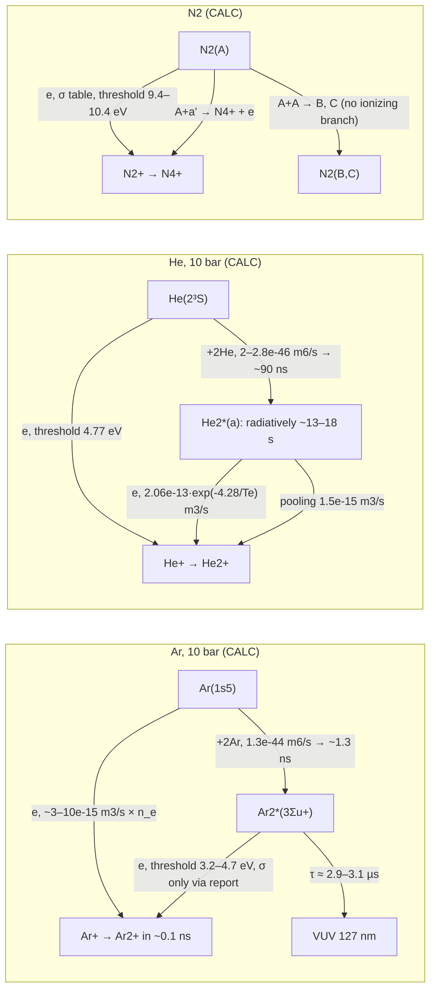
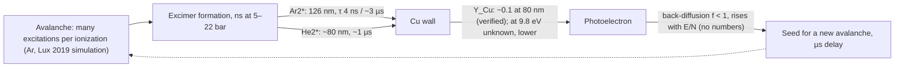

# Excited-state rates for a 5–15 bar avalanche model in He, Ar and N₂

**Companion file:** [`excited_state_rates.json`](excited_state_rates.json) has the per-reaction data, units, verification level and notes.

**Search date:** 2026-11-22.

**Review type:** a targeted starting compilation, **not** a systematic review.

**Target conditions**
- Pure He, Ar or N₂ at 5–15 bar and T_g = 300 K. Number density is N ≈ 2.41 × 10²⁵ m⁻³ per bar.
- Two-term-Boltzmann mean electron energy of 4–8 eV, which corresponds to "T_e" = 2/3 ε̄ ≈ 2.7–5.3 eV.
- E/N of 15–100 Td.
- The model already uses ground-state LXCat (IST-Lisbon) cross sections.

**Sources used**
- IOPscience: open-access HTML of Stankov et al. 2022, licensed CC BY.
- arXiv and ar5iv: Jovanović 2023, Kemaneci 2017, Santorelli 2021 and Amsler 2008.
- PubMed Central: Schröter 2018, Saifutdinov 2023 and Peters 2019.
- The LoKI-GM GitHub input files from IST-Lisbon.
- The LXCat contributor listing.
- OpenAlex abstracts.
- Crossref metadata, including deposited reference lists.

**Access limits**
- **LXCat data tables could not be downloaded.** This affects the TRINITI Ar\* and He\* sets and the BSR Ar(1s) sets. The site uses session/POST pages behind Cloudflare.
- **The NIFS He report is not readable.** NIFS-DATA-059 (Ralchenko) is a scanned PDF.
- **Most primary papers were not opened**, and the requested books were not accessed. Examples:
  - Kolts & Setser 1978, whose abstract has no numbers
  - Keto 1974
  - Vriens & Smeets 1980
  - Hyman 1979
  - Piper 1988
  - Holstein 1951 and Walsh 1959
  - the books by MacDonald (1966) and Raizer (1991)
- **Many values are secondary.** Where a value came from an open compilation, it is marked **FT-2**.

**Verification labels**

| Label | Meaning |
|---|---|
| FT | Read in the full text of the cited source |
| FT-2 | Read in the full text of an open secondary compilation; the primary source was not opened |
| ABS | Read in the abstract only |
| DB | Read in a database or repository file |
| CALC | My own arithmetic; not a published number |

## What dominates at 5–15 bar

These are my estimates (CALC) from the verified coefficients below. They are inference, not measurements.

*This is a conceptual map with calculated timescales. It is not to scale. The timescales come from the coefficients in the JSON at 300 K and assume that three-body rates still scale as N² at 10 bar, which has not been validated.*

- **Argon:** the metastable Ar(1s5) atom is converted to an excimer in about **5 ns at 5 bar and 0.6 ns at 15 bar**.
  - For stepwise ionization from Ar(4s) to compete, n_e would need to be at least about 10²³ m⁻³ at 10 bar. I estimated this using the Kemaneci Maxwellian fit, k ≈ 3–10 × 10⁻¹⁵ m³/s.
  - Below that density, the cumulative channel is **Ar₂\* ionization**. Its rate coefficient is the least well supported of all the data here.
  - Measured excimer formation times support fast conversion. Santorelli et al. (FT) report **46 ns at 1.5 bar and 2.6 ns at 16 bar**, with a singlet lifetime of about 4–5 ns and a triplet lifetime of about 3 µs.
  - The 1.5 bar value matches Millet's coefficient, which predicts 58 ns. The 16 bar value is close to the detector's 4 ns sampling time.
- **Helium:** He(2³S) is converted to the excimer in **about 340 ns at 5 bar and 38 ns at 15 bar**.
  - He₂\*(a) is effectively non-radiative, so it stores energy as a reservoir that later ionizes, either by electron impact or by pooling.
  - My inference is that cumulative ionization should therefore be relatively more effective in He than in Ar at these pressures.
- **Nitrogen:** N₂(A) is long-lived, with radiative and N₂-quenching losses below about 10⁴ s⁻¹ at 10 bar.
  - Its ionization threshold of about 9.4–10.4 eV is high compared with the 4–8 eV mean energy.
  - **A + A pooling cannot ionize**, because 2 × 6.2 eV is less than 15.58 eV.
  - Associative ionization needs N₂(a′).

## Argon (items 1–7)

| Item | Process | Value (SI) | Source and level | Comment |
|---|---|---|---|---|
| 1 | e + Ar(1s5, 1s4, 1s3, 1s2) → Ar⁺ | Thresholds 4.207 / 4.131 / 4.032 / 3.927 eV. σ from the Vriens–Smeets formula | Stankov 2022, Table 2 (FT-2) | The formula was not read, so no σ table is given |
| 1 | Same, Maxwellian fit | 6.8e-15 Te^0.67 exp(−4.20/Te) m³/s | Kemaneci 2017, Table III (FT-2; Kannari 1985) | Cross-check only |
| 1 | LXCat "Ar\*" | TRINITI has 1 process; BSR has state-resolved Ar(4s, 4p, …) targets | LXCat listing (DB, data not read) | www.lxcat.net/TRINITI, www.lxcat.net/BSR |
| 2 | e + Ar(4sm) → Ar(4p) | 8.9e-13 Te^0.51 exp(−1.59/Te) m³/s | Kemaneci (FT-2) | For a solver, use the BSR 1s→2p cross sections (as Stankov does) |
| 2 | e + Ar(4s) → Ar (superelastic) | 4.3e-16 Te^0.74 m³/s | Kemaneci (FT-2; Ashida 1995) | Better to use detailed balance (Stankov, Jovanović) |
| 2 | e + 4sm ↔ 4sr | 3.7e-13 / 9.1e-13 m³/s | Kemaneci (FT-2; Ferreira 1985) | |
| 3 | 1s5 + 1s5 → Ar⁺ + Ar + e | 1.2e-15 m³/s | Stankov Table 3 (FT-2; Blagoev 1979) | Mixed pairs 2.1–4.2e-15. Kemaneci gives 6.4e-16. **No Ar₂⁺ channel was found in any source** |
| 4 | 1s5 + 2Ar → Ar₂\*(³Σu⁺) | **1.3e-44 m⁶/s** | Stankov (FT-2); Millet 1982 abstract gives 13.8 Torr⁻² s⁻¹, which is 1.33e-44 m⁶/s (CALC) | Lumped alternative: 8.33e-45 (Jovanović) |
| 4 | 1s4 + 2Ar → Ar₂\*(¹Σu⁺) | 1.5e-45 m⁶/s | Stankov; Millet abstract gives 1.6 Torr⁻² s⁻¹ | |
| 4 | 1s5 + Ar → 2Ar | 1.5e-20 m³/s | Stankov (FT-2; Millet) | Kemaneci gives 2.1e-21, a factor-7 spread |
| 5 | Ar₂\* radiative | Singlet 2.38e8 s⁻¹ (4.2 ns); triplet v=0 3.5e5 s⁻¹ (2.86 µs); triplet v≫0 2.0e5 s⁻¹ | Stankov (FT-2; Keto 1974, Millet, Moerman); Amsler 2008 (ABS): 3.14 ± 0.07 µs at 1.1 bar | |
| 5 | e + Ar₂\* → Ar₂⁺ | Thresholds 3.23 / 3.15 eV (v≫0), 4.74 / 4.66 eV (v=0) | Stankov and Jovanović (FT-2; Flannery & McCann 1980 report) | **No rate or σ values were read** |
| 5 | Ar₂\* + Ar₂\* pooling; e-induced singlet↔triplet mixing | — | **Not found** | Treat as a sensitivity parameter |
| 6 | Trapped 1s4 / 1s2 radiation | 6.43e3/√d and 2.74e4/√d s⁻¹, with d in m | Stankov (FT-2; Golubovskii 2007, Biberman) | At d = 1 mm this is 2.0e5 and 8.7e5 s⁻¹ (CALC). It is negligible next to the three-body rate at 5–15 bar |
| 6 | Holstein cylinder | 0.196 k₀ √(λ₀/R), with k₀ = 1.056e8 s⁻¹ and λ₀ = 106 nm | Jovanović (FT-2) | At R = 1 mm this gives 2.1e5 s⁻¹ (CALC), consistent with Stankov's value |
| 7 | Ar⁺ + 2Ar → Ar₂⁺ + Ar | 2.25e-43 (Tg/300)^−0.4 m⁶/s | Jones 1980, valid 100–300 K (FT-2 in three compilations) | |
| 7 | e + Ar₂⁺ (DR), total | 8.1e-13 (Tg/300)^−0.86 (Te/300 K)^−0.64 m³/s | Stankov (FT-2; Lukáč 2011 × Royal & Orel branching). The total is my back-calculation | Jovanović: 6.86e-13 (Te/300)^−2/3 f(Tg). These differ by about 1.7× at Te = 3 eV |

## Helium (item 8)

| Process | Value (SI) | Source and level |
|---|---|---|
| e + He(2³S) / He(2¹S) → He⁺ | Thresholds 4.77 eV (Schröter) and 3.97 eV (CALC from level energies). σ is computed by a Boltzmann solver; the source reference was not resolved | Schröter Table 5 (FT-2). **Ralchenko 2008 ADNDT 94, 603** is the recommended σ source; only its metadata was checked |
| He\* + He\* pooling | **1.5e-15 m³/s** (Deloche β₁₁ = (1.5 ± 0.3)e-9 cm³/s). Schröter splits this into 4.5e-16 (He⁺) and 1.05e-15 (He₂⁺) | Deloche 1976 (ABS); Schröter (FT-2). Saifutdinov gives 2.9e-15, twice as high |
| He₂\* + He₂\* / He\* + He₂\* | (1.5 ± 0.5)e-9 / (2.5 ± 1.5)e-9 cm³/s | Deloche (ABS). My reading of the subscripts is inferred |
| e + He\* superelastic / e + He₂\* → 2He + e | (4.2 ± 0.6)e-9 / (3.8 ± 0.8)e-9 cm³/s | Deloche (ABS); Schröter gives 3.8e-15 m³/s |
| He(2³S) + 2He → He₂\* | 2.0–2.8e-46 m⁶/s | Saifutdinov R13 (FT-2); Schröter R380 (from an earlier workspace check) |
| e + He₂\* → He₂⁺ + 2e | 2.06e-13 exp(−4.28/Te) m³/s, threshold 3.90 eV | Schröter (FT-2) |
| He₂\* lifetime | a³Σu⁺ about 13–18 s; A¹Σu⁺ **not found** | Earlier workspace review (ABS), not re-read today |
| He⁺ + 2He → He₂⁺ | 1.4e-43 (Tg/300)^−0.6 m⁶/s | Saifutdinov (FT-2) |
| He₂⁺ recombination | (α_c2 + k₀₂n₀)(Te/293)^−x₂ + k_e2 n_e (Te/293)^−y₂, with k₀₂ = 5e-27 cm⁶/s, k_e2 = 4e-20 cm⁶/s, α_c2 < 5e-10 cm³/s | Deloche (ABS), fitted at 5–100 Torr. Extrapolating to 5–15 bar is not validated |

## Nitrogen (item 9)

| Process | Value | Source and level |
|---|---|---|
| e + N₂(A) → N₂⁺ + 2e | σ table from 10.4 eV to 1 keV, peaking at about 2.2e-20 m² near 70 eV. The file itself says "Check threshold"; the adiabatic threshold is about 9.4 eV (CALC) | LoKI-GM `N2_LXCat_extra.txt` (DB). It is in LXCat format and ready for a solver. **No primary reference is given** |
| N₂(A) + N₂(A) → N₂(B) / N₂(C) | 7.7e-17 / 1.5e-16 m³/s. Peters' tuned values are 2.9e-9 / 2.6e-10 cm³/s; the literature spans roughly 14× | LoKI-GM (Guerra 2019 scheme, DB); Peters Tables I and IV (FT-2) |
| Ionizing A + A pooling | None, since 12.4 eV is less than 15.58 eV (CALC) | — |
| N₂(A) + N₂(a′) → N₄⁺ + e, and → N₂⁺ + N₂ + e | 5e-18 m³/s each; a′ + a′ is 2.5e-17 m³/s each | LoKI-GM (DB). The original Brunet value was not opened |
| N₂(A) + N₂ → 2N₂ | Literature range 3e-19 to 3e-16 cm³/s; the original bound is below 3e-18; Peters tuned 2e-17 | Peters Table IV (FT-2) |
| N₂(A) radiative | 0.5 s⁻¹ | Peters R2 (FT-2) |
| Main N₂(A) loss at 5–15 bar | Electron impact (superelastic, ionization, A→B/C); pooling at large [A]; impurities. This is inference | — |

## Breakdown comparisons (He vs Ar, at or above 1 atm)

These are summarized in the JSON under `breakdown_comparisons`.

- **Park et al. 2001** (ABS): at 13.56 MHz and 1 atm, breakdown roughly follows a Paschen curve but depends on frequency. Adding Ar, O₂ or N₂ to He *raises* the breakdown voltage.
- **Moravej et al. 2004** (ABS): He and Ar RF discharges at 50–760 Torr. These are sustained, not breakdown, conditions, and T_e and n_e are model-derived.
- **Jovanović et al. 2023** (FT, a model): in an atmospheric-pressure Ar DBD, stepwise ionization of metastables and ionization of excimers dominate electron production.

**Not verified:**
- the MacDonald (1966) and Raizer (1991) books;
- MacDonald & Brown 1949 and Dutton & Powell 1971, which were checked only in earlier workspace reviews.

I found **no accessible measurement above 1 atm of microwave or pulsed breakdown fields that compares He and Ar and isolates stepwise ionization.** Lisovskiy, Kudryavtsev and the plasma-jet ignition literature were not searched in depth.

## Disagreements and cautions

- **Ar₂⁺ dissociative recombination:** the three compilations differ by about 1.7–3×. Kemaneci's form is per channel.
- **Ar metastable two-body quenching:** values differ by 7×. This matters little at high pressure, where three-body formation dominates.
- **He\* pooling:** Saifutdinov's value is twice the Deloche and Schröter values.
- **N₂(A) pooling:** the literature spreads over roughly 14× for both channels, and Peters' values are tuned to his experiment.
- **Three-body rates at 5–15 bar:** every three-body rate was measured at or below about 1 bar. The N² scaling is not validated at 5–15 bar.
  - Santorelli's 16 bar formation time is 5× slower than the Millet-based prediction. This may be an instrument limit or a sign of saturation.
- **Stankov's Ar⁺ + 2e row:** it prints 8.75e-27·Te^−9/2 with units that are dimensionally inconsistent. I did not transcribe it.

## Suggested validation

These are recommendations, not results.

1. **Build σ(E) tables** for Ar(1s) and Ar₂\* ionization (Vriens–Smeets and Flannery–McCann) and for He(2³S, 2¹S) (Ralchenko 2008) from the primary sources. Then check the EEDF-integrated rates against the Kemaneci and Schröter fits at Maxwellian T_e.
2. **Compare the simulated excimer formation time and VUV decay** with Santorelli's measurements (46 ns at 1.5 bar, singlet 4–5 ns, triplet about 3 µs). Use the same pressure and an α-like seed.
3. **Run sensitivity sweeps** over the unverified channels (Ar₂\* pooling, Ar₂\* electron-impact ionization rate, N₂(A) quenching) to see whether they change the avalanche growth over the relevant time window before acquiring the primaries.

## Annotated bibliography

- **Stankov, Becker, Hoder, Loffhagen (2022)**, PSST 31, 125002, [10.1088/1361-6595/ac9332](https://doi.org/10.1088/1361-6595/ac9332).
  - A 23-species, 409-process argon model for about 300 K, sub-atmospheric to atmospheric pressure, tested against DBD and µAPPJ data. Licensed CC BY. FT.
  - It is the main argon source here. Its data are on INPTDAT ([10.34711/inptdat.585](https://doi.org/10.34711/inptdat.585)), which was not opened.
- **Jovanović et al. (2023)**, PSST 32, 055011, [10.1088/1361-6595/acd2fc](https://doi.org/10.1088/1361-6595/acd2fc), arXiv:2212.08033. A lumped argon model of an atmospheric DBD; it gives the Holstein trapping form. FT.
- **Kemaneci et al. (2017)**, J. Phys. D 50, 245203, [10.1088/1361-6463/aa7093](https://doi.org/10.1088/1361-6463/aa7093). Low-pressure argon fits with Maxwellian assumptions. FT-2.
- **Millet et al. (1982)**, J. Phys. B 15, 2935, [10.1088/0022-3700/15/17/024](https://doi.org/10.1088/0022-3700/15/17/024). Three-body excimer formation constants and the 2.86 µs triplet lifetime. ABS.
- **Santorelli et al. (2021)**, EPJC, [10.1140/epjc/s10052-021-09375-3](https://doi.org/10.1140/epjc/s10052-021-09375-3). Measured Ar excimer formation and decay times at 1.5–16 bar. FT.
- **Amsler et al. (2008)**, JINST 3, P02001, [10.1088/1748-0221/3/02/P02001](https://doi.org/10.1088/1748-0221/3/02/P02001). Triplet lifetime 3.14 µs in gaseous Ar at 1.1 bar. ABS.
- **Jones et al. (1980)**, J. Phys. B 13, 3247, [10.1088/0022-3700/13/16/021](https://doi.org/10.1088/0022-3700/13/16/021). Three-body ion conversion at 100–300 K. Metadata only.
- **Deloche et al. (1976)**, PRA 13, 1140, [10.1103/PhysRevA.13.1140](https://doi.org/10.1103/PhysRevA.13.1140). He afterglow at 5–100 Torr: pooling, superelastic and recombination coefficients. ABS.
- **Schröter et al. (2018)**, PCCP 20, 24263, [10.1039/c8cp02473a](https://doi.org/10.1039/c8cp02473a). He/H₂O chemistry including He\*/He₂\* rows. FT.
- **Saifutdinov & Timerkaev (2023)**, Nanomaterials 13, 1966, [10.3390/nano13131966](https://doi.org/10.3390/nano13131966). An atmospheric-pressure He reaction set. FT.
- **Ralchenko et al. (2008)**, ADNDT 94, 603, [10.1016/j.adt.2007.11.003](https://doi.org/10.1016/j.adt.2007.11.003). Recommended He excited-state cross sections. Metadata only.
- **Guerra et al. (2019)**, PSST 28, 073001, [10.1088/1361-6595/ab252c](https://doi.org/10.1088/1361-6595/ab252c), implemented in the LoKI-GM `nitrogen_mod.chem` and `N2_LXCat_extra.txt` files. N₂ excited-state scheme and the N₂(A) ionization σ. DB.
- **Peters, Shneider & Miles (2019)**, JAP 125, 243301, [10.1063/1.5098306](https://doi.org/10.1063/1.5098306). N₂(A) pooling and quenching with literature ranges (Table IV). FT.
- **Park et al. (2001)**, JAP, [10.1063/1.1323754](https://doi.org/10.1063/1.1323754). ABS.
- **Moravej et al. (2004)**, JAP 96, 7011, [10.1063/1.1815047](https://doi.org/10.1063/1.1815047). ABS.
- **Pointers whose metadata only was checked:**
  - Hyman 1979, PRA 20, 855, [10.1103/PhysRevA.20.855](https://doi.org/10.1103/PhysRevA.20.855)
  - Vlček 1989, J. Phys. D 22, 623, [10.1088/0022-3727/22/5/009](https://doi.org/10.1088/0022-3727/22/5/009). The requested "Vlček 1992, J. Phys. D 25, 1888" was not found.
  - Kolts & Setser 1978, [10.1063/1.435638](https://doi.org/10.1063/1.435638). The abstract has no numbers.

---

## Wall-photoemission feedback: Cu walls, 4.5–21.7 bar

*Added on 2026-11-23. This is a targeted search, not a systematic review. The data are in the JSON under the key `photoemission_feedback`, using the same labels as above. INF marks my inference.*

**Question.** Can excimer VUV light reaching the Cu cavity walls release photoelectrons that seed new avalanches? This applies to the Ar₂\* continuum near 126–128 nm (about 9.8 eV), the He₂\* continuum at roughly 60–100 nm, and the He 58.4 nm line.

### What was verified

| # | Quantity | Value | Source and level |
|---|---|---|---|
| 1 | Cu quantum efficiency at about 80 nm (He₂\* continuum, ~15.5 eV) | **About 0.1 electrons per photon** | Aulchenko et al. 2003, quoting Cairns & Samson 1966 (FT-2). The Cairns & Samson abstract gives about ±30% accuracy for untreated metals at 40–110 nm (ABS) |
| 1 | Cu yield at 9.7–9.8 eV (Ar₂\*) | **Not found.** The only verified statement is that it is "considerably reduced" at 150 nm compared with 80 nm | Aulchenko 2003 (FT) |
| 1 | Feuerbacher & Fitton 1972 | **Contains no Cu.** It covers Au, Al, stainless steel, carbons, silica and In₂O₃ up to 25 eV | Abstract (ABS) |
| 2 | Photoelectron backscattering in noble gases | Particularly strong in noble gases. The escaping fraction f rises with E/N and falls as photon energy increases from 6.7 to 9.8 eV (Xe, Ar, Ne, E/N below 40 Td). **No numbers were read for Ar or He at 15–100 Td or for Cu cathodes** | Escada 2009 (FT); Dias 2003 and Escada 2007 (ABS); Phelps & Petrović 1999 (ABS) |
| 3 | He photon feedback from a Cu cathode at 5 atm | A secondary pulse appears at gains above 10⁴. At a gain of 10⁴ it was **100% of the primary signal with two GEMs and 20% with three**. It was absent in Kr. Gain rose faster than exponential above 10⁵. The delay was about 1 µs | Aulchenko 2003 (FT) |
| 3 | Maximum gain vs pressure | He reached about 10⁵ at 15 atm and Ne about 10⁵ at 7 atm. In Ar, Kr and Xe the maximum gain drops sharply above 3 atm, which the authors attribute to ion feedback rather than photons | Bondar 2002 (FT); Bondar 2001 (ABS); Buzulutskov 2002 (FT) |
| 3 | Feedback-loop model for Ar | G_tot = G_av + ε·G_ph/(1 − p·G_ph), stable only while p·G < 1. More than 100 excitations occur per ionization in the simulation | Lux 2019 (FT) |
| 3/4 | Ar₂\* VUV photoemission at 1 atm | Significant for Ar metastable kinetics, the dominant ionization pathways and the α–γ transition. The gas is optically thin to these photons | Robert et al. 2022 (ABS) |
| 3 | γ_ph for Ar | Phelps & Petrović state that the yield varies strongly with photon energy and surface condition. **No value was read** | Abstract only |
| 4 | Delayed feedback sources | He VUV: about 1 µs. Ar₂\* triplet: 2.9–3.1 µs. Ar₂\* singlet: 4–5 ns | Aulchenko (FT); see the `Ar2-radiative` entry |
| 4 | Comparison of Ar vs He jitter from photoemission | **Not found.** Marković 2005, at low pressure, attributes Ar delay memory to Ar₂⁺ decay and N-atom surface effects | Marković (ABS) |
| 5 | Ar₂\* light through Ar | The gas is transparent in practice. Light was detected through 1.5–16 bar of Ar. The nearest ground-state Ar absorption lines are at 106.7 and 104.8 nm (CALC), about 2 eV away | Santorelli (FT); Robert (ABS) |
| 5 | He₂\* light through He | 80 nm light reached the Cu cathode at 5 atm. He absorbs from the ground state only near 58.4 nm and below its 50.4 nm photoionization edge (CALC). The 58.4 nm line is trapped (INF) | Aulchenko (FT) |

*This is a conceptual loop built from the entries above. It is not to scale. The dashed arrow is the feedback path, and it closes only if γ_ph,eff·(e^{αd} − 1) ≥ 1.*

### How to bound the feedback in the model (INF)

Use γ_ph,eff = (n_exc/n_ion) · η_VUV · Ω_wall · T_gas · Y_Cu · f_bd.

| Factor | Meaning | How well it is known |
|---|---|---|
| n_exc/n_ion | Excitations per ionization | Compute it from your LXCat/BOLSIG runs at 15–100 Td |
| η_VUV | Fraction of excitations that end as VUV photons | Close to 1 in pure gas at these pressures; impurities reduce it |
| Ω_wall | Geometric fraction of photons reaching the wall | Up to about 0.5 for a planar wall |
| T_gas | Transmission through the gas | About 1 |
| Y_Cu | Cu photoelectric yield | About 0.1 for He (verified). Unknown for Ar, but below the He value |
| f_bd | Fraction of photoelectrons not back-diffusing to the wall | Below 1; no number found |

- **Run a sweep rather than fixing one value.** Vary Y_Cu·f_bd from about 10⁻⁴ to 10⁻¹. The data predict the loop is stronger and more easily reached in He than in Ar.
- **Feedback avalanches arrive late.** They should lag the primary by about 1–3 µs, because that is the VUV emission timescale.

### Sources to obtain next

- **Cairns & Samson 1966**, for Cu yields at 1216 Å, 584 Å and 800 Å.
- **Phelps & Petrović 1999**, for γ_ph and the back-diffusion corrections in Ar.
- **Coelho et al. 2007**, NIM A 581, 190 ([10.1016/j.nima.2007.07.075](https://doi.org/10.1016/j.nima.2007.07.075)), and **Dias 2003**, for measured and simulated f in pure Ar.
- **The full text of Robert et al. 2022**, for the photoemission yield it assumes.
